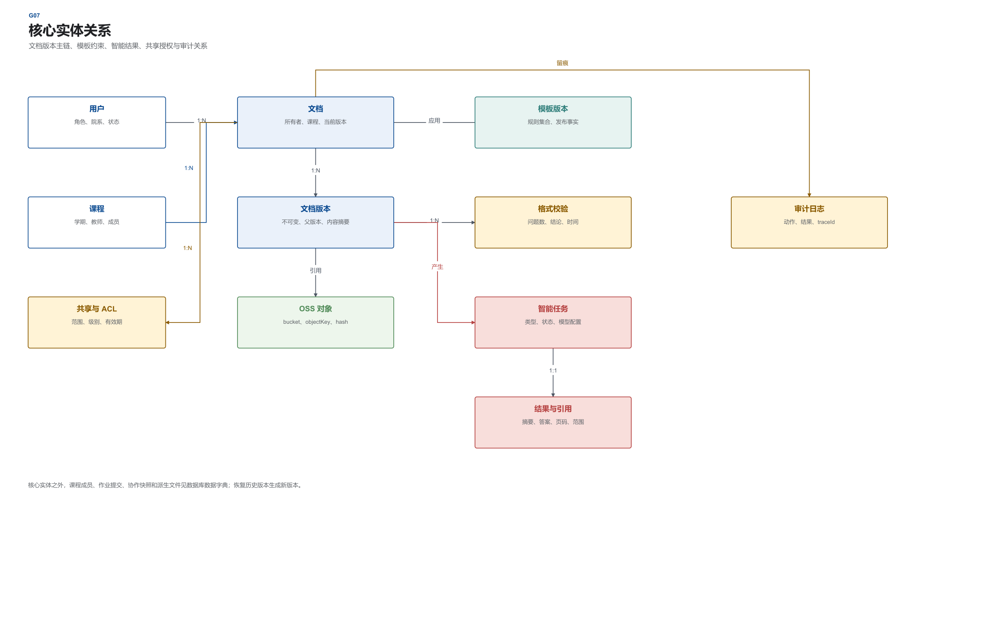

# 数据库设计说明书

> 文件编号：CIDAS-DBD-001 ｜ 版本：1.1.0 ｜ 发布日期：2026-10-18
>
> 来源文件：05_系统设计/02_数据库设计说明书.docx

面向师生的校园智能文档辅助系统
# 数据库设计说明书
文件编号：CIDAS-DBD-001
版本：1.1.0
日期：2026-10-18
项目组
# 文件修改控制

| 编号 | 版本 | 修改内容 | 日期 |
| --- | --- | --- | --- |
| 1 | 1.0.0 | 创建数据库概念、逻辑和物理设计。 | 2026-10-18 |
| 2 | 1.0.0 | 统一 38 张业务表的主键、创建时间和更新时间规范。 | 2026-10-18 |
| 3 | 1.0.0 | 补充 Oracle DDL、索引、触发器和基础角色权限 SQL。 | 2026-10-18 |
| 3 | 1.1.0 | 同步角色模型：预置角色合并为三类 | 2026-10-30 |

# 1 引言
## 1.1 编写目的
本说明书定义 CIDAS 的概念数据模型、逻辑表结构、物理存储、索引、约束、保留策略和安全要求。开发人员应依据本文与 `数据库脚本` 目录中的可执行 SQL 创建 Oracle 数据库对象；详细设计中的仓储方法、事务边界和对象映射以本文表结构为准。
数据库设计覆盖六个业务域以及运维事件。所有业务表均包含 `id`、`create_time`、`update_time`。主键由数据库通过 `SYS_GUID()` 生成，两个时间字段由 `SYSTIMESTAMP` 默认值创建，并由逐表触发器维护 `update_time`。
## 1.2 数据库选型
业务数据库选用 Oracle Database 26ai。选择依据包括事务完整性、成熟的分区与审计能力、RAID1 单机部署基础，以及对 AI Vector Search 的原生支持。Redis 7 只保存会话、热点缓存、限流状态和任务队列，不承担业务事实存储。阿里云 OSS 保存原始文件和派生文件，数据库仅保存对象登记与引用关系。
## 1.3 设计依据与约束
数据库设计遵循第三范式，版本、对象、任务与授权关系通过外键和唯一约束维护。单机部署意味着数据库不采用读写分离或自动故障转移；备份、归档日志和恢复演练是主要可用性保障。原始文件不在数据库中长期保存，避免大对象拖慢备份和恢复。
# 2 概念结构设计
## 2.1 业务实体分析
系统围绕用户、课程、文档和模板建立主业务链。用户通过角色与课程成员获得基础权限；文档拥有多个不可变版本；每个版本对应一个原始 OSS 对象，并可产生解析、预览、转换和导出等派生文件。文档版本被切分为可检索的文本块，文本块保存向量；智能任务基于版本或分块产生摘要、要点、答案和润色结果，每个结果通过引用表关联原文。
协作会话从基线版本开始，实时增量由 Yjs 网关维护，定期快照生成新文档版本。作业提交引用学生文档的指定版本和格式校验结果。审计日志按事件追加写入，不承担业务恢复职责。
## 2.2 全景 E-R 图
核心业务实体及其基数关系如图 2-1 所示。

图 2-1  核心实体关系图
## 2.3 核心实体关系
表 2-1  核心实体关系及基数

| 实体关系 | 基数 | 删除与保留规则 |
| --- | --- | --- |
| 用户 - 课程成员 | 1:N | 用户注销时保留历史成员关系；当前状态置为移除。 |
| 课程 - 文档 | 1:N | 课程关闭不删除历史文档；文档仍按权限访问。 |
| 文档 - 文档版本 | 1:N | 历史版本不可覆盖；回收站到期后按策略清理版本和派生对象。 |
| 文档版本 - OSS 对象 | N:1 | 主文件对象登记在版本；派生对象通过派生文件表关联。 |
| 模板 - 模板版本 | 1:N | 已发布版本不可修改；新规则生成新版本。 |
| 模板版本 - 格式规则 | 1:N | 停用模板不删除历史规则，保证历史校验可解释。 |
| 文档版本 - 文本分块 | 1:N | 版本删除时按保留策略清理分块和向量。 |
| 分块 - 向量 | 1:N | 不同模型配置可产生不同向量，文本块本身唯一。 |
| 智能任务 - 智能结果 | 1:N | 失败任务可无结果；成功结果保留模型和提示词版本。 |
| 智能结果 - 引用 | 1:N | 引用必须指向同一文档版本的可用分块。 |
| 文档 - 共享授权 | 1:N | 撤销共享保留审计记录，不物理删除历史授权事实。 |
| 作业 - 提交 | 1:N | 学生可多次提交；每次提交形成独立 attempt。 |
| 文档 - 审计日志 | 1:N | 审计独立保留不少于 3 年，不随文档物理删除。 |

# 3 逻辑结构设计
## 3.1 通用字段与命名规范
表 3-1  所有业务表必须包含的公共字段

| 字段名 | 数据类型 | 约束 | 默认值 | 说明 |
| --- | --- | --- | --- | --- |
| id | RAW(16) | PRIMARY KEY, NOT NULL | SYS_GUID() | 数据库生成的主键。 |
| create_time | TIMESTAMP(6) WITH TIME ZONE | NOT NULL | SYSTIMESTAMP | 记录创建时间，UTC 存储、前端按上海时区展示。 |
| update_time | TIMESTAMP(6) WITH TIME ZONE | NOT NULL | SYSTIMESTAMP | 逐表 BEFORE UPDATE 触发器维护。 |

表名统一使用 `edudoc_` 前缀；普通字段使用小写下划线命名。主键约束名为 `pk_<业务名>`，唯一约束为 `uk_<业务名>_<序号>`，外键约束为 `fk_<业务名>_<序号>`。布尔值使用 `Y/N`，状态使用短字符串并在 `CHECK` 约束中枚举，避免不可解释的魔法数字。
## 3.2 代码表与状态值
表 3-2  主要状态码

| 字段 | 取值 | 含义 |
| --- | --- | --- |
| document.status | UPLOADING / PARSING / READY / FAILED / SUBMITTED / ARCHIVED / DELETED | 文档从上传到归档的生命周期。 |
| ai_task.status | QUEUED / RUNNING / SUCCEEDED / FAILED / CANCELED | 智能任务状态机。 |
| format_check.status | QUEUED / RUNNING / PASSED / FAILED / ERROR | 格式校验状态。 |
| conversion_task.status | QUEUED / RUNNING / SUCCEEDED / FAILED / CANCELED | 转换任务状态。 |
| share_grant.permission_level | VIEW / COMMENT / EDIT / DOWNLOAD | 文档 ACL 权限级别。 |
| collab_member.permission_level | VIEW / COMMENT / EDIT | 协作会话权限。 |
| account_status | A / I / L / D | 正常、未激活、锁定、注销。 |

## 3.3 数据表总览
表 3-3  业务数据表清单

| 序号 | 表名 | 名称 | 业务域 | 主要职责 |
| --- | --- | --- | --- | --- |
| 1 | edudoc_user | 用户主表 | 身份与课程 | 保存校内用户、统一身份认证映射和本地兼容账号。 |
| 2 | edudoc_role | 角色表 | 身份与课程 | 保存学生、教师、运维人员及自定义角色。 |
| 3 | edudoc_permission | 权限点表 | 身份与课程 | 定义资源、动作与权限编码，用于 RBAC 授权。 |
| 4 | edudoc_user_role | 用户角色关联表 | 身份与课程 | 记录用户与角色的生效关系及有效期。 |
| 5 | edudoc_role_permission | 角色权限关联表 | 身份与课程 | 记录角色拥有的权限点。 |
| 6 | edudoc_course | 课程表 | 身份与课程 | 保存课程、学期和课程负责人信息。 |
| 7 | edudoc_course_member | 课程成员表 | 身份与课程 | 维护课程中的学生、教师与助教成员关系。 |
| 8 | edudoc_oss_object | OSS 对象登记表 | 文档接入 | 登记 OSS 中的原始文件、解析产物、导出件与协作快照。 |
| 9 | edudoc_template | 课程模板表 | 格式与模板 | 保存课程模板的逻辑主记录。 |
| 10 | edudoc_template_version | 模板版本表 | 格式与模板 | 保存模板的版本化规则集合与发布信息。 |
| 11 | edudoc_format_rule | 格式规则表 | 格式与模板 | 保存模板版本中的可执行格式检查规则。 |
| 12 | edudoc_document | 文档主表 | 文档接入 | 保存文档身份、归属、当前版本、状态与软删除信息。 |
| 13 | edudoc_document_version | 文档版本表 | 协作与版本 | 记录每次上传、编辑、协作、恢复或提交形成的不可变版本。 |
| 14 | edudoc_derived_file | 派生文件表 | 文档接入 | 将解析、预览、转换和导出产物与文档版本关联。 |
| 15 | edudoc_document_element | 文档结构元素表 | 格式与模板 | 保存标题、图表、代码块、公式等结构元素及编号索引。 |
| 16 | edudoc_document_chunk | 文档分块表 | 智能处理 | 保存解析后的文本分块、章节路径与原文定位信息。 |
| 17 | edudoc_ai_model_profile | 模型配置表 | 智能处理 | 保存模型类型、服务引用和向量维度，不保存明文密钥。 |
| 18 | edudoc_chunk_embedding | 分块向量表 | 智能处理 | 保存分块在指定模型配置下的向量。 |
| 19 | edudoc_document_share | 共享设置表 | 权限与审计 | 定义文档共享范围、有效期链接和下载策略。 |
| 20 | edudoc_share_grant | 文档 ACL 表 | 权限与审计 | 记录用户或课程等主体的细粒度文档权限。 |
| 21 | edudoc_format_check | 格式校验任务表 | 格式与模板 | 记录文档与模板版本之间的格式校验任务与汇总结果。 |
| 22 | edudoc_format_issue | 格式问题表 | 格式与模板 | 保存格式校验发现的逐项问题和修复状态。 |
| 23 | edudoc_conversion_task | 格式转换任务表 | 格式与模板 | 记录 Word/PDF 转换任务、输入输出对象与失败原因。 |
| 24 | edudoc_ai_task | 智能处理任务表 | 智能处理 | 保存摘要、要点、问答、润色与向量化任务的状态和幂等信息。 |
| 25 | edudoc_ai_result | 智能处理结果表 | 智能处理 | 保存摘要、要点和润色等结构化结果及模型元数据。 |
| 26 | edudoc_ai_citation | 智能结果引用表 | 智能处理 | 将智能结果关联到原文分块与页码，支持回跳核验。 |
| 27 | edudoc_qa_session | 问答会话表 | 智能处理 | 保存围绕单份文档建立的问答会话。 |
| 28 | edudoc_qa_message | 问答消息表 | 智能处理 | 保存用户问题、助手回答、任务关联和连续追问顺序。 |
| 29 | edudoc_polish_result | 润色结果表 | 智能处理 | 保存原文、润色文本、采纳结果与撤销依据。 |
| 30 | edudoc_collab_session | 协作会话表 | 协作与版本 | 保存实时协作会话、基线版本与同步状态。 |
| 31 | edudoc_collab_member | 协作成员表 | 协作与版本 | 保存协作会话的参与成员、权限和在线状态。 |
| 32 | edudoc_collab_snapshot | 协作快照表 | 协作与版本 | 保存 Yjs 快照对应的文档版本和 OSS 对象。 |
| 33 | edudoc_assignment | 作业表 | 导出与统计 | 保存教师发布的课程作业、模板和截止时间。 |
| 34 | edudoc_submission | 作业提交表 | 导出与统计 | 记录学生某次提交的文档版本、格式校验与评分信息。 |
| 35 | edudoc_export_task | 导出任务表 | 导出与统计 | 记录全文、摘要、要点、问答和指定版本的导出任务。 |
| 36 | edudoc_reference_item | 参考文献条目表 | 格式与模板 | 保存解析后的参考文献条目、标准格式与生成结果。 |
| 37 | edudoc_audit_log | 审计日志表 | 权限与审计 | 追加写入文档访问、编辑、下载、共享和权限变更事件。 |
| 38 | edudoc_outbox_event | 可靠事件表 | 运维与集成 | 通过事务性 Outbox 将解析、转换、通知和同步事件投递到异步任务。 |

## 3.4 数据字典
以下逐表列出全部字段。每张表都重复列出 `id`、`create_time` 和 `update_time`，确保阅读单个表定义时不依赖上下文。所有说明与 `01_schema.sql` 中的 `COMMENT ON COLUMN` 保持一致。
身份与课程数据表
### 3.4.1 用户主表（`edudoc_user`）
保存校内用户、统一身份认证映射和本地兼容账号。
表 3-3  用户主表字段定义

| 字段名 | 数据类型 | 是否为空 | 默认值 | 键 | 说明 |
| --- | --- | --- | --- | --- | --- |
| id | RAW(16) | 否 | SYS_GUID() | PK | 主键，数据库自动生成 GUID |
| create_time | TIMESTAMP(6) WITH TIME ZONE | 否 | SYSTIMESTAMP | - | 创建时间，默认数据库当前时间 |
| update_time | TIMESTAMP(6) WITH TIME ZONE | 否 | SYSTIMESTAMP | - | 最后更新时间，由触发器维护 |
| username | VARCHAR2(64) | 否 | - | UK | 校内登录名 |
| external_subject_id | VARCHAR2(128) | 是 | - | UK | 统一身份认证 subject 标识 |
| display_name | VARCHAR2(100) | 否 | - | - | 显示姓名 |
| email | VARCHAR2(200) | 是 | - | - | 校内邮箱 |
| department | VARCHAR2(200) | 是 | - | - | 所属院系或部门 |
| auth_source | VARCHAR2(20) | 否 | 'LOCAL' | - | 认证来源：LOCAL 或 SSO |
| password_hash | VARCHAR2(255) | 是 | - | - | 本地兼容账号密码哈希，SSO 用户为空 |
| account_status | CHAR(1) | 否 | 'A' | - | 账号状态：A 正常、I 未激活、L 锁定、D 注销 |
| last_login_time | TIMESTAMP(6) WITH TIME ZONE | 是 | - | - | 最近登录时间 |
| remark | VARCHAR2(500) | 是 | - | - | 管理备注 |

### 3.4.2 角色表（`edudoc_role`）
保存学生、教师、运维人员及自定义角色。
表 3-4  角色表字段定义

| 字段名 | 数据类型 | 是否为空 | 默认值 | 键 | 说明 |
| --- | --- | --- | --- | --- | --- |
| id | RAW(16) | 否 | SYS_GUID() | PK | 主键，数据库自动生成 GUID |
| create_time | TIMESTAMP(6) WITH TIME ZONE | 否 | SYSTIMESTAMP | - | 创建时间，默认数据库当前时间 |
| update_time | TIMESTAMP(6) WITH TIME ZONE | 否 | SYSTIMESTAMP | - | 最后更新时间，由触发器维护 |
| role_code | VARCHAR2(40) | 否 | - | UK | 角色编码 |
| role_name | VARCHAR2(80) | 否 | - | - | 角色名称 |
| is_builtin | CHAR(1) | 否 | 'N' | - | 是否内置角色：Y/N |
| description | VARCHAR2(500) | 是 | - | - | 角色职责说明 |
| status | CHAR(1) | 否 | 'A' | - | 状态：A 启用、D 停用 |

### 3.4.3 权限点表（`edudoc_permission`）
定义资源、动作与权限编码，用于 RBAC 授权。
表 3-5  权限点表字段定义

| 字段名 | 数据类型 | 是否为空 | 默认值 | 键 | 说明 |
| --- | --- | --- | --- | --- | --- |
| id | RAW(16) | 否 | SYS_GUID() | PK | 主键，数据库自动生成 GUID |
| create_time | TIMESTAMP(6) WITH TIME ZONE | 否 | SYSTIMESTAMP | - | 创建时间，默认数据库当前时间 |
| update_time | TIMESTAMP(6) WITH TIME ZONE | 否 | SYSTIMESTAMP | - | 最后更新时间，由触发器维护 |
| permission_code | VARCHAR2(80) | 否 | - | UK | 权限编码 |
| permission_name | VARCHAR2(100) | 否 | - | - | 权限名称 |
| resource_type | VARCHAR2(40) | 否 | - | - | 资源类型，如 DOCUMENT、TEMPLATE、AUDIT |
| action_code | VARCHAR2(40) | 否 | - | - | 动作编码，如 READ、EDIT、DELETE、EXPORT |
| description | VARCHAR2(500) | 是 | - | - | 权限说明 |

### 3.4.4 用户角色关联表（`edudoc_user_role`）
记录用户与角色的生效关系及有效期。
表 3-6  用户角色关联表字段定义

| 字段名 | 数据类型 | 是否为空 | 默认值 | 键 | 说明 |
| --- | --- | --- | --- | --- | --- |
| id | RAW(16) | 否 | SYS_GUID() | PK | 主键，数据库自动生成 GUID |
| create_time | TIMESTAMP(6) WITH TIME ZONE | 否 | SYSTIMESTAMP | - | 创建时间，默认数据库当前时间 |
| update_time | TIMESTAMP(6) WITH TIME ZONE | 否 | SYSTIMESTAMP | - | 最后更新时间，由触发器维护 |
| user_id | RAW(16) | 否 | - | UK/FK | 用户 ID |
| role_id | RAW(16) | 否 | - | UK/FK | 角色 ID |
| effective_from | TIMESTAMP(6) WITH TIME ZONE | 否 | SYSTIMESTAMP | UK | 生效时间 |
| effective_to | TIMESTAMP(6) WITH TIME ZONE | 是 | - | - | 失效时间，空表示长期有效 |
| granted_by | RAW(16) | 是 | - | FK | 授权人 ID |

### 3.4.5 角色权限关联表（`edudoc_role_permission`）
记录角色拥有的权限点。
表 3-7  角色权限关联表字段定义

| 字段名 | 数据类型 | 是否为空 | 默认值 | 键 | 说明 |
| --- | --- | --- | --- | --- | --- |
| id | RAW(16) | 否 | SYS_GUID() | PK | 主键，数据库自动生成 GUID |
| create_time | TIMESTAMP(6) WITH TIME ZONE | 否 | SYSTIMESTAMP | - | 创建时间，默认数据库当前时间 |
| update_time | TIMESTAMP(6) WITH TIME ZONE | 否 | SYSTIMESTAMP | - | 最后更新时间，由触发器维护 |
| role_id | RAW(16) | 否 | - | UK/FK | 角色 ID |
| permission_id | RAW(16) | 否 | - | UK/FK | 权限 ID |

### 3.4.6 课程表（`edudoc_course`）
保存课程、学期和课程负责人信息。
表 3-8  课程表字段定义

| 字段名 | 数据类型 | 是否为空 | 默认值 | 键 | 说明 |
| --- | --- | --- | --- | --- | --- |
| id | RAW(16) | 否 | SYS_GUID() | PK | 主键，数据库自动生成 GUID |
| create_time | TIMESTAMP(6) WITH TIME ZONE | 否 | SYSTIMESTAMP | - | 创建时间，默认数据库当前时间 |
| update_time | TIMESTAMP(6) WITH TIME ZONE | 否 | SYSTIMESTAMP | - | 最后更新时间，由触发器维护 |
| course_code | VARCHAR2(40) | 否 | - | UK | 课程编码 |
| course_name | VARCHAR2(200) | 否 | - | - | 课程名称 |
| term_code | VARCHAR2(30) | 否 | - | UK | 学期编码，如 2026-FALL |
| teacher_id | RAW(16) | 是 | - | FK | 课程负责人 ID |
| department | VARCHAR2(200) | 是 | - | - | 开课院系 |
| start_date | DATE | 是 | - | - | 课程开始日期 |
| end_date | DATE | 是 | - | - | 课程结束日期 |
| status | CHAR(1) | 否 | 'A' | - | 状态：A 启用、C 关闭 |

### 3.4.7 课程成员表（`edudoc_course_member`）
维护课程中的学生、教师与助教成员关系。
表 3-9  课程成员表字段定义

| 字段名 | 数据类型 | 是否为空 | 默认值 | 键 | 说明 |
| --- | --- | --- | --- | --- | --- |
| id | RAW(16) | 否 | SYS_GUID() | PK | 主键，数据库自动生成 GUID |
| create_time | TIMESTAMP(6) WITH TIME ZONE | 否 | SYSTIMESTAMP | - | 创建时间，默认数据库当前时间 |
| update_time | TIMESTAMP(6) WITH TIME ZONE | 否 | SYSTIMESTAMP | - | 最后更新时间，由触发器维护 |
| course_id | RAW(16) | 否 | - | UK/FK | 课程 ID |
| user_id | RAW(16) | 否 | - | UK/FK | 用户 ID |
| member_role | VARCHAR2(20) | 否 | - | - | 课程内角色：STUDENT、TEACHER、ASSISTANT |
| group_name | VARCHAR2(50) | 是 | - | - | 课程组名（06 切片1 增）：成员导入落点，课程列表「班级/课程组数」据此 `COUNT(DISTINCT)` 现算；课程组实体表仍属切片 3/4 |
| status | CHAR(1) | 否 | 'A' | - | 状态：A 有效、R 移除 |

文档接入数据表
### 3.4.8 OSS 对象登记表（`edudoc_oss_object`）
登记 OSS 中的原始文件、解析产物、导出件与协作快照。
表 3-10  OSS 对象登记表字段定义

| 字段名 | 数据类型 | 是否为空 | 默认值 | 键 | 说明 |
| --- | --- | --- | --- | --- | --- |
| id | RAW(16) | 否 | SYS_GUID() | PK | 主键，数据库自动生成 GUID |
| create_time | TIMESTAMP(6) WITH TIME ZONE | 否 | SYSTIMESTAMP | - | 创建时间，默认数据库当前时间 |
| update_time | TIMESTAMP(6) WITH TIME ZONE | 否 | SYSTIMESTAMP | - | 最后更新时间，由触发器维护 |
| bucket_name | VARCHAR2(128) | 否 | - | UK | OSS Bucket 名称 |
| region | VARCHAR2(40) | 否 | - | - | OSS 地域，固定中国大陆地域 |
| object_key | VARCHAR2(512) | 否 | - | UK | OSS 对象键 |
| object_version_id | VARCHAR2(128) | 是 | - | UK | OSS 版本标识 |
| etag | VARCHAR2(128) | 是 | - | - | OSS ETag |
| content_hash | VARCHAR2(128) | 否 | - | - | SHA-256 内容摘要 |
| size_bytes | NUMBER(19) | 否 | - | - | 对象字节数 |
| mime_type | VARCHAR2(120) | 否 | - | - | MIME 类型 |
| encryption_type | VARCHAR2(40) | 否 | - | - | 加密方式：SSE-KMS、SSE-OSS |
| object_role | VARCHAR2(40) | 否 | - | - | 对象用途：ORIGINAL、PARSED、PREVIEW、CONVERTED、EXPORT、SNAPSHOT |
| status | CHAR(1) | 否 | 'A' | - | 状态：A 可用、D 待清理、P 待保护 |
| retention_until | TIMESTAMP(6) WITH TIME ZONE | 是 | - | - | 对象保留截止时间 |

### 3.4.9 文档主表（`edudoc_document`）
保存文档身份、归属、当前版本、状态与软删除信息。
表 3-11  文档主表字段定义

| 字段名 | 数据类型 | 是否为空 | 默认值 | 键 | 说明 |
| --- | --- | --- | --- | --- | --- |
| id | RAW(16) | 否 | SYS_GUID() | PK | 主键，数据库自动生成 GUID |
| create_time | TIMESTAMP(6) WITH TIME ZONE | 否 | SYSTIMESTAMP | - | 创建时间，默认数据库当前时间 |
| update_time | TIMESTAMP(6) WITH TIME ZONE | 否 | SYSTIMESTAMP | - | 最后更新时间，由触发器维护 |
| course_id | RAW(16) | 是 | - | UK/FK | 所属课程 ID |
| owner_id | RAW(16) | 否 | - | UK/FK | 文档所有者 ID |
| title | VARCHAR2(200) | 否 | - | UK | 文档标题 |
| doc_type | VARCHAR2(20) | 否 | - | - | 文档类型：COURSEWARE、HOMEWORK、THESIS、REPORT |
| status | VARCHAR2(20) | 否 | - | - | 状态：UPLOADING、PARSING、READY、FAILED、SUBMITTED、ARCHIVED、DELETED |
| template_version_id | RAW(16) | 是 | - | FK | 绑定的课程模板版本 ID |
| current_version_id | RAW(16) | 是 | - | - | 当前文档版本 ID |
| deleted_at | TIMESTAMP(6) WITH TIME ZONE | 是 | - | - | 软删除时间 |
| purge_at | TIMESTAMP(6) WITH TIME ZONE | 是 | - | - | 回收站物理清理时间 |
| cover_object_id | RAW(16) | 是 | - | FK | 缩略图或封面对应 OSS 对象 ID |

### 3.4.10 派生文件表（`edudoc_derived_file`）
将解析、预览、转换和导出产物与文档版本关联。
表 3-12  派生文件表字段定义

| 字段名 | 数据类型 | 是否为空 | 默认值 | 键 | 说明 |
| --- | --- | --- | --- | --- | --- |
| id | RAW(16) | 否 | SYS_GUID() | PK | 主键，数据库自动生成 GUID |
| create_time | TIMESTAMP(6) WITH TIME ZONE | 否 | SYSTIMESTAMP | - | 创建时间，默认数据库当前时间 |
| update_time | TIMESTAMP(6) WITH TIME ZONE | 否 | SYSTIMESTAMP | - | 最后更新时间，由触发器维护 |
| document_version_id | RAW(16) | 否 | - | UK/FK | 文档版本 ID |
| object_id | RAW(16) | 否 | - | FK | OSS 对象 ID |
| file_role | VARCHAR2(30) | 否 | - | UK | 用途：PARSED_HTML、PREVIEW_PDF、THUMBNAIL、CONVERTED、EXPORT |
| format_code | VARCHAR2(20) | 否 | - | UK | 文件格式，如 DOCX、PDF、HTML |
| status | VARCHAR2(20) | 否 | 'READY' | - | 状态：READY、FAILED、STALE |

智能处理数据表
### 3.4.11 文档分块表（`edudoc_document_chunk`）
保存解析后的文本分块、章节路径与原文定位信息。
表 3-13  文档分块表字段定义

| 字段名 | 数据类型 | 是否为空 | 默认值 | 键 | 说明 |
| --- | --- | --- | --- | --- | --- |
| id | RAW(16) | 否 | SYS_GUID() | PK | 主键，数据库自动生成 GUID |
| create_time | TIMESTAMP(6) WITH TIME ZONE | 否 | SYSTIMESTAMP | - | 创建时间，默认数据库当前时间 |
| update_time | TIMESTAMP(6) WITH TIME ZONE | 否 | SYSTIMESTAMP | - | 最后更新时间，由触发器维护 |
| document_version_id | RAW(16) | 否 | - | UK/FK | 文档版本 ID |
| chunk_no | NUMBER(12) | 否 | - | UK | 分块序号 |
| heading_path | VARCHAR2(1000) | 是 | - | - | 章节路径 |
| page_no | NUMBER(8) | 是 | - | - | 起始页码 |
| char_start | NUMBER(12) | 是 | - | - | 原文起始字符位置 |
| char_end | NUMBER(12) | 是 | - | - | 原文结束字符位置 |
| content_text | CLOB | 否 | - | - | 分块文本 |
| token_count | NUMBER(8) | 否 | - | - | 估算 token 数 |
| content_hash | VARCHAR2(128) | 否 | - | - | 分块内容摘要 |
| index_status | VARCHAR2(20) | 否 | 'PENDING' | - | 索引状态：PENDING、READY、FAILED |

### 3.4.12 模型配置表（`edudoc_ai_model_profile`）
保存模型类型、服务引用和向量维度，不保存明文密钥。
表 3-14  模型配置表字段定义

| 字段名 | 数据类型 | 是否为空 | 默认值 | 键 | 说明 |
| --- | --- | --- | --- | --- | --- |
| id | RAW(16) | 否 | SYS_GUID() | PK | 主键，数据库自动生成 GUID |
| create_time | TIMESTAMP(6) WITH TIME ZONE | 否 | SYSTIMESTAMP | - | 创建时间，默认数据库当前时间 |
| update_time | TIMESTAMP(6) WITH TIME ZONE | 否 | SYSTIMESTAMP | - | 最后更新时间，由触发器维护 |
| profile_code | VARCHAR2(60) | 否 | - | UK | 配置编码 |
| provider_type | VARCHAR2(40) | 否 | - | - | 提供方类型：LLM、EMBEDDING、RERANK |
| model_name | VARCHAR2(120) | 否 | - | - | 模型名称 |
| endpoint_config_key | VARCHAR2(120) | 否 | - | - | 服务器配置中心中的端点和密钥键 |
| embedding_dimension | NUMBER(6) | 是 | - | - | 向量维度 |
| metric_type | VARCHAR2(20) | 是 | - | - | 向量距离：COSINE、EUCLIDEAN、DOT |
| status | CHAR(1) | 否 | 'A' | - | 状态：A 启用、D 停用 |
| profile_json | JSON | 是 | - | - | 温度、上下文长度等非敏感参数 |

### 3.4.13 分块向量表（`edudoc_chunk_embedding`）
保存分块在指定模型配置下的向量。
表 3-15  分块向量表字段定义

| 字段名 | 数据类型 | 是否为空 | 默认值 | 键 | 说明 |
| --- | --- | --- | --- | --- | --- |
| id | RAW(16) | 否 | SYS_GUID() | PK | 主键，数据库自动生成 GUID |
| create_time | TIMESTAMP(6) WITH TIME ZONE | 否 | SYSTIMESTAMP | - | 创建时间，默认数据库当前时间 |
| update_time | TIMESTAMP(6) WITH TIME ZONE | 否 | SYSTIMESTAMP | - | 最后更新时间，由触发器维护 |
| chunk_id | RAW(16) | 否 | - | UK/FK | 分块 ID |
| model_profile_id | RAW(16) | 否 | - | UK/FK | 模型配置 ID |
| embedding | VECTOR(1024, FLOAT32) | 否 | - | - | 固定维度文本向量 |
| embedding_status | VARCHAR2(20) | 否 | 'READY' | - | 状态：READY、STALE、FAILED |

### 3.4.14 智能处理任务表（`edudoc_ai_task`）
保存摘要、要点、问答、润色与向量化任务的状态和幂等信息。
表 3-16  智能处理任务表字段定义

| 字段名 | 数据类型 | 是否为空 | 默认值 | 键 | 说明 |
| --- | --- | --- | --- | --- | --- |
| id | RAW(16) | 否 | SYS_GUID() | PK | 主键，数据库自动生成 GUID |
| create_time | TIMESTAMP(6) WITH TIME ZONE | 否 | SYSTIMESTAMP | - | 创建时间，默认数据库当前时间 |
| update_time | TIMESTAMP(6) WITH TIME ZONE | 否 | SYSTIMESTAMP | - | 最后更新时间，由触发器维护 |
| document_id | RAW(16) | 否 | - | FK | 文档 ID |
| document_version_id | RAW(16) | 否 | - | FK | 文档版本 ID |
| task_type | VARCHAR2(20) | 否 | - | - | 任务类型：SUMMARY、KEYPOINT、QA、POLISH、EMBED |
| status | VARCHAR2(20) | 否 | - | - | 状态：QUEUED、RUNNING、SUCCEEDED、FAILED、CANCELED |
| priority | NUMBER(3) | 否 | 5 | - | 优先级，数值越小越优先 |
| model_profile_id | RAW(16) | 是 | - | FK | 模型配置 ID |
| request_payload | JSON | 是 | - | - | 请求参数，不保存明文敏感凭据 |
| requested_by | RAW(16) | 否 | - | FK | 发起人 ID |
| progress | NUMBER(5) | 否 | 0 | - | 进度百分比 |
| idempotency_key | VARCHAR2(128) | 是 | - | UK | 幂等键 |
| error_code | VARCHAR2(60) | 是 | - | - | 失败错误码 |
| retry_count | NUMBER(5) | 否 | 0 | - | 重试次数 |
| started_at | TIMESTAMP(6) WITH TIME ZONE | 是 | - | - | 开始时间 |
| finished_at | TIMESTAMP(6) WITH TIME ZONE | 是 | - | - | 结束时间 |

### 3.4.15 智能处理结果表（`edudoc_ai_result`）
保存摘要、要点和润色等结构化结果及模型元数据。
表 3-17  智能处理结果表字段定义

| 字段名 | 数据类型 | 是否为空 | 默认值 | 键 | 说明 |
| --- | --- | --- | --- | --- | --- |
| id | RAW(16) | 否 | SYS_GUID() | PK | 主键，数据库自动生成 GUID |
| create_time | TIMESTAMP(6) WITH TIME ZONE | 否 | SYSTIMESTAMP | - | 创建时间，默认数据库当前时间 |
| update_time | TIMESTAMP(6) WITH TIME ZONE | 否 | SYSTIMESTAMP | - | 最后更新时间，由触发器维护 |
| task_id | RAW(16) | 否 | - | FK | 智能任务 ID |
| result_type | VARCHAR2(30) | 否 | - | - | 结果类型：SUMMARY、KEYPOINT、POLISH、ANSWER |
| content_text | CLOB | 是 | - | - | 结果正文 |
| structured_json | JSON | 是 | - | - | 结构化结果，如摘要段落与要点清单 |
| confidence | NUMBER(5,4) | 是 | - | - | 模型置信度，范围 0 至 1 |
| model_name | VARCHAR2(120) | 否 | - | - | 实际模型名称 |
| prompt_version | VARCHAR2(40) | 否 | - | - | 提示词版本 |
| input_tokens | NUMBER(12) | 是 | - | - | 输入 token 数 |
| output_tokens | NUMBER(12) | 是 | - | - | 输出 token 数 |

### 3.4.16 智能结果引用表（`edudoc_ai_citation`）
将智能结果关联到原文分块与页码，支持回跳核验。
表 3-18  智能结果引用表字段定义

| 字段名 | 数据类型 | 是否为空 | 默认值 | 键 | 说明 |
| --- | --- | --- | --- | --- | --- |
| id | RAW(16) | 否 | SYS_GUID() | PK | 主键，数据库自动生成 GUID |
| create_time | TIMESTAMP(6) WITH TIME ZONE | 否 | SYSTIMESTAMP | - | 创建时间，默认数据库当前时间 |
| update_time | TIMESTAMP(6) WITH TIME ZONE | 否 | SYSTIMESTAMP | - | 最后更新时间，由触发器维护 |
| result_id | RAW(16) | 否 | - | UK/FK | 智能结果 ID |
| chunk_id | RAW(16) | 否 | - | UK/FK | 原文分块 ID |
| page_no | NUMBER(8) | 是 | - | - | 页码 |
| char_start | NUMBER(12) | 是 | - | - | 引用起始字符 |
| char_end | NUMBER(12) | 是 | - | - | 引用结束字符 |
| quote_text | VARCHAR2(2000) | 是 | - | - | 引用原文片段 |
| rank_no | NUMBER(5) | 否 | 1 | UK | 引用排序 |

### 3.4.17 问答会话表（`edudoc_qa_session`）
保存围绕单份文档建立的问答会话。
表 3-19  问答会话表字段定义

| 字段名 | 数据类型 | 是否为空 | 默认值 | 键 | 说明 |
| --- | --- | --- | --- | --- | --- |
| id | RAW(16) | 否 | SYS_GUID() | PK | 主键，数据库自动生成 GUID |
| create_time | TIMESTAMP(6) WITH TIME ZONE | 否 | SYSTIMESTAMP | - | 创建时间，默认数据库当前时间 |
| update_time | TIMESTAMP(6) WITH TIME ZONE | 否 | SYSTIMESTAMP | - | 最后更新时间，由触发器维护 |
| document_id | RAW(16) | 否 | - | FK | 文档 ID |
| user_id | RAW(16) | 否 | - | FK | 会话用户 ID |
| title | VARCHAR2(200) | 是 | - | - | 会话标题 |
| status | CHAR(1) | 否 | 'A' | - | 状态：A 活跃、C 关闭 |

### 3.4.18 问答消息表（`edudoc_qa_message`）
保存用户问题、助手回答、任务关联和连续追问顺序。
表 3-20  问答消息表字段定义

| 字段名 | 数据类型 | 是否为空 | 默认值 | 键 | 说明 |
| --- | --- | --- | --- | --- | --- |
| id | RAW(16) | 否 | SYS_GUID() | PK | 主键，数据库自动生成 GUID |
| create_time | TIMESTAMP(6) WITH TIME ZONE | 否 | SYSTIMESTAMP | - | 创建时间，默认数据库当前时间 |
| update_time | TIMESTAMP(6) WITH TIME ZONE | 否 | SYSTIMESTAMP | - | 最后更新时间，由触发器维护 |
| session_id | RAW(16) | 否 | - | UK/FK | 问答会话 ID |
| role | VARCHAR2(20) | 否 | - | - | 消息角色：USER、ASSISTANT、SYSTEM |
| content_text | CLOB | 否 | - | - | 消息正文 |
| ai_task_id | RAW(16) | 是 | - | FK | 关联的智能任务 ID |
| sequence_no | NUMBER(10) | 否 | - | UK | 会话内消息顺序 |
| status | VARCHAR2(20) | 否 | - | - | 状态：READY、FAILED、REFUSED |

### 3.4.19 润色结果表（`edudoc_polish_result`）
保存原文、润色文本、采纳结果与撤销依据。
表 3-21  润色结果表字段定义

| 字段名 | 数据类型 | 是否为空 | 默认值 | 键 | 说明 |
| --- | --- | --- | --- | --- | --- |
| id | RAW(16) | 否 | SYS_GUID() | PK | 主键，数据库自动生成 GUID |
| create_time | TIMESTAMP(6) WITH TIME ZONE | 否 | SYSTIMESTAMP | - | 创建时间，默认数据库当前时间 |
| update_time | TIMESTAMP(6) WITH TIME ZONE | 否 | SYSTIMESTAMP | - | 最后更新时间，由触发器维护 |
| document_id | RAW(16) | 否 | - | FK | 文档 ID |
| document_version_id | RAW(16) | 否 | - | FK | 原始文档版本 ID |
| user_id | RAW(16) | 否 | - | FK | 操作用户 ID |
| ai_task_id | RAW(16) | 否 | - | FK | 智能任务 ID |
| source_text | CLOB | 否 | - | - | 润色前文本 |
| polished_text | CLOB | 否 | - | - | 模型润色文本 |
| accepted_text | CLOB | 是 | - | - | 实际采纳文本 |
| decision | VARCHAR2(20) | 否 | - | - | 处理结果：PENDING、ACCEPT、PARTIAL、REJECT |

格式与模板数据表
### 3.4.20 课程模板表（`edudoc_template`）
保存课程模板的逻辑主记录。
表 3-22  课程模板表字段定义

| 字段名 | 数据类型 | 是否为空 | 默认值 | 键 | 说明 |
| --- | --- | --- | --- | --- | --- |
| id | RAW(16) | 否 | SYS_GUID() | PK | 主键，数据库自动生成 GUID |
| create_time | TIMESTAMP(6) WITH TIME ZONE | 否 | SYSTIMESTAMP | - | 创建时间，默认数据库当前时间 |
| update_time | TIMESTAMP(6) WITH TIME ZONE | 否 | SYSTIMESTAMP | - | 最后更新时间，由触发器维护 |
| course_id | RAW(16) | 是 | - | UK/FK | 所属课程 ID |
| template_name | VARCHAR2(200) | 否 | - | UK | 模板名称 |
| description | VARCHAR2(1000) | 是 | - | - | 模板说明 |
| owner_id | RAW(16) | 否 | - | FK | 模板维护人 ID |
| current_version_id | RAW(16) | 是 | - | - | 当前发布版本 ID |
| status | CHAR(1) | 否 | 'D' | - | 状态：D 草稿、P 已发布、A 停用 |

### 3.4.21 模板版本表（`edudoc_template_version`）
保存模板的版本化规则集合与发布信息。
表 3-23  模板版本表字段定义

| 字段名 | 数据类型 | 是否为空 | 默认值 | 键 | 说明 |
| --- | --- | --- | --- | --- | --- |
| id | RAW(16) | 否 | SYS_GUID() | PK | 主键，数据库自动生成 GUID |
| create_time | TIMESTAMP(6) WITH TIME ZONE | 否 | SYSTIMESTAMP | - | 创建时间，默认数据库当前时间 |
| update_time | TIMESTAMP(6) WITH TIME ZONE | 否 | SYSTIMESTAMP | - | 最后更新时间，由触发器维护 |
| template_id | RAW(16) | 否 | - | UK/FK | 模板 ID |
| version_no | NUMBER(10) | 否 | - | UK | 版本号 |
| source_object_id | RAW(16) | 是 | - | FK | 模板源文件 OSS 对象 ID |
| validation_status | VARCHAR2(20) | 否 | 'PENDING' | - | 校验状态：PENDING、VALID、INVALID |
| published_by | RAW(16) | 是 | - | FK | 发布人 ID |
| published_at | TIMESTAMP(6) WITH TIME ZONE | 是 | - | - | 发布时间 |
| change_summary | VARCHAR2(1000) | 是 | - | - | 版本变更说明 |
| parse_error | VARCHAR2(1000) | 是 | - | - | 解析失败原因（1107 审查 P2-2 迁移新增） |

### 3.4.22 格式规则表（`edudoc_format_rule`）
保存模板版本中的可执行格式检查规则。
表 3-24  格式规则表字段定义

| 字段名 | 数据类型 | 是否为空 | 默认值 | 键 | 说明 |
| --- | --- | --- | --- | --- | --- |
| id | RAW(16) | 否 | SYS_GUID() | PK | 主键，数据库自动生成 GUID |
| create_time | TIMESTAMP(6) WITH TIME ZONE | 否 | SYSTIMESTAMP | - | 创建时间，默认数据库当前时间 |
| update_time | TIMESTAMP(6) WITH TIME ZONE | 否 | SYSTIMESTAMP | - | 最后更新时间，由触发器维护 |
| template_version_id | RAW(16) | 否 | - | FK | 模板版本 ID |
| rule_type | VARCHAR2(40) | 否 | - | - | 规则类型：FONT、SIZE、LINE_SPACING、MARGIN、CAPTION、REFERENCE、CODE |
| target_selector | VARCHAR2(300) | 否 | - | - | 规则作用对象，如 HEADING_1、BODY、FIGURE_CAPTION |
| severity | VARCHAR2(20) | 否 | - | - | 严重程度：BLOCKER、WARNING、INFO |
| auto_fixable | CHAR(1) | 否 | - | - | 是否可自动修复：Y/N |
| rule_config_json | JSON | 否 | - | - | 期望值、容差和修复参数 |
| rule_order | NUMBER(6) | 否 | 0 | - | 规则执行顺序 |

### 3.4.23 文档结构元素表（`edudoc_document_element`）
保存标题、图表、代码块、公式等结构元素及编号索引。
表 3-25  文档结构元素表字段定义

| 字段名 | 数据类型 | 是否为空 | 默认值 | 键 | 说明 |
| --- | --- | --- | --- | --- | --- |
| id | RAW(16) | 否 | SYS_GUID() | PK | 主键，数据库自动生成 GUID |
| create_time | TIMESTAMP(6) WITH TIME ZONE | 否 | SYSTIMESTAMP | - | 创建时间，默认数据库当前时间 |
| update_time | TIMESTAMP(6) WITH TIME ZONE | 否 | SYSTIMESTAMP | - | 最后更新时间，由触发器维护 |
| document_version_id | RAW(16) | 否 | - | UK/FK | 文档版本 ID |
| element_key | VARCHAR2(120) | 否 | - | UK | 版本内稳定元素键 |
| element_type | VARCHAR2(20) | 否 | - | - | 元素类型：HEADING、FIGURE、TABLE、CODE、EQUATION |
| chapter_no | VARCHAR2(20) | 是 | - | - | 所属章节号 |
| sequence_no | NUMBER(8) | 是 | - | - | 章内序号 |
| display_label | VARCHAR2(80) | 是 | - | - | 显示编号，如章节内的图表序号 |
| caption_text | VARCHAR2(1000) | 是 | - | - | 题注或标题 |
| location_json | JSON | 是 | - | - | 页码、段落和字符位置 |

### 3.4.24 格式校验任务表（`edudoc_format_check`）
记录文档与模板版本之间的格式校验任务与汇总结果。
表 3-26  格式校验任务表字段定义

| 字段名 | 数据类型 | 是否为空 | 默认值 | 键 | 说明 |
| --- | --- | --- | --- | --- | --- |
| id | RAW(16) | 否 | SYS_GUID() | PK | 主键，数据库自动生成 GUID |
| create_time | TIMESTAMP(6) WITH TIME ZONE | 否 | SYSTIMESTAMP | - | 创建时间，默认数据库当前时间 |
| update_time | TIMESTAMP(6) WITH TIME ZONE | 否 | SYSTIMESTAMP | - | 最后更新时间，由触发器维护 |
| document_id | RAW(16) | 否 | - | FK | 文档 ID |
| document_version_id | RAW(16) | 否 | - | FK | 文档版本 ID |
| template_version_id | RAW(16) | 否 | - | FK | 模板版本 ID |
| requested_by | RAW(16) | 否 | - | FK | 发起人 ID |
| status | VARCHAR2(20) | 否 | - | - | 状态：QUEUED、RUNNING、PASSED、FAILED、ERROR |
| total_issue_count | NUMBER(10) | 否 | 0 | - | 问题总数 |
| blocking_issue_count | NUMBER(10) | 否 | 0 | - | 阻断问题数 |
| started_at | TIMESTAMP(6) WITH TIME ZONE | 是 | - | - | 开始时间 |
| finished_at | TIMESTAMP(6) WITH TIME ZONE | 是 | - | - | 结束时间 |
| result_summary | VARCHAR2(2000) | 是 | - | - | 校验结论摘要 |

### 3.4.25 格式问题表（`edudoc_format_issue`）
保存格式校验发现的逐项问题和修复状态。
表 3-27  格式问题表字段定义

| 字段名 | 数据类型 | 是否为空 | 默认值 | 键 | 说明 |
| --- | --- | --- | --- | --- | --- |
| id | RAW(16) | 否 | SYS_GUID() | PK | 主键，数据库自动生成 GUID |
| create_time | TIMESTAMP(6) WITH TIME ZONE | 否 | SYSTIMESTAMP | - | 创建时间，默认数据库当前时间 |
| update_time | TIMESTAMP(6) WITH TIME ZONE | 否 | SYSTIMESTAMP | - | 最后更新时间，由触发器维护 |
| format_check_id | RAW(16) | 否 | - | FK | 格式校验任务 ID |
| rule_id | RAW(16) | 是 | - | FK | 命中的规则 ID |
| issue_type | VARCHAR2(60) | 否 | - | - | 问题类型 |
| location_type | VARCHAR2(20) | 否 | - | - | 位置类型：PAGE、PARAGRAPH、ELEMENT、REFERENCE |
| location_ref | JSON | 是 | - | - | 页码、段落、元素键和字符范围 |
| expected_value | VARCHAR2(1000) | 是 | - | - | 期望值 |
| actual_value | VARCHAR2(1000) | 是 | - | - | 当前值 |
| severity | VARCHAR2(20) | 否 | - | - | 严重程度：BLOCKER、WARNING、INFO |
| auto_fixable | CHAR(1) | 否 | - | - | 是否可自动修复：Y/N |
| fix_status | VARCHAR2(20) | 否 | 'OPEN' | - | 状态：OPEN、FIXED、IGNORED |
| guidance | VARCHAR2(2000) | 是 | - | - | 人工修改指引 |

### 3.4.26 格式转换任务表（`edudoc_conversion_task`）
记录 Word/PDF 转换任务、输入输出对象与失败原因。
表 3-28  格式转换任务表字段定义

| 字段名 | 数据类型 | 是否为空 | 默认值 | 键 | 说明 |
| --- | --- | --- | --- | --- | --- |
| id | RAW(16) | 否 | SYS_GUID() | PK | 主键，数据库自动生成 GUID |
| create_time | TIMESTAMP(6) WITH TIME ZONE | 否 | SYSTIMESTAMP | - | 创建时间，默认数据库当前时间 |
| update_time | TIMESTAMP(6) WITH TIME ZONE | 否 | SYSTIMESTAMP | - | 最后更新时间，由触发器维护 |
| document_id | RAW(16) | 否 | - | FK | 文档 ID |
| source_version_id | RAW(16) | 否 | - | FK | 源文档版本 ID |
| source_object_id | RAW(16) | 否 | - | FK | 源 OSS 对象 ID |
| target_format | VARCHAR2(20) | 否 | - | - | 目标格式：DOCX、PDF |
| status | VARCHAR2(20) | 否 | - | - | 状态：QUEUED、RUNNING、SUCCEEDED、FAILED、CANCELED |
| progress | NUMBER(5) | 否 | 0 | - | 进度百分比 |
| result_object_id | RAW(16) | 是 | - | FK | 结果 OSS 对象 ID |
| failure_code | VARCHAR2(60) | 是 | - | - | 失败错误码 |
| failure_message | VARCHAR2(1000) | 是 | - | - | 失败说明 |
| requested_by | RAW(16) | 否 | - | FK | 发起人 ID |
| retry_count | NUMBER(5) | 否 | 0 | - | 重试次数 |
| started_at | TIMESTAMP(6) WITH TIME ZONE | 是 | - | - | 开始时间 |
| finished_at | TIMESTAMP(6) WITH TIME ZONE | 是 | - | - | 结束时间 |

### 3.4.27 参考文献条目表（`edudoc_reference_item`）
保存解析后的参考文献条目、标准格式与生成结果。
表 3-29  参考文献条目表字段定义

| 字段名 | 数据类型 | 是否为空 | 默认值 | 键 | 说明 |
| --- | --- | --- | --- | --- | --- |
| id | RAW(16) | 否 | SYS_GUID() | PK | 主键，数据库自动生成 GUID |
| create_time | TIMESTAMP(6) WITH TIME ZONE | 否 | SYSTIMESTAMP | - | 创建时间，默认数据库当前时间 |
| update_time | TIMESTAMP(6) WITH TIME ZONE | 否 | SYSTIMESTAMP | - | 最后更新时间，由触发器维护 |
| document_id | RAW(16) | 否 | - | FK | 文档 ID |
| document_version_id | RAW(16) | 否 | - | FK | 文档版本 ID |
| raw_text | VARCHAR2(2000) | 否 | - | - | 原始条目 |
| parsed_json | JSON | 是 | - | - | 作者、题名、年份、DOI 等解析结果 |
| standard_code | VARCHAR2(40) | 是 | - | - | 引用标准，如 GB/T 7714-2015 |
| formatted_text | VARCHAR2(2000) | 是 | - | - | 标准格式化结果 |
| status | VARCHAR2(20) | 否 | - | - | 状态：PARSED、FORMATTED、FAILED |

协作与版本数据表
### 3.4.28 文档版本表（`edudoc_document_version`）
记录每次上传、编辑、协作、恢复或提交形成的不可变版本。
表 3-30  文档版本表字段定义

| 字段名 | 数据类型 | 是否为空 | 默认值 | 键 | 说明 |
| --- | --- | --- | --- | --- | --- |
| id | RAW(16) | 否 | SYS_GUID() | PK | 主键，数据库自动生成 GUID |
| create_time | TIMESTAMP(6) WITH TIME ZONE | 否 | SYSTIMESTAMP | - | 创建时间，默认数据库当前时间 |
| update_time | TIMESTAMP(6) WITH TIME ZONE | 否 | SYSTIMESTAMP | - | 最后更新时间，由触发器维护 |
| document_id | RAW(16) | 否 | - | UK/FK | 文档 ID |
| version_no | NUMBER(10) | 否 | - | UK | 版本序号 |
| parent_version_id | RAW(16) | 是 | - | FK | 父版本 ID |
| version_type | VARCHAR2(30) | 否 | - | - | 版本来源：UPLOAD、EDIT、COLLABORATION、RESTORE、SUBMISSION |
| source_object_id | RAW(16) | 否 | - | FK | 该版本主文件 OSS 对象 ID |
| editor_id | RAW(16) | 否 | - | FK | 生成版本的操作用户 ID |
| change_summary | VARCHAR2(1000) | 是 | - | - | 版本变更说明 |
| content_hash | VARCHAR2(128) | 否 | - | - | 版本内容摘要 |
| version_status | CHAR(1) | 否 | 'A' | - | 状态：A 有效、F 归档 |

### 3.4.29 协作会话表（`edudoc_collab_session`）
保存实时协作会话、基线版本与同步状态。
表 3-31  协作会话表字段定义

| 字段名 | 数据类型 | 是否为空 | 默认值 | 键 | 说明 |
| --- | --- | --- | --- | --- | --- |
| id | RAW(16) | 否 | SYS_GUID() | PK | 主键，数据库自动生成 GUID |
| create_time | TIMESTAMP(6) WITH TIME ZONE | 否 | SYSTIMESTAMP | - | 创建时间，默认数据库当前时间 |
| update_time | TIMESTAMP(6) WITH TIME ZONE | 否 | SYSTIMESTAMP | - | 最后更新时间，由触发器维护 |
| document_id | RAW(16) | 否 | - | FK | 文档 ID |
| base_version_id | RAW(16) | 否 | - | FK | 协作开始时的版本 ID |
| provider_doc_key | VARCHAR2(120) | 否 | - | UK | Yjs 网关中的文档键 |
| status | VARCHAR2(20) | 否 | - | - | 状态：OPEN、CLOSED、SNAPSHOTTED |
| created_by | RAW(16) | 否 | - | FK | 创建人 ID |
| opened_at | TIMESTAMP(6) WITH TIME ZONE | 否 | SYSTIMESTAMP | - | 打开时间 |
| closed_at | TIMESTAMP(6) WITH TIME ZONE | 是 | - | - | 关闭时间 |
| last_snapshot_at | TIMESTAMP(6) WITH TIME ZONE | 是 | - | - | 最近快照时间 |

### 3.4.30 协作成员表（`edudoc_collab_member`）
保存协作会话的参与成员、权限和在线状态。
表 3-32  协作成员表字段定义

| 字段名 | 数据类型 | 是否为空 | 默认值 | 键 | 说明 |
| --- | --- | --- | --- | --- | --- |
| id | RAW(16) | 否 | SYS_GUID() | PK | 主键，数据库自动生成 GUID |
| create_time | TIMESTAMP(6) WITH TIME ZONE | 否 | SYSTIMESTAMP | - | 创建时间，默认数据库当前时间 |
| update_time | TIMESTAMP(6) WITH TIME ZONE | 否 | SYSTIMESTAMP | - | 最后更新时间，由触发器维护 |
| collab_session_id | RAW(16) | 否 | - | UK/FK | 协作会话 ID |
| user_id | RAW(16) | 否 | - | UK/FK | 成员用户 ID |
| permission_level | VARCHAR2(20) | 否 | - | - | 权限：VIEW、COMMENT、EDIT |
| connection_status | VARCHAR2(20) | 否 | - | - | 连接状态：ONLINE、OFFLINE、REMOVED |
| joined_at | TIMESTAMP(6) WITH TIME ZONE | 否 | SYSTIMESTAMP | - | 加入时间 |
| left_at | TIMESTAMP(6) WITH TIME ZONE | 是 | - | - | 离开时间 |

### 3.4.31 协作快照表（`edudoc_collab_snapshot`）
保存 Yjs 快照对应的文档版本和 OSS 对象。
表 3-33  协作快照表字段定义

| 字段名 | 数据类型 | 是否为空 | 默认值 | 键 | 说明 |
| --- | --- | --- | --- | --- | --- |
| id | RAW(16) | 否 | SYS_GUID() | PK | 主键，数据库自动生成 GUID |
| create_time | TIMESTAMP(6) WITH TIME ZONE | 否 | SYSTIMESTAMP | - | 创建时间，默认数据库当前时间 |
| update_time | TIMESTAMP(6) WITH TIME ZONE | 否 | SYSTIMESTAMP | - | 最后更新时间，由触发器维护 |
| collab_session_id | RAW(16) | 否 | - | UK/FK | 协作会话 ID |
| document_version_id | RAW(16) | 否 | - | UK/FK | 落库的文档版本 ID |
| snapshot_object_id | RAW(16) | 否 | - | FK | Yjs 快照 OSS 对象 ID |
| state_vector_hash | VARCHAR2(128) | 否 | - | - | Yjs 状态向量摘要 |
| last_update_no | NUMBER(19) | 否 | - | - | 快照覆盖的更新序号 |

权限与审计数据表
### 3.4.32 共享设置表（`edudoc_document_share`）
定义文档共享范围、有效期链接和下载策略。
表 3-34  共享设置表字段定义

| 字段名 | 数据类型 | 是否为空 | 默认值 | 键 | 说明 |
| --- | --- | --- | --- | --- | --- |
| id | RAW(16) | 否 | SYS_GUID() | PK | 主键，数据库自动生成 GUID |
| create_time | TIMESTAMP(6) WITH TIME ZONE | 否 | SYSTIMESTAMP | - | 创建时间，默认数据库当前时间 |
| update_time | TIMESTAMP(6) WITH TIME ZONE | 否 | SYSTIMESTAMP | - | 最后更新时间，由触发器维护 |
| document_id | RAW(16) | 否 | - | FK | 文档 ID |
| owner_id | RAW(16) | 否 | - | FK | 共享发起人 ID |
| share_scope | VARCHAR2(20) | 否 | - | - | 范围：SELF、MEMBERS、GROUP、COURSE、LINK |
| link_token_hash | VARCHAR2(128) | 是 | - | UK | 共享链接令牌哈希 |
| expires_at | TIMESTAMP(6) WITH TIME ZONE | 是 | - | - | 链接过期时间 |
| max_download_count | NUMBER(10) | 是 | - | - | 最大下载次数 |
| download_count | NUMBER(10) | 否 | 0 | - | 已下载次数 |
| status | CHAR(1) | 否 | 'A' | - | 状态：A 有效、R 撤销、E 过期 |

### 3.4.33 文档 ACL 表（`edudoc_share_grant`）
记录用户或课程等主体的细粒度文档权限。
表 3-35  文档 ACL 表字段定义

| 字段名 | 数据类型 | 是否为空 | 默认值 | 键 | 说明 |
| --- | --- | --- | --- | --- | --- |
| id | RAW(16) | 否 | SYS_GUID() | PK | 主键，数据库自动生成 GUID |
| create_time | TIMESTAMP(6) WITH TIME ZONE | 否 | SYSTIMESTAMP | - | 创建时间，默认数据库当前时间 |
| update_time | TIMESTAMP(6) WITH TIME ZONE | 否 | SYSTIMESTAMP | - | 最后更新时间，由触发器维护 |
| share_id | RAW(16) | 否 | - | UK/FK | 共享设置 ID |
| principal_type | VARCHAR2(20) | 否 | - | UK | 授权主体类型：USER、COURSE、GROUP |
| principal_ref | VARCHAR2(128) | 否 | - | UK | 主体引用值 |
| permission_level | VARCHAR2(20) | 否 | - | UK | 权限：VIEW、COMMENT、EDIT、DOWNLOAD |
| valid_from | TIMESTAMP(6) WITH TIME ZONE | 否 | SYSTIMESTAMP | - | 生效时间 |
| valid_to | TIMESTAMP(6) WITH TIME ZONE | 是 | - | - | 失效时间 |
| granted_by | RAW(16) | 否 | - | FK | 授权人 ID |

### 3.4.34 审计日志表（`edudoc_audit_log`）
追加写入文档访问、编辑、下载、共享和权限变更事件。
表 3-36  审计日志表字段定义

| 字段名 | 数据类型 | 是否为空 | 默认值 | 键 | 说明 |
| --- | --- | --- | --- | --- | --- |
| id | RAW(16) | 否 | SYS_GUID() | PK | 主键，数据库自动生成 GUID |
| create_time | TIMESTAMP(6) WITH TIME ZONE | 否 | SYSTIMESTAMP | - | 创建时间，默认数据库当前时间 |
| update_time | TIMESTAMP(6) WITH TIME ZONE | 否 | SYSTIMESTAMP | - | 最后更新时间，由触发器维护 |
| actor_id | RAW(16) | 是 | - | FK | 操作人 ID，系统任务可为空 |
| actor_role | VARCHAR2(40) | 是 | - | - | 操作时的角色编码 |
| action_type | VARCHAR2(60) | 否 | - | - | 操作类型 |
| resource_type | VARCHAR2(40) | 否 | - | - | 资源类型 |
| resource_ref | VARCHAR2(128) | 否 | - | - | 资源 ID 或业务键 |
| document_id | RAW(16) | 是 | - | FK | 关联文档 ID |
| result_code | VARCHAR2(40) | 否 | - | - | 处理结果码 |
| source_ip | VARCHAR2(64) | 是 | - | - | 来源 IP |
| user_agent | VARCHAR2(500) | 是 | - | - | 客户端标识 |
| trace_id | VARCHAR2(64) | 否 | - | - | 链路追踪 ID |
| detail_json | JSON | 是 | - | - | 不含正文和令牌的补充信息 |
| occurred_at | TIMESTAMP(6) WITH TIME ZONE | 否 | SYSTIMESTAMP | - | 事件发生时间 |

导出与统计数据表
### 3.4.35 作业表（`edudoc_assignment`）
保存教师发布的课程作业、模板和截止时间。
表 3-37  作业表字段定义

| 字段名 | 数据类型 | 是否为空 | 默认值 | 键 | 说明 |
| --- | --- | --- | --- | --- | --- |
| id | RAW(16) | 否 | SYS_GUID() | PK | 主键，数据库自动生成 GUID |
| create_time | TIMESTAMP(6) WITH TIME ZONE | 否 | SYSTIMESTAMP | - | 创建时间，默认数据库当前时间 |
| update_time | TIMESTAMP(6) WITH TIME ZONE | 否 | SYSTIMESTAMP | - | 最后更新时间，由触发器维护 |
| course_id | RAW(16) | 否 | - | FK | 课程 ID |
| title | VARCHAR2(200) | 否 | - | - | 作业标题 |
| description | VARCHAR2(2000) | 是 | - | - | 作业说明 |
| template_version_id | RAW(16) | 是 | - | FK | 要求使用的模板版本 ID |
| published_by | RAW(16) | 否 | - | FK | 发布教师 ID |
| publish_time | TIMESTAMP(6) WITH TIME ZONE | 否 | SYSTIMESTAMP | - | 发布时间 |
| due_time | TIMESTAMP(6) WITH TIME ZONE | 否 | - | - | 截止时间 |
| allow_late | CHAR(1) | 否 | 'N' | - | 是否允许迟交：Y/N |
| submission_format | VARCHAR2(10) | 否 | 'BOTH' | CHECK | 要求提交格式：DOCX、PDF、BOTH（06 切片1 增） |
| require_format_check | CHAR(1) | 否 | 'N' | CHECK | 提交前是否强制格式校验：Y/N（06 切片1 增；本期同步阻断未实现，见 06 遗留债 3） |
| rubric_json | VARCHAR2(2000) | 是 | - | - | 评分标准 JSON `[{"name":"…","maxScore":20}]`（06 切片1 增，按「速度优先」口径不建 rubric 明细表，分项不做 SQL 聚合） |
| status | VARCHAR2(20) | 否 | - | - | 状态：DRAFT、PUBLISHED、CLOSED |

### 3.4.36 作业提交表（`edudoc_submission`）
记录学生某次提交的文档版本、格式校验与评分信息。
表 3-38  作业提交表字段定义

| 字段名 | 数据类型 | 是否为空 | 默认值 | 键 | 说明 |
| --- | --- | --- | --- | --- | --- |
| id | RAW(16) | 否 | SYS_GUID() | PK | 主键，数据库自动生成 GUID |
| create_time | TIMESTAMP(6) WITH TIME ZONE | 否 | SYSTIMESTAMP | - | 创建时间，默认数据库当前时间 |
| update_time | TIMESTAMP(6) WITH TIME ZONE | 否 | SYSTIMESTAMP | - | 最后更新时间，由触发器维护 |
| assignment_id | RAW(16) | 否 | - | UK/FK | 作业 ID |
| student_id | RAW(16) | 否 | - | UK/FK | 学生 ID |
| document_id | RAW(16) | 否 | - | FK | 提交文档 ID |
| document_version_id | RAW(16) | 否 | - | FK | 提交版本 ID |
| format_check_id | RAW(16) | 是 | - | FK | 提交前格式校验 ID |
| attempt_no | NUMBER(5) | 否 | 1 | UK | 提交次数 |
| submitted_at | TIMESTAMP(6) WITH TIME ZONE | 否 | SYSTIMESTAMP | - | 提交时间 |
| status | VARCHAR2(20) | 否 | - | - | 状态：SUBMITTED、LATE、WITHDRAWN、GRADED |
| score | NUMBER(6,2) | 是 | - | - | 评分（服务端按 `score_json` 分项求和，不信任前端总分） |
| feedback | VARCHAR2(2000) | 是 | - | - | 教师反馈 |
| score_json | VARCHAR2(2000) | 是 | - | - | 分项得分 JSON `[{"name":"…","maxScore":20,"score":18}]`（06 切片1 增，与 `edudoc_assignment.rubric_json` 同口径，不建明细表） |

### 3.4.37 导出任务表（`edudoc_export_task`）
记录全文、摘要、要点、问答和指定版本的导出任务。
表 3-39  导出任务表字段定义

| 字段名 | 数据类型 | 是否为空 | 默认值 | 键 | 说明 |
| --- | --- | --- | --- | --- | --- |
| id | RAW(16) | 否 | SYS_GUID() | PK | 主键，数据库自动生成 GUID |
| create_time | TIMESTAMP(6) WITH TIME ZONE | 否 | SYSTIMESTAMP | - | 创建时间，默认数据库当前时间 |
| update_time | TIMESTAMP(6) WITH TIME ZONE | 否 | SYSTIMESTAMP | - | 最后更新时间，由触发器维护 |
| document_id | RAW(16) | 否 | - | FK | 文档 ID |
| document_version_id | RAW(16) | 否 | - | FK | 文档版本 ID |
| export_scope | VARCHAR2(30) | 否 | - | - | 导出范围：FULL、SUMMARY、KEYPOINT、QA、VERSION |
| target_format | VARCHAR2(20) | 否 | - | - | 目标格式：DOCX、PDF、TXT |
| status | VARCHAR2(20) | 否 | - | - | 状态：QUEUED、RUNNING、SUCCEEDED、FAILED |
| result_object_id | RAW(16) | 是 | - | FK | 结果 OSS 对象 ID |
| requested_by | RAW(16) | 否 | - | FK | 发起人 ID |
| failure_message | VARCHAR2(1000) | 是 | - | - | 失败说明 |
| finished_at | TIMESTAMP(6) WITH TIME ZONE | 是 | - | - | 完成时间 |

运维与集成数据表
### 3.4.38 可靠事件表（`edudoc_outbox_event`）
通过事务性 Outbox 将解析、转换、通知和同步事件投递到异步任务。
表 3-40  可靠事件表字段定义

| 字段名 | 数据类型 | 是否为空 | 默认值 | 键 | 说明 |
| --- | --- | --- | --- | --- | --- |
| id | RAW(16) | 否 | SYS_GUID() | PK | 主键，数据库自动生成 GUID |
| create_time | TIMESTAMP(6) WITH TIME ZONE | 否 | SYSTIMESTAMP | - | 创建时间，默认数据库当前时间 |
| update_time | TIMESTAMP(6) WITH TIME ZONE | 否 | SYSTIMESTAMP | - | 最后更新时间，由触发器维护 |
| aggregate_type | VARCHAR2(60) | 否 | - | - | 聚合类型 |
| aggregate_ref | VARCHAR2(128) | 否 | - | - | 聚合业务键 |
| event_type | VARCHAR2(80) | 否 | - | - | 事件类型 |
| payload_json | JSON | 否 | - | - | 事件负载 |
| status | VARCHAR2(20) | 否 | 'NEW' | - | 状态：NEW、PUBLISHED、FAILED |
| retry_count | NUMBER(5) | 否 | 0 | - | 投递重试次数 |
| next_retry_at | TIMESTAMP(6) WITH TIME ZONE | 是 | - | - | 下次重试时间 |
| published_at | TIMESTAMP(6) WITH TIME ZONE | 是 | - | - | 投递成功时间 |

## 3.5 外键与一致性
主业务外键由数据库直接约束。`edudoc_document.current_version_id` 与 `edudoc_document_version.document_id` 构成循环引用，因此在 `edudoc_document` 中不声明该列的外键，应用在“文档 + 首个版本”同一事务中写入，并在后续更新时校验版本归属。其余版本、授权、任务、对象、提交和引用关系均声明外键。
删除默认采用逻辑删除。用户、课程、文档和共享关系不随业务删除级联清理审计记录；历史版本和 OSS 对象由保留任务按状态与 `purge_at` 分批清理。清理动作本身必须写入审计并保留对象键摘要。
## 3.6 数据库与 OSS 映射
表 3-4  文件对象映射

| 业务对象 | 数据库位置 | OSS 位置 | 映射规则 |
| --- | --- | --- | --- |
| 原始文档 | document_version.source_object_id | 原始文件对象 | 每上传一次形成新对象和版本；内容摘要用于去重提示。 |
| 解析文本 | document_chunk.content_text | 可选 PARSED JSON/HTML 对象 | 结构化分块落库，供检索、引用和校验。 |
| 预览文件 | derived_file | PREVIEW_PDF / THUMBNAIL | 按文档版本和格式唯一。 |
| 转换结果 | conversion_task.result_object_id | CONVERTED 对象 | 原文件保持不变；失败任务无结果对象。 |
| 导出结果 | export_task.result_object_id | EXPORT 对象 | 签名 URL 短期有效，重复下载重新签发。 |
| 协作快照 | collab_snapshot.snapshot_object_id | SNAPSHOT 对象 | Yjs 快照与生成的文档版本同时登记。 |

# 4 物理结构设计与优化
## 4.1 数据类型与存储规则
主键统一使用 `RAW(16)`，比字符串 GUID 更紧凑；业务展示层转换为十六进制字符串。时间使用带时区的 `TIMESTAMP(6)`，避免跨时区运维误读。结构化配置、定位和请求参数使用 Oracle `JSON` 类型。大文本使用 `CLOB`，文件本体不进入数据库。
`edudoc_audit_log` 按月创建分区或按年度迁移到归档表。当前单机版本先保留普通表，但索引和保留任务按分区键 `occurred_at` 设计，以便后续在线扩展。其他大表以 `document_version_id`、`document_id`、`status` 和 `create_time` 为主要查询入口。
## 4.2 索引设计
表 4-1  二级索引与向量索引

| 索引名 | 表 | 字段 | 用途 |
| --- | --- | --- | --- |
| ix_user_status | edudoc_user | account_status, department | 用户筛选 |
| ix_course_term | edudoc_course | term_code, status | 课程学期筛选 |
| ix_course_member_user | edudoc_course_member | user_id, status | 用户课程列表 |
| ix_doc_owner_status | edudoc_document | owner_id, status, update_time | 我的文档 |
| ix_doc_course_status | edudoc_document | course_id, status, update_time | 课程文档 |
| ix_doc_purge | edudoc_document | status, purge_at | 回收站清理 |
| ix_doc_title_search | edudoc_document | title | 标题检索前缀 |
| ix_docver_doc_time | edudoc_document_version | document_id, version_no | 版本列表 |
| ix_oss_role_status | edudoc_oss_object | object_role, status | 对象巡检 |
| ix_derived_version | edudoc_derived_file | document_version_id, status | 派生文件查询 |
| ix_element_version | edudoc_document_element | document_version_id, element_type, chapter_no, sequence_no | 图表编号顺序 |
| ix_chunk_version | edudoc_document_chunk | document_version_id, chunk_no | 分块顺序 |
| ix_chunk_index | edudoc_document_chunk | index_status, update_time | 待索引任务 |
| ix_share_document | edudoc_document_share | document_id, status | 文档共享查询 |
| ix_grant_principal | edudoc_share_grant | principal_type, principal_ref, permission_level | ACL 鉴权 |
| ix_fmtcheck_doc | edudoc_format_check | document_id, status, create_time | 格式校验历史 |
| ix_issue_check | edudoc_format_issue | format_check_id, severity, fix_status | 问题清单 |
| ix_conv_status | edudoc_conversion_task | status, create_time | 转换队列 |
| ix_ai_status | edudoc_ai_task | status, priority, create_time | 智能任务调度 |
| ix_ai_doc | edudoc_ai_task | document_id, document_version_id, task_type | 文档任务历史 |
| ix_qa_session_user | edudoc_qa_session | user_id, document_id, status | 问答历史 |
| ix_collab_doc | edudoc_collab_session | document_id, status | 协作会话查询 |
| ix_assignment_course | edudoc_assignment | course_id, status, due_time | 作业列表 |
| ix_submission_assignment | edudoc_submission | assignment_id, status, student_id | 提交统计 |
| ix_export_status | edudoc_export_task | status, create_time | 导出队列 |
| ix_audit_time | edudoc_audit_log | occurred_at | 审计时间检索 |
| ix_audit_actor | edudoc_audit_log | actor_id, occurred_at | 用户审计 |
| ix_audit_document | edudoc_audit_log | document_id, occurred_at | 文档审计 |
| ix_outbox_status | edudoc_outbox_event | status, next_retry_at | 事件投递 |
| ix_chunk_embedding_vec | edudoc_chunk_embedding | embedding | Oracle AI Vector Search，HNSW，COSINE，目标准确率 95%。 |

标题检索当前使用普通索引配合全文或前缀查询；若后续需要大规模中文分词，可在 Oracle Text 中建立独立索引。审计日志按时间、用户和文档建立组合索引，但不对 `detail_json` 建全文索引，避免敏感内容进入检索缓存。
## 4.3 向量检索设计
`edudoc_chunk_embedding.embedding` 初始固定为 `VECTOR(1024, FLOAT32)`，与 `edudoc_ai_model_profile.embedding_dimension` 保持一致。模型适配层在调用前校验维度；更换维度时新增模型配置并建立新的向量列或新表版本，不直接改写既有向量。向量只对当前 `READY` 分块建立索引，分块重新解析时将旧向量标记为 `STALE`。
## 4.4 数据保留与归档
表 4-2  保留与清理策略

| 数据类型 | 保留规则 | 清理方式 |
| --- | --- | --- |
| 当前文档与已提交版本 | 随文档保留 | 文档物理删除时按合规流程处理。 |
| 历史工作版本 | 默认 180 天 | 到期标记归档，OSS 对象保留受保护版本。 |
| 回收站文档 | 默认 30 天 | `purge_at` 到期后分批清理版本、派生对象和分块，保留审计摘要。 |
| 审计日志 | 不少于 3 年 | 按月归档，禁止业务用户删除。 |
| 临时上传分片 | 上传会话过期后 24 小时 | OSS 生命周期规则自动清理未完成分片。 |
| 协作快照 | 与对应文档版本一致 | 随历史版本归档，不作为实时编辑唯一副本。 |
| 转换与导出结果 | 默认 30 天 | 可重复生成的对象到期清理；任务记录保留用于审计。 |

# 5 数据库安全与运维
## 5.1 权限控制
应用使用专用数据库账号连接 Oracle，禁止使用 `SYS` 或 `SYSTEM`。业务账号只拥有本应用 Schema 的对象权限；报表、备份和审计查询使用独立账号并最小授权。数据库账号口令定期轮换，应用通过环境变量或配置中心读取，不写入源代码和文档。
行级授权由应用层 RBAC 与文档 ACL 共同实现。数据库层面通过视图或查询过滤作为第二道防线，不允许前端直接拼接 SQL。所有动态查询使用绑定变量，防止 SQL 注入。
## 5.2 加密与敏感数据
数据库启用 TDE 或等价存储加密；含个人信息和文档标识的备份加密保存。`edudoc_user.password_hash` 只保存强哈希；模型密钥和 OSS AccessKey 不进入数据库，仅保存配置键。`audit_log.detail_json` 禁止写入正文、答案、令牌和云端密钥。
## 5.3 备份与恢复
表 5-1  备份与恢复设计

| 对象 | 备份策略 | 恢复目标 | 验证 |
| --- | --- | --- | --- |
| Oracle 全量数据 | 每日逻辑或物理全量备份，保留 30 天。 | 恢复最近可用全量。 | 每月抽查恢复。 |
| Oracle 归档日志 | 持续归档并分机保存。 | 恢复到故障前时间点。 | 季度恢复演练。 |
| OSS 文档对象 | 开启版本控制与生命周期保护，按学校要求异地备份。 | 恢复误删对象和历史版本。 | 抽样核验内容摘要。 |
| 数据库初始化与变更脚本 | Git 版本管理。 | 重建空库或灾备环境。 | 每次发布前在测试库执行。 |

## 5.4 审计与监控指标
数据库监控至少包括连接数、表空间使用率、慢查询、锁等待、归档日志空间、备份成功率和向量索引查询耗时。异常批量下载、权限变更和对象清理由应用审计与数据库审计共同覆盖。
# 6 SQL 交付物
表 6-1  数据库脚本清单

| 文件 | 作用 | 执行顺序 |
| --- | --- | --- |
| 01_schema.sql | 创建 38 张业务表、主键、唯一、外键、CHECK 约束和表和字段注释。 | 1 |
| 02_indexes.sql | 创建业务索引和 Oracle 向量索引。 | 2 |
| 03_triggers.sql | 为每张表创建 `update_time` 触发器。 | 3 |
| 04_seed.sql | 初始化三类预置角色（学生、教师、运维）、权限点和角色权限映射。 | 3 |

执行前应由 DBA 创建 Schema、表空间和专用账号，并确认 Oracle 版本支持 `VECTOR` 类型与 In-Memory Neighbor Graph 索引。若目标环境不支持向量语法，可先执行除向量索引外的脚本，再由数据库升级窗口补齐。
# 附录 A 表与文件对象核对
本设计共定义 38 张业务表，410 个字段。每张表均包含 3 个公共字段，DDL 中逐表声明默认值和主键，触发器脚本逐表维护更新时间。字段总数包含公共字段和业务字段，不包含索引和约束对象。
表 A-1  公共字段覆盖核对

| 检查项 | 结果 |
| --- | --- |
| 包含 id 的业务表 | 38 / 38 |
| 包含 create_time 的业务表 | 38 / 38 |
| 包含 update_time 的业务表 | 38 / 38 |
| update_time 触发器 | 38 个 |
| 公共字段定义 | id, create_time, update_time |
