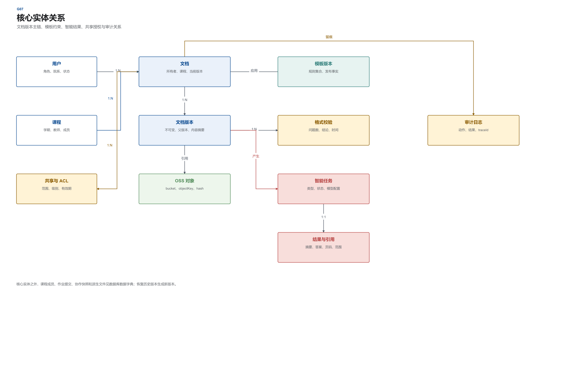
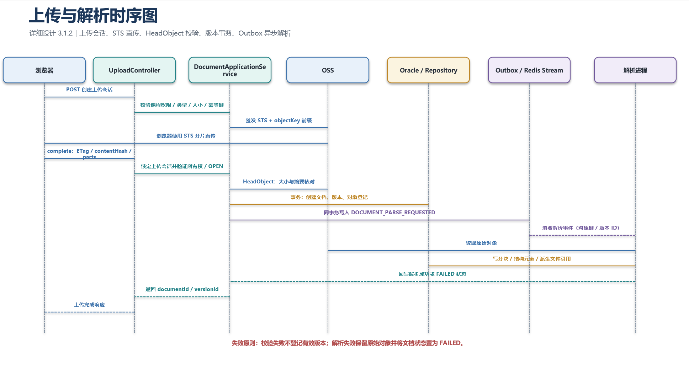
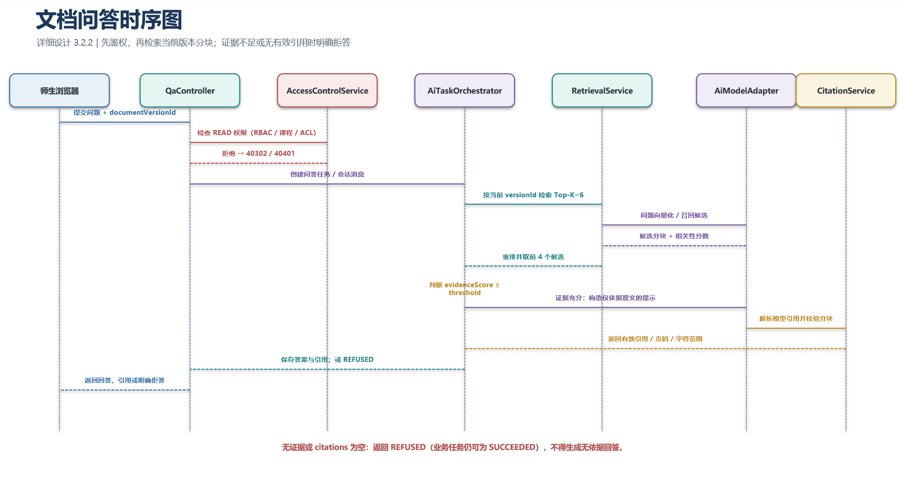
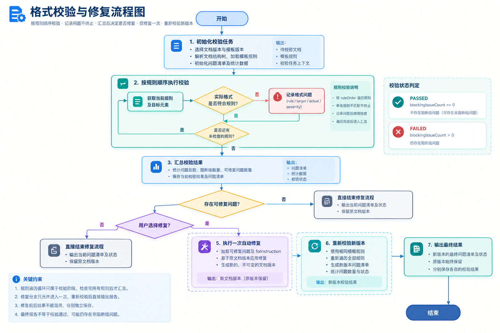
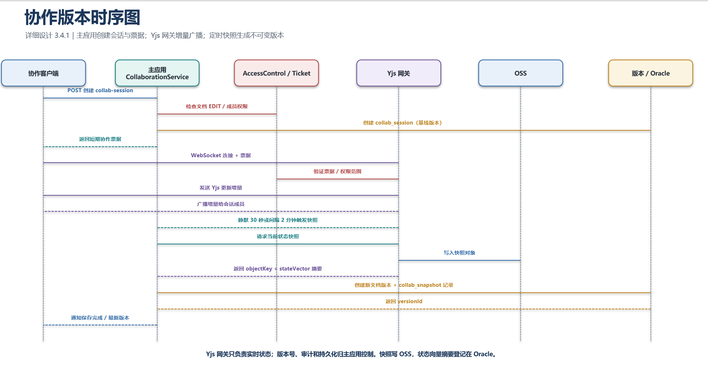
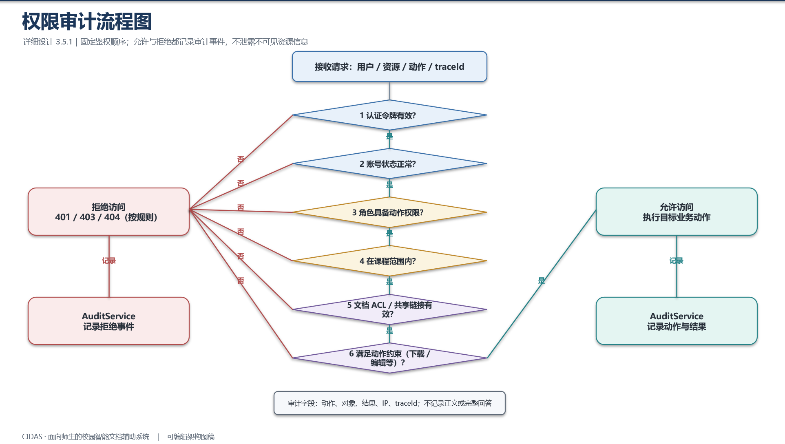

# 概要设计说明书

> 文件编号：CIDAS-HLD-001 ｜ 版本：1.1.0 ｜ 发布日期：2026-10-18
>
> 来源文件：05_系统设计/01_概要设计说明书.docx

面向师生的校园智能文档辅助系统
# 概要设计说明书
文件编号：CIDAS-HLD-001
版本：1.1.0
日期：2026-10-18
项目组
# 文件修改控制

| 编号 | 版本 | 修改内容 | 日期 |
| --- | --- | --- | --- |
| 1 | 1.0.0 | 创建系统概要设计，明确总体架构、模块划分、接口和部署边界。 | 2026-10-18 |
| 2 | 1.0.0 | 纳入单机部署、阿里云 OSS 和 Oracle 26ai 向量检索决策。 | 2026-10-18 |
| 3 | 1.0.0 | 补充系统流图、顶层 DFD、一层 DFD 和需求追踪矩阵。 | 2026-10-18 |
| 3 | 1.1.0 | 同步三角色原型：81 个业务画面与 5 个认证画面，角色模型合并 | 2026-10-30 |

# 1 引言
## 1.1 编写目的
本说明书面向项目组成员、指导教师、后续开发与测试人员，说明校园智能文档辅助系统（CIDAS，产品昵称 EduDocAssistant）的总体架构、模块边界、核心数据流、接口和单机部署方案。文档用于回答系统“由哪些部分组成、各部分如何协作、为什么这样划分”三个问题，并为数据库设计、详细设计、编码和验收提供共同基线。
本文只描述总体方案和跨模块约束。各业务模块的类、方法、校验规则和测试用例见《详细设计说明书》，表结构、索引、约束与 SQL 脚本见《数据库设计说明书》。
## 1.2 背景与范围
系统部署在校园网络内部的服务器或校园云环境中，服务对象包括学生、教师和运维人员（教学管理员与系统运维合并）。系统接收 Word 与 PDF 课件、作业、论文和课程报告，提供解析预览、摘要、要点提取、文档问答、文本润色、课程模板、格式校验、格式转换、协作版本、权限审计、文档导出和作业统计。
功能边界止于文档处理和教学协同。系统不承担教学过程管理，不替代学校教务系统或教学平台，不处理涉密文档，也不提供绕过服务端权限的本地文件直传通道。本期只交付桌面 Web 端，移动端适配保留为后续迭代。
现有 `EduDocAssistant` 代码目录为空，因此本设计不是对既有实现的逆向说明，而是依据需求调研、需求陈述、需求规格和三条角色路线共 81 个业务画面与 5 个认证画面形成的可编码施工方案。
## 1.3 术语与定义
表 1-1  术语与定义

| 术语 | 定义 |
| --- | --- |
| CIDAS | Campus Intelligent Document Assistant System，校园智能文档辅助系统。 |
| 模块化单体 | 按业务域分包并部署为一个 Spring Boot 主应用，模块之间只通过应用服务接口调用。 |
| RBAC | 基于角色的访问控制，先判断用户角色是否具备资源动作权限。 |
| 文档 ACL | 在角色权限之上按文档、课程、成员、共享链接和有效期授予的细粒度权限。 |
| DFD | 数据流图，描述外部实体、处理过程、数据流和数据存储之间的关系。 |
| 系统流图 | 描述用户操作跨前端、主应用、异步处理和数据基础设施运行时的业务流程。 |
| Yjs | 面向协同编辑的 CRDT 数据结构，用于多人增量同步与冲突合并。 |
| Outbox | 与业务事务同库写入事件，再由调度器异步投递，避免业务提交和消息发布不一致。 |
| STS | 阿里云短期访问凭证，用于浏览器受控上传 OSS，不暴露长期 AccessKey。 |
| Top-K 检索 | 从文档分块向量中召回最相关的 K 个候选片段，再生成带引用的回答。 |

## 1.4 设计依据
- 《面向师生的校园智能文档辅助系统 需求陈述说明书》1.0.0-0.0.0。
- 《面向师生的校园智能文档辅助系统 需求规格说明书》1.0.0-0.0.0。
- `03_页面原型` 中的三条角色路线共 81 个业务画面、5 个认证画面和设计令牌。
- GB/T 8567-2006 计算机软件文档编制规范。
- 项目组已确认的系统设计决策：模块化单体、独立智能与转换进程、单机部署、Oracle + 阿里云 OSS。
## 1.5 已确认的设计决策
表 1-2  系统设计输入决策

| 决策项 | 确认结果 | 对设计的影响 |
| --- | --- | --- |
| 交付形式 | 四份正式交付：概要设计、数据库设计、详细设计、系统设计 PPT；图表源文件同目录保存。 | 三份 Word 文档共享表名、接口名、图号和术语。 |
| 架构风格 | 模块化单体 + 独立智能服务与转换工作进程。 | 降低课程项目运维成本，同时保留按业务域拆分服务的边界。 |
| 协作实现 | Yjs CRDT + 同机 Node.js 协作同步网关。 | 实时同步采用成熟库，主应用负责权限、版本和审计。 |
| 智能能力 | 可配置国产模型适配层，Oracle 26ai 保存文本向量。 | 不绑定具体厂商，不额外引入向量数据库。 |
| 文件存储 | Oracle 保存元数据和向量，阿里云 OSS 保存文件本体。 | OSS 使用中国大陆地域、私有 Bucket、SSE 和短期签名访问。 |
| 部署规模 | 仅单机部署。 | 不承诺节点故障自动切换；以备份、恢复演练和快速回滚保障运行目标。 |
| 保留策略 | 历史工作版本默认 180 天，回收站 30 天，审计日志不少于 3 年。 | 清理任务、归档状态和保留字段进入数据库设计。 |
| 设计周期 | 2026-10-13 至 2026-10-18。 | 文档落款日期统一为 2026-10-18。 |

# 2 系统总体架构设计
## 2.1 架构设计目标与原则
总体架构围绕文档全生命周期组织。上传后形成不可变版本，解析结果、智能结果和格式检查均引用具体版本，协作文档通过快照形成新版本。所有读写动作先经过身份与文档 ACL 校验，再经过审计切面，确保敏感文档不会被跨课程或越权访问。
- 边界优先：六个业务域各自拥有应用服务、领域对象和仓储接口，跨域不直接访问对方数据表。
- 版本不可变：上传、编辑、协作、恢复和提交都生成新版本，历史版本不覆盖。
- 异步削峰：解析、向量化、格式转换、导出和通知通过 Redis Stream 与 Outbox 异步执行。
- 最小暴露：浏览器只接触短期 STS、签名 URL 和业务 API，不持有长期云凭据。
- 可追溯：每次权限变更、文件下载和模型调用均写入 traceId 关联的审计日志。
- 单机可运维：组件数量受控，配置、日志、备份和恢复路径明确，不伪装成多节点高可用。
## 2.2 系统整体逻辑架构
系统分为访问接入、业务应用、独立处理和存储与外部能力四层。浏览器通过 HTTPS 访问 Nginx，Nginx 将静态资源、REST API、协作 WebSocket 和下载跳转分别转发到对应进程。Spring Boot 主应用承担身份、课程、文档、模板、协作、权限、导出和统计等业务编排。Python/FastAPI 服务只处理智能任务和模型调用；转换工作进程处理 Word/PDF 转换；Yjs 网关处理实时编辑同步。 系统总体逻辑架构如图 2-1 所示。

图 2-1  CIDAS 总体逻辑架构
主应用与独立进程之间使用内网 HTTPS 或受保护的 WebSocket。异步任务以 Redis Stream 为队列，业务事务通过 `edudoc_outbox_event` 表可靠地发布事件。Oracle 负责事务数据、版本关系和向量索引；OSS 只保存对象实体；Redis 只保存可重建的会话、缓存与队列状态，不作为业务事实来源。
## 2.3 分层职责与调用边界
表 2-1  分层职责

| 层次 | 主要组件 | 职责 | 禁止事项 |
| --- | --- | --- | --- |
| 访问接入 | 浏览器、Nginx | 页面渲染、TLS、静态资源、反向代理、限流、traceId 注入。 | 不得直接访问 Oracle；不得保存长期 OSS 密钥。 |
| 业务应用 | Spring Boot 主应用 | 身份、课程、文档、模板、AI 编排、权限、审计、导出和统计。 | 不得在请求线程执行长时间模型推理或文件转换。 |
| 独立处理 | AI 服务、转换进程、Yjs 网关、Outbox 调度器 | 模型调用、向量化、格式转换、实时协作和可靠事件投递。 | 不得绕过主应用鉴权获取未授权文档。 |
| 存储与外部能力 | Oracle、Redis、阿里云 OSS、模型服务 | 事务、向量、缓存、对象、模型能力和备份。 | 不得把 Redis 作为唯一业务数据源。 |

## 2.4 技术选型
表 2-2  技术栈与选型理由

| 领域 | 选型 | 用途 | 选型理由 |
| --- | --- | --- | --- |
| 前端 | React 18+、TypeScript、Vite、React Router、Axios、TipTap、Yjs | 页面、编辑器、协作文档、预览和差异对比。 | 与原型和需求基线一致，组件生态成熟。 |
| 主应用 | Java 21、Spring Boot 3.x、Spring Security、MyBatis-Plus、Spring WebSocket | 模块化单体、REST、鉴权、审计和管理。 | 团队已覆盖，适合课程项目规模和单机部署。 |
| 协作网关 | Node.js 22、Yjs、WebSocket | 实时光标、增量同步和快照生成。 | 避免自行实现 OT/CRDT，降低冲突处理风险。 |
| 智能服务 | Python 3.13、FastAPI | 摘要、要点、问答、润色、向量化。 | AI 生态成熟，与 Java 主应用解耦。 |
| 数据库 | Oracle Database 26ai | 业务数据、版本关系、向量检索和审计。 | 需求指定，AI Vector Search 可减少独立向量库。 |
| 缓存与队列 | Redis 7.x | 会话、缓存、限流、Redis Stream。 | 轻量、可靠，适合单机部署。 |
| 对象存储 | 阿里云 OSS | 原文、派生文件、转换结果、导出件和快照。 | 支持中国大陆地域、私有 Bucket、SSE 与短期签名。 |
| 文档处理 | Apache Tika、PDFBox、LibreOffice Headless、python-docx | 解析、预览、转换和导出。 | 开源可部署，覆盖 Word 与 PDF 主链路。 |
| 构建与质量 | Maven、pnpm、ESLint、JUnit 5、Vitest、Playwright、k6 | 构建、静态检查、单元、端到端和压测。 | 覆盖前后端与性能验收。 |

# 3 模块与子系统划分
## 3.1 模块结构
六大业务域在代码中分别使用 `document`、`ai`、`template`、`collaboration`、`access`、`export` 包前缀。每个业务域包含 `api`、`application`、`domain`、`infrastructure` 四个子层。`common` 只提供不包含业务状态的横切能力，如统一响应、错误码、trace、事务模板和类型转换。 模块结构如图 3-1 所示。

图 3-1  系统模块结构
## 3.2 各业务域职责
表 3-1  业务域职责与需求映射

| 业务域 | 核心职责 | 主要输入 | 主要输出 | 对应需求 |
| --- | --- | --- | --- | --- |
| 文档接入 | 上传会话、OSS 直传、文档解析、预览、历史记录和回收站。 | 原始文件、课程、文档类型。 | 文档元数据、版本、分块、预览与状态。 | REQ-10、REQ-14、NFR-05 |
| 智能处理 | 任务编排、模型适配、摘要、要点、问答、润色和引用回填。 | 文档版本、用户问题、选中段落。 | 结构化结果、引用出处、任务状态。 | REQ-10 至 REQ-13 |
| 格式与模板 | 课程模板版本、格式规则、校验、修复、转换和图表编号。 | 模板规则、文档结构树、目标格式。 | 问题清单、修复版本、转换结果。 | REQ-01、REQ-02、REQ-04、REQ-07、REQ-08、REQ-14 |
| 协作与版本 | 协作会话、成员权限、Yjs 快照、版本对比与恢复。 | 协作增量、成员操作、基线版本。 | 协作快照、不可变版本、差异结果。 | REQ-03 |
| 权限与审计 | 角色权限、文档 ACL、共享链接、访问拒绝与审计查询。 | 角色、课程成员、共享设置、请求上下文。 | 授权结果、短期下载凭证、审计事件。 | REQ-06、REQ-09、NFR-02、NFR-06 |
| 导出与统计 | 全文与智能结果导出、作业发布、提交和统计。 | 文档版本、导出范围、作业配置。 | 导出文件、提交记录、统计报表。 | REQ-08、REQ-14 |

## 3.3 运行时组件
表 3-2  运行时组件与进程边界

| 组件 | 运行方式 | 关键约束 |
| --- | --- | --- |
| Nginx | 一个系统服务进程 | TLS 1.2+、请求体限制、超时、限流、traceId 透传。 |
| Spring Boot 主应用 | 一个 JVM 进程 | 业务事务、REST、审计、权限、Outbox 和定时任务。 |
| AI 服务 | 一个 FastAPI 进程 | 模型适配、提示模板、向量化、引用校验，不直接暴露公网。 |
| 转换工作进程 | 一个常驻 Python 进程 | 消费 Redis Stream；每次转换使用独立临时目录和超时终止。 |
| Yjs 网关 | 一个 Node.js 进程 | 校验协作票据；增量同步；按间隔通知主应用落快照。 |
| Outbox 调度器 | 主应用内独立线程池 | 扫描未发布事件、指数退避重试，不阻塞请求线程。 |

## 3.4 模块间交互原则
- 同步交互用于必须立即返回的业务结果，如权限判断、版本列表和任务状态查询。
- 异步交互用于可排队任务，如解析、向量化、格式转换、导出、提醒和统计刷新。
- 跨域事务使用本地事务 + Outbox，不引入分布式事务协议。
- AI 服务不直接决定用户权限，所有文档访问都由主应用签发短期内部令牌并记录审计。
- Yjs 网关只处理实时协作状态；版本号、审计和持久化归属由主应用控制。
# 4 核心业务流程与数据流
## 4.1 师生文档处理总体流程
学生从课程模板进入文档，完成上传、解析、智能处理、格式检查、导出和提交；教师维护模板和作业，查看提交统计并下载文档；运维人员在授权范围内维护课程配置、查看审计，并管理账号角色、巡检服务、备份和恢复。多角色流程在提交、共享和审计处汇合，不把教学成绩管理扩展成独立教务系统。 师生文档处理总体流程如图 4-1 所示。

图 4-1  系统流图
## 4.2 文档智能处理流程
文档确认上传后，主应用登记文档和版本，再发布解析事件。解析进程读取 OSS 原始对象，使用 Apache Tika 或 PDFBox 提取文本、标题和页码，生成统一结构树和分块。AI 服务对分块进行向量化并将向量写入 Oracle，摘要、要点和问答结果均保存引用分块与页码。问答在证据不足时返回明确拒答，不以模型常识补写文档事实。
润色任务使用用户选中的段落，不把整份文档发送给模型。模型返回润色文本后，用户可选择采纳、部分采纳或放弃；采纳动作生成新版本并保留一次撤销依据。格式校验将结构树与课程模板规则比对，可修复项生成操作指令，写入新版本后再复审。
## 4.3 顶层数据流
顶层数据流把 CIDAS 视为一个处理过程，外部实体包括校内用户、学校外部系统、模型服务和阿里云 OSS。用户提交身份、课程、文档和操作指令；学校系统提供身份和课程事实；模型服务接收受控的分块与提示参数；OSS 接收原始文件和派生文件。系统输出预览、智能结果、格式报告、版本、提交统计和审计记录。 顶层数据流如图 4-2 所示。

图 4-2  数据流图（顶层）
## 4.4 一层数据流
一层 DFD 将系统拆分为身份与课程、文档接入、智能处理、格式与模板、协作与版本、权限与审计、导出与统计七个处理过程。各过程共享用户、课程、文档、分块、模板和审计等数据存储，但每个数据存储只有一个业务域拥有写权限，其他业务域通过应用服务接口读取或请求变更。 一层数据流如图 4-3 所示。

图 4-3  数据流图（一层）
表 4-1  关键数据流说明

| 数据流 | 来源 | 去向 | 处理规则 |
| --- | --- | --- | --- |
| 身份与课程上下文 | 统一身份认证 / 教务接口 | P1、P6 | 映射校内账号、角色和课程成员，接口不可用时启用本地兼容认证。 |
| 上传完成事件 | 文档接入 | 解析进程 | 以 OSS 对象键、内容摘要和上传会话 ID 做幂等校验。 |
| 文本分块与向量 | 解析进程 / AI 服务 | Oracle | 分块保留页码和字符范围，向量维度必须匹配模型配置。 |
| 问答结果与引用 | AI 服务 | P3、P6 | 引用必须指向当前文档版本分块；无依据时返回拒答。 |
| 模板规则 | P4 | 格式校验 | 只使用文档绑定的模板版本，模板变更不影响历史版本。 |
| 共享授权 | P6 | P2、P5、P7 | 按角色、课程成员、文档 ACL 和有效期链接计算最终权限。 |
| 审计事件 | 所有处理过程 | D6 | 写入动作、对象、结果、IP、traceId，不写入正文和完整回答。 |

# 5 接口设计
## 5.1 内部接口
表 5-1  模块间应用服务接口

| 接口提供方 | 方法 | 输入 | 输出 | 调用方 |
| --- | --- | --- | --- | --- |
| DocumentAppService | createUploadSession/completeUpload | 用户、课程、文件元数据 | 上传凭证、文档 ID、版本 ID | 前端、导出模块 |
| DocumentAppService | getPreview/searchChunks | 文档 ID、版本 ID、关键词 | 结构树、预览地址、分块命中 | 前端、AI 编排 |
| DocumentVersionAppService | create/list/compare/restore | 文档 ID、版本 ID、变更说明 | 版本记录、差异、恢复版本 | 协作、导出、提交 |
| TemplateRuleAppService | resolveRules/publishVersion | 课程、模板版本 | 规则集合、发布结果 | 格式校验、作业 |
| AccessControlAppService | check/issueDownloadTicket | 用户、资源、动作、请求上下文 | 允许或拒绝、短期票据 | 全部业务模块 |
| AiTaskAppService | submit/get/cancel | 文档版本、任务类型、参数 | 任务 ID、状态、结构化结果 | 前端、文档模块 |
| ExportSubmissionAppService | export/submit/statistics | 文档版本、范围、作业、课程 | 导出任务、提交记录、统计 | 前端、统计页面 |

## 5.2 外部接口
表 5-2  外部接口清单

| 编号 | 接口 | 协议 | 调用方向 | 失败与降级 |
| --- | --- | --- | --- | --- |
| I01 | 统一身份认证 / 本地兼容认证 | HTTPS / OIDC 或等价接口 | 主应用 → 学校认证 | 认证不可用时只允许既有会话续期，不开放匿名访问。 |
| I02 | 教务系统账号与课程同步 | HTTPS / 定时或事件同步 | 主应用 ↔ 教务系统 | 保存同步游标；失败重试；课程以本地快照为准并标记待同步。 |
| I03 | 文档转换能力 | 内网 HTTPS / Redis Stream | 主应用 ↔ 转换进程 | 任务超时、失败原因落库，允许重新提交。 |
| I04 | 智能模型能力 | 内网 HTTPS / OpenAI 兼容接口适配 | AI 服务 → 国产模型服务 | 超时、熔断、重试；返回可解释失败码，不伪造结果。 |
| I05 | 阿里云 OSS | HTTPS / S3 兼容 API | 浏览器、主应用 → OSS | STS 签发失败阻止上传；对象校验失败不可登记为有效版本。 |
| I06 | 邮件 / 站内提醒 | 内部事件 + 邮件网关 | 主应用 → 提醒服务 | 提醒失败不影响提交事实，由 Outbox 重试。 |

## 5.3 REST 接口规范
业务接口统一使用 `/api/v1` 前缀、HTTPS 和 JSON。创建资源返回 201，删除或撤销成功返回 204，查询成功返回 200。身份令牌放在 `Authorization: Bearer` 头，所有请求写入或透传 `X-Trace-Id`。分页参数使用 `page` 和 `pageSize`，排序使用 `sort`，幂等写操作使用 `Idempotency-Key`。
{
  "code": 200,
  "message": "success",
  "data": {},
  "traceId": "2f6b...",
  "timestamp": "2026-10-18T10:00:00+08:00"
}
## 5.4 OSS 上传与访问接口
- `POST /api/v1/documents/upload-sessions`：校验文件类型、大小和课程权限，返回上传会话 ID、STS 凭证、允许的 objectKey 前缀和过期时间。
- 浏览器使用 STS 分片上传到私有 Bucket，不经过主应用转发大文件。
- `POST /api/v1/documents/upload-sessions/{id}/complete`：提交 ETag、contentHash 和分片清单，主应用调用 HeadObject 校验后登记版本。
- 下载接口先做 RBAC 和 ACL 鉴权，再生成 5 分钟有效的签名 URL；一次性链接同时递增下载计数。
- 所有对象使用 SSE-KMS 或 SSE-OSS 加密，禁止公共读；Bucket 开启版本控制和生命周期保护。
## 5.5 AI 与转换任务接口
AI 服务内部接口分为 `summarize`、`extract-keypoints`、`embed`、`answer` 和 `polish` 五类。主应用只发送文档版本 ID、必要分块、模型配置引用和参数，不发送用户凭据。转换服务接收源 OSS 对象键、目标格式和回调任务 ID，转换完成后返回结果对象键、文件摘要和页数。两类服务都必须支持取消、超时、幂等键和结构化错误。
# 6 运行与部署设计
## 6.1 单机部署拓扑
应用服务器运行 Nginx、Spring Boot、Yjs 网关、FastAPI、转换进程和 Redis；数据库服务器运行 Oracle 26ai。文档对象放入阿里云 OSS，模型服务通过受控 HTTPS 访问。应用服务器和数据库服务器均位于校园网络或校园云的安全组内，只有 Nginx 对用户开放 HTTPS。 单机部署拓扑如图 6-1 所示。

图 6-1  单机部署拓扑
## 6.2 服务器配置
表 6-1  建议运行配置

| 节点 | 配置 | 部署内容 | 关键说明 |
| --- | --- | --- | --- |
| 应用服务器 | 8 核 2.5GHz、16GB 内存、200GB SSD、千兆网络 | Nginx、主应用、AI 服务、Yjs 网关、转换进程、Redis | 通过 systemd 管理进程；日志与临时目录分离；限制转换并发。 |
| 数据库服务器 | 8 核、32GB 内存、500GB SSD、RAID1 | Oracle Database 26ai | 数据库与应用服务器独立；启用归档日志与每日备份。 |
| 客户端 | 8GB 内存、2Mbps 以上网络 | Chrome、Edge、Safari 最新两个版本 | 桌面端 1440×900 基准。 |
| OSS | 中国大陆地域私有 Bucket | 原始文件、派生文件、导出件、快照 | 启用 SSE、版本控制和生命周期规则。 |

## 6.3 可用性与恢复
单机部署不具备节点故障自动切换能力。系统以 99.5% 可用性和 30 分钟恢复时间为运行目标，通过进程自动重启、数据库归档日志、每日全量备份、OSS 版本控制、健康检查和故障演练实现。应用异常时由 systemd 重启；数据库故障时按最近备份和归档日志恢复到故障前时点；OSS 对象误删通过版本控制恢复。设计文档明确该限制，不把备份描述为高可用。
## 6.4 容量与高峰估算
表 6-2  容量估算与应对

| 指标 | 设计假设 | 应对措施 |
| --- | --- | --- |
| 并发在线用户 | 1000 名在线，500 并发集中上传 | Nginx 限流、OSS 直传、上传会话轻量化、Redis 计数。 |
| 单文件大小 | 不超过 20MB | 分片上传、断点续传、对象摘要校验。 |
| 解析与摘要 | 30 页文档 60 秒内完成 | 异步解析、并行分块、预热模型连接、任务优先级。 |
| 问答响应 | 单次不超过 5 秒 | Top-K 限制、上下文裁剪、向量索引、超时降级。 |
| 转换吞吐 | 20MB 单文件成功率不低于 99% | 独立工作进程、并发上限、失败重试与原因记录。 |
| 审计保留 | 不少于 3 年 | 按月分区/归档策略预留，日志导出与冷热分层。 |

# 7 综合约束与设计原则
## 7.1 安全性设计
- 传输使用 TLS 1.2 及以上；口令使用强哈希；令牌短期有效并支持撤销。
- RBAC 决定角色能做什么，文档 ACL 决定角色能对哪份文档做什么，二者都必须通过。
- OSS 私有 Bucket、短期 STS、签名 URL 和 SSE；长期 AccessKey 只保存在服务器配置中。
- SQL 使用参数绑定；上传文件做类型、大小、内容摘要和恶意文件检查。
- 审计日志禁止写入正文、模型回答、口令、令牌和云端密钥。
- 个人信息展示按最小必要原则脱敏，敏感数据只存储在国内地域。
## 7.2 性能与扩展性
请求链路只做事务和轻量校验，耗时任务异步化。热点课程、权限结果和模板规则使用短期缓存，但权限变更和模板发布通过版本号使缓存失效。每类异步任务设置独立并发上限，避免转换或模型调用占满 CPU 和连接池。后续若需要拆分服务，可按六个业务域边界平移，不需要先重写领域模型。
## 7.3 异常、日志与追踪
表 7-1  全局异常与日志原则

| 场景 | 响应策略 | 日志与审计 |
| --- | --- | --- |
| 参数或文件校验失败 | 返回 4xx 统一错误码和可操作提示。 | 记录请求摘要，不保存文件正文。 |
| 越权或链接失效 | 返回 403 或 410，不泄露资源是否存在。 | 写入 actor、resourceRef、traceId 和拒绝原因。 |
| 版本冲突 | 返回 409，要求重新加载或选择覆盖策略。 | 记录期望版本和当前版本号。 |
| AI 超时或模型失败 | 任务标记 FAILED，可重试，不返回伪造答案。 | 记录 provider、model、耗时和错误类别。 |
| OSS 或数据库短时不可用 | 返回 503，幂等接口允许安全重试。 | 记录依赖、重试次数和熔断状态。 |
| 未捕获异常 | 返回 500 与 traceId，避免暴露堆栈。 | 服务端记录完整堆栈和请求上下文。 |

## 7.4 可维护性
接口按业务域和版本管理，配置通过环境变量或配置中心热加载。数据库变更使用版本化 SQL 脚本，文档中的表名、字段名和接口名与脚本保持一致。每季度至少执行一次恢复演练，并记录数据恢复点、恢复耗时和问题整改。
# 8 设计决策与待闭环事项
## 8.1 关键设计决策
表 8-1  关键架构决策

| 编号 | 决策 | 理由 | 代价 |
| --- | --- | --- | --- |
| ADR-01 | 模块化单体而非六服务微服务 | 单机、小团队和课程周期更适合集中事务和部署。 | 进程级故障域集中，需要清晰的模块边界和接口纪律。 |
| ADR-02 | Yjs 协作网关独立运行 | 成熟 CRDT 能处理实时冲突，减少自研风险。 | 增加一个 Node.js 进程和协作票据接口。 |
| ADR-03 | Oracle 26ai 承载向量 | 减少独立向量库组件，简化备份与权限。 | 模型向量维度必须固定并由适配层校验。 |
| ADR-04 | OSS 直传 | 大文件不占应用服务器带宽和内存，适合 500 并发上传。 | 需要 STS、回调校验和对象一致性保护。 |
| ADR-05 | Outbox + Redis Stream | 兼顾事务一致性与轻量异步，不引入复杂消息中间件。 | 需要幂等消费、重试和死信处理。 |
| ADR-06 | 单机部署 | 与现有硬件预算和运维能力一致。 | 不提供节点级自动故障转移，恢复目标依赖备份与演练。 |

## 8.2 待闭环事项
表 8-2  设计阶段保留的可配置事项

| 事项 | 当前设计处理 | 闭环方式 |
| --- | --- | --- |
| 统一身份认证接口细节 | 通过 `AuthProvider` 适配层支持 OIDC 或校内接口，同时保留本地兼容认证。 | 信息中心确认字段映射、令牌时效和登出反馈。 |
| 教务系统课程同步 | 课程与成员使用本地快照，保留 `externalSubjectId` 与同步游标。 | 确认开放接口与数据范围后接入。 |
| 具体国产模型厂商 | 模型名称、端点和密钥使用配置注入，向量维度固定 1024。 | 试点环境确定模型后校准提示词和并发阈值。 |
| 个人信息脱敏范围 | 日志不存正文，界面按最小必要展示；字段级脱敏规则可配置。 | 依据学校合规要求确定。 |
| 版本与回收站保留期 | 历史工作版本 180 天，回收站 30 天，审计不少于 3 年。 | 学校如有统一制度，直接调整配置和归档任务。 |

# 附录 A 需求与设计映射
表 A-1  主要需求的设计落点

| 需求 | 主要设计落点 | 验证方式 |
| --- | --- | --- |
| REQ-01 / REQ-02 | TipTap 代码块扩展、结构元素表、章节编号与图表索引。 | 插入和增删图表后检查编号连续与导出保真。 |
| REQ-03 | Yjs 网关、协作成员、快照与版本回退。 | 4 人并发编辑和指定版本恢复。 |
| REQ-04 | 模板规则解析、格式检查任务、问题清单和自动修复。 | 模板样本集定位准确率不低于 95%。 |
| REQ-05 | OSS 分片直传、上传会话、限流和幂等完成回调。 | 500 并发上传压测。 |
| REQ-06 | RBAC + 文档 ACL + 共享链接。 | 越权用例与审计检查。 |
| REQ-07 | 参考文献解析、标准格式生成与规则扩展点。 | 参考文献样本集准确率测试。 |
| REQ-08 | 模板版本、作业和提交统计。 | 模板发布和提交状态演示。 |
| REQ-09 | 统一审计切面与查询导出。 | 抽查关键操作覆盖率。 |
| REQ-10 至 REQ-13 | 解析、分块、向量、任务编排、引用回填和润色对比。 | 处理时限、引用正确性、拒答与可还原测试。 |
| REQ-14 | 转换任务、导出任务和对象版本。 | 批量转换成功率与历史记录检索。 |
| NFR-01 至 NFR-07 | 单机容量控制、TLS/加密、备份恢复、桌面兼容和接口文档。 | 压测、故障演练、兼容性与安全审查。 |
