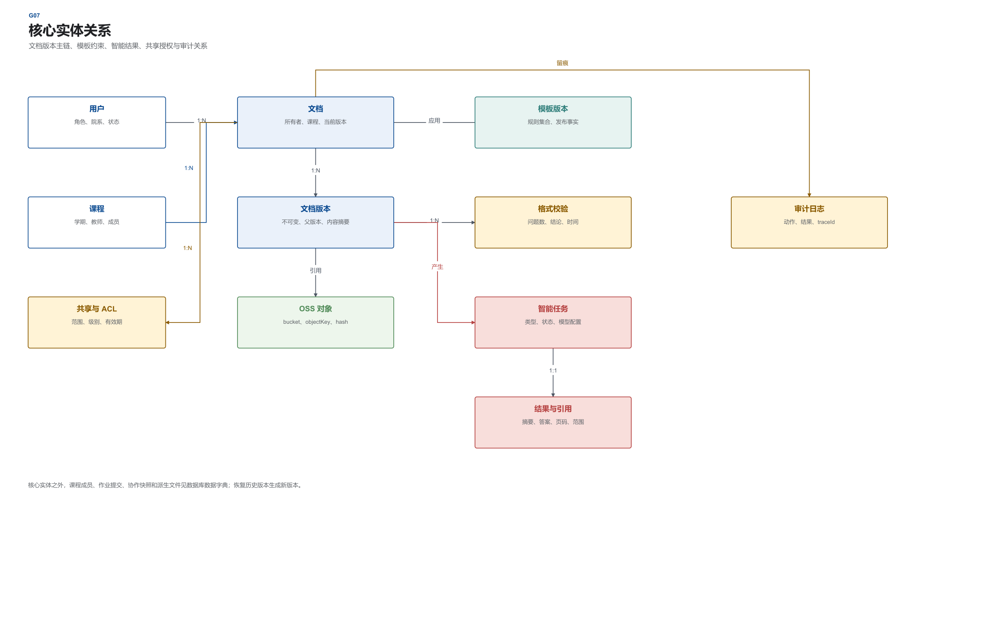
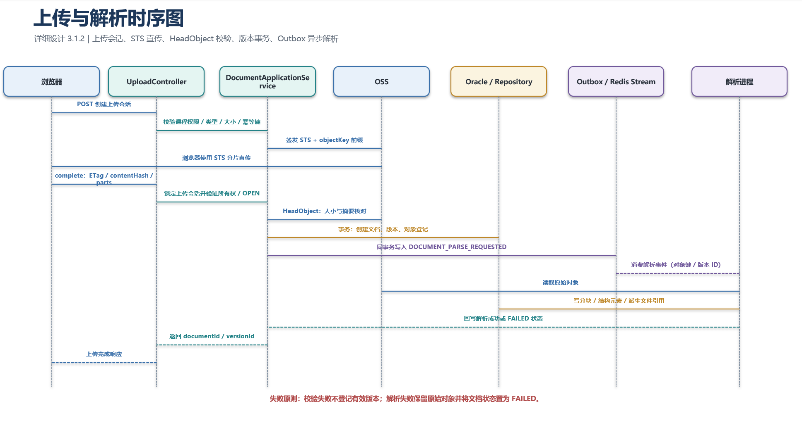
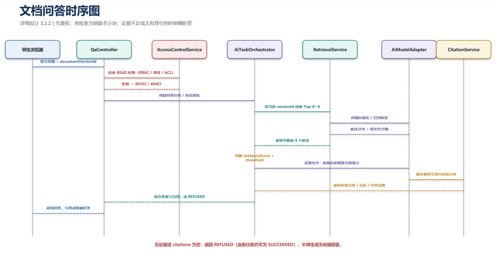
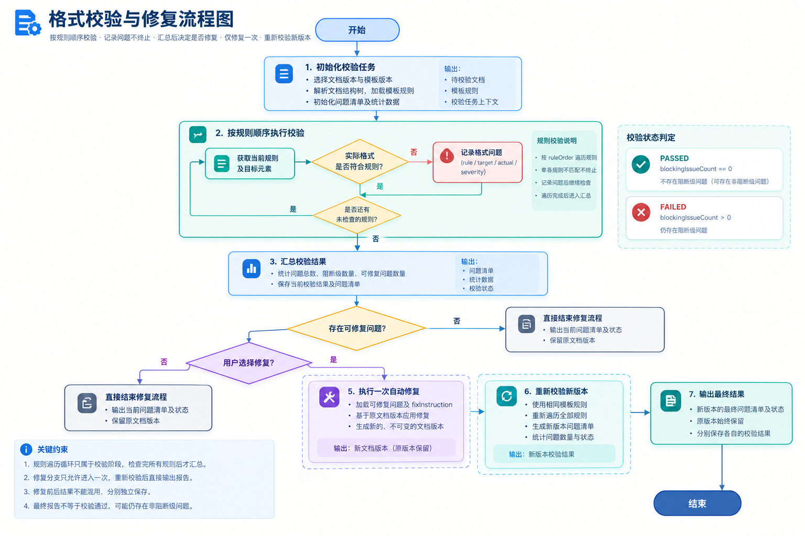
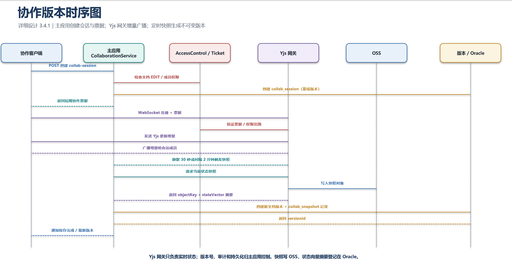
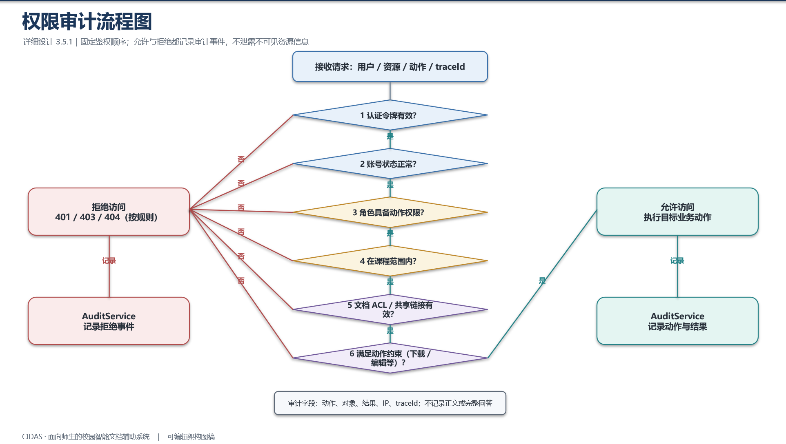

# 详细设计说明书

> 文件编号：CIDAS-LLD-001 ｜ 版本：1.1.0 ｜ 发布日期：2026-10-18
>
> 来源文件：05_系统设计/03_详细设计说明书.docx

面向师生的校园智能文档辅助系统
# 详细设计说明书
文件编号：CIDAS-LLD-001
版本：1.1.0
日期：2026-10-18
项目组
# 文件修改控制

| 编号 | 版本 | 修改内容 | 日期 |
| --- | --- | --- | --- |
| 1 | 1.0.0 | 创建六大业务域详细设计、接口与异常模型。 | 2026-10-18 |
| 2 | 1.0.0 | 补充页面流转、表单校验和前后端交互规范。 | 2026-10-18 |
| 3 | 1.0.0 | 补充单元测试策略、核心用例与验收边界。 | 2026-10-18 |
| 3 | 1.1.0 | 同步三角色原型页面映射与角色模型 | 2026-10-30 |

# 1 引言
## 1.1 编写目的
本说明书把概要设计和数据库设计落实到可编码的类、方法、接口、页面状态、校验规则和异常处理。开发人员可以据此建立工程骨架、编写接口和测试，不需要再从原型或需求文档反推实现细节。
本文中的类名、方法名、接口路径、表名和错误码是跨文档契约。若实现需要调整，应同步更新概要设计、数据库设计和接口测试，避免文档与代码双向漂移。
## 1.2 背景与参考依据
- 《CIDAS 需求规格说明书》1.0.0-0.0.0。
- 《CIDAS 概要设计说明书》CIDAS-HLD-001。
- 《CIDAS 数据库设计说明书》CIDAS-DBD-001。
- `03_页面原型` 的三条角色路线共 81 个业务画面与 5 个认证画面。
# 2 通用设计
## 2.1 后端工程结构
表 2-1  Spring Boot 包结构

| 包 | 职责 | 典型对象 |
| --- | --- | --- |
| common.api | 统一响应、分页、错误码和 trace | ApiResponse、PageResult、ErrorCode |
| common.security | 认证上下文、令牌解析和鉴权切面 | UserPrincipal、AuthContext、AccessGuard |
| common.persistence | 公共审计字段、事务模板和仓储基类 | BaseEntity、TransactionRunner |
| document.api | 上传、文档、预览和版本 REST 接口 | DocumentController、UploadController |
| document.application | 上传编排、解析协调和文档事务 | DocumentApplicationService、UploadSessionService |
| ai.application | 智能任务编排、状态轮询和结果校验 | AiTaskOrchestrator、AiResultService |
| template.application | 模板、规则、格式检查与转换 | TemplateRuleService、FormatCheckService |
| collaboration.application | 协作票据、快照和版本落库 | CollaborationService、SnapshotService |
| access.application | RBAC、ACL、共享链接和审计 | AccessControlService、AuditService |
| export.application | 导出、作业提交和统计 | ExportService、SubmissionService |
| infrastructure.oss | OSS 签名、对象校验和生命周期 | OssStorageAdapter |
| infrastructure.ai | 模型服务适配、重试和熔断 | AiModelAdapter、ModelCircuitBreaker |

模块内部采用 Controller → ApplicationService → DomainService/Repository 的调用顺序。Controller 只做参数绑定、身份读取和响应转换；ApplicationService 负责事务和跨领域编排；Repository 只做持久化。任何 Controller 不得直接调用 Mapper 或 OSS 客户端。 核心应用类图如图 2-1 所示。

图 2-1  核心应用类图
## 2.2 通用请求上下文
表 2-2  请求上下文对象

| 字段 | 类型 | 说明 |
| --- | --- | --- |
| userId | UUID | 当前登录用户，系统任务允许为空。 |
| roles | Set<String> | 当前用户生效角色编码。 |
| courseScope | Set<UUID> | 用户可访问的课程范围。 |
| traceId | String | 从请求头或网关生成，贯穿接口、任务和审计。 |
| sourceIp | String | 取自受信代理头，禁止直接相信公网伪造值。 |
| requestId | String | 幂等请求或批处理关联 ID。 |

## 2.3 统一响应与错误模型
表 2-3  REST 响应约定

| HTTP 状态 | 业务 code | 使用场景 | 客户端处理 |
| --- | --- | --- | --- |
| 200 | 200 | 查询、更新成功。 | 读取 data 并刷新状态。 |
| 201 | 200 | 创建上传会话、任务、作业等资源。 | 读取 Location 或 data.id。 |
| 204 | 200 | 删除、撤销或取消成功。 | 不解析响应体。 |
| 400 | 40001 | 参数或业务格式错误。 | 定位字段并提示。 |
| 401 | 40101 | 未登录或令牌过期。 | 跳转登录并保留回跳地址。 |
| 403 | 40301 | 角色不具备权限。 | 显示无权限状态。 |
| 403 | 40302 | 文档 ACL 拒绝。 | 不显示资源是否存在。 |
| 404 | 40401 | 资源不存在或不可见。 | 显示统一空状态。 |
| 409 | 40901 | 版本或并发冲突。 | 重新加载最新版本。 |
| 413 | 41301 | 文件或请求体过大。 | 提示大小限制。 |
| 415 | 41501 | 文件类型不支持。 | 提示允许的 Word/PDF 类型。 |
| 429 | 42901 | 限流或并发任务超限。 | 显示稍后重试和排队序号。 |
| 500 | 50001 | 未捕获异常。 | 显示 traceId，联系管理员。 |
| 502 | 50201 | 模型或外部服务失败。 | 允许重试，不展示伪造结果。 |
| 503 | 50301 | OSS、数据库或内部服务暂时不可用。 | 幂等请求可安全重试。 |
| 504 | 50401 | 处理超时。 | 保留任务并允许查询状态。 |

## 2.4 事务、幂等与并发
- 上传完成、版本创建、作业提交和共享授权使用本地事务；Outbox 事件与业务写入同事务提交。
- 创建上传会话、完成上传、创建 AI 任务、提交作业和创建导出任务要求 `Idempotency-Key`。
- 文档更新使用 `current_version_id` 或 `version_no` 做乐观并发校验；冲突返回 40901。
- Redis Stream 消费使用 `consumerGroup + messageId + taskId` 组合去重，任务表状态作为最终事实。
- OSS 对象以 `bucket + objectKey + versionId` 唯一标识，内容摘要不同则不得复用旧版本。
## 2.5 安全上下文与审计切面
鉴权顺序固定为：认证令牌 → 账号状态 → 角色权限 → 课程范围 → 文档 ACL/共享链接 → 动作约束。审计切面在安全上下文建立后执行，记录动作开始和结果；如果鉴权失败，也记录拒绝事件，但不暴露资源标题等敏感信息。
# 3 模块级详细设计
## 3.1 文档接入模块
### 3.1.1 模块职责与对象
表 3-1  文档接入核心类

| 类/服务 | 职责 | 依赖 | 关键约束 |
| --- | --- | --- | --- |
| DocumentController | 文档列表、详情、重命名、删除和回收站接口。 | DocumentApplicationService | 不返回未授权课程文档。 |
| UploadController | 创建上传会话、完成回调和重新解析。 | UploadSessionService | 校验类型、大小、课程与幂等键。 |
| DocumentApplicationService | 文档状态机、文档与版本事务编排。 | Repository、OssStorageAdapter、Outbox | 版本不可覆盖。 |
| OssStorageAdapter | STS、HeadObject、签名 URL、复制和删除。 | 阿里云 OSS SDK | 不暴露长期 AccessKey。 |
| ParsingTaskPublisher | 发布解析事件并设置优先级。 | Outbox、Redis Stream | 事件负载只含对象和任务标识。 |
| PreviewService | 结构树、分页、关键词检索和定位。 | ChunkRepository、DerivedFileRepository | 命中结果必须对应请求版本。 |

### 3.1.2 上传与解析流程
浏览器先申请上传会话，主应用检查课程权限、文件类型和大小后签发 STS。上传完成后，主应用通过 HeadObject 和内容摘要确认对象，创建文档、首个版本和原始对象登记，再发布解析事件。解析进程只消费已登记版本，成功后写入分块、元素索引和派生文件，失败时保留原始文件并将文档状态置为 FAILED。 文档上传与解析时序如图 3-1 所示。

图 3-1  文档上传与解析时序
### 完成上传伪代码
completeUpload(user, sessionId, idempotencyKey, completion):
assert idempotencyKey not used or same result
session = uploadSessionRepo.lock(sessionId)
assert session.ownerId == user.id and session.status == OPEN
object = oss.headObject(session.objectKey)
assert object.size == session.expectedSize
assert completion.contentHash == object.contentHash
transaction:
document = createDocument(session.courseId, session.metadata, user.id)
version = createVersion(document, object, user.id, "UPLOAD")
document.currentVersionId = version.id
document.status = PARSING
outbox.publish("DOCUMENT_PARSE_REQUESTED", version.id)
audit.record("UPLOAD_COMPLETED", document.id, object.contentHash)
return DocumentCreated(document.id, version.id)
### 3.1.3 接口与函数定义
表 3-2  文档接入主要接口

| 方法 | 路径 | 输入 | 输出/异常 |
| --- | --- | --- | --- |
| GET | /api/v1/documents | courseId,type,status,keyword,page,pageSize | 分页文档；40301/40302 |
| POST | /api/v1/documents/upload-sessions | courseId,title,fileName,size,mimeType | 会话、STS、objectKey；41301/41501 |
| POST | /api/v1/documents/upload-sessions/{id}/complete | ETag、contentHash、parts | documentId、versionId；40901 |
| GET | /api/v1/documents/{id} | 可选 versionId | 文档详情与权限摘要；40401 |
| PATCH | /api/v1/documents/{id} | title、courseId、tags | 更新后的文档；40901 |
| DELETE | /api/v1/documents/{id} | 无 | 204；文档进入回收站 |
| POST | /api/v1/documents/{id}/restore | 无 | 204；恢复文档 |
| POST | /api/v1/documents/{id}/parse | versionId | 任务 ID；40901 |
| GET | /api/v1/documents/{id}/preview | versionId,page | 预览对象或结构树；40401 |
| GET | /api/v1/documents/{id}/search | versionId,q | 命中页码、段落和字符范围 |

## 3.2 智能处理模块
### 3.2.1 模块职责与任务状态机
AI 编排层只管理任务、权限和结果结构，不把模型协议暴露给前端。任务从 `QUEUED` 进入 `RUNNING`，成功写结果和引用后进入 `SUCCEEDED`；超时、模型失败或证据不足按不同结果处理。证据不足的问答是成功的业务结果，状态为 `SUCCEEDED`，消息状态为 `REFUSED`。
表 3-3  智能处理核心类

| 类/服务 | 职责 | 关键输入 | 关键输出 |
| --- | --- | --- | --- |
| AiTaskOrchestrator | 任务幂等、排队、状态更新和结果保存。 | 文档版本、任务类型、参数 | taskId、状态、结果 |
| AiModelAdapter | 统一调用国产模型适配层。 | 提示、分块、参数 | 文本、结构化 JSON、token 统计 |
| RetrievalService | Top-K 向量召回、重排和证据阈值判断。 | 问题向量、versionId | 候选分块与相关性 |
| CitationService | 校验引用与生成页码/字符范围。 | 模型引用、分块 | 可回跳的引用列表 |
| PolishService | 处理选中段落、采纳和撤销。 | 原文、润色结果、决策 | 新版本或放弃记录 |

### 3.2.2 问答检索与拒答
问答检索、引用校验与拒答分支如图 3-2 所示。

图 3-2  文档问答时序
### 问答核心算法
answer(documentVersion, question, topK=6):
assert access.check(currentUser, documentVersion.documentId, READ)
questionVector = model.embed(question)
candidates = vectorRepo.search(questionVector, versionId, topK)
candidates = rerank(question, candidates).take(4)
evidenceScore = max(candidate.score)
if evidenceScore < evidenceThreshold:
return REFUSED("未在文档中找到依据")
prompt = buildEvidenceOnlyPrompt(question, candidates)
raw = model.answer(prompt, maxTokens=900)
citations = citationService.resolve(raw.citations, candidates)
if citations.isEmpty():
return REFUSED("文档依据不足以形成可核实回答")
return Answer(raw.text, citations, model.metadata)
### 3.2.3 接口定义
表 3-4  智能处理接口

| 方法 | 路径 | 说明 | 超时与异常 |
| --- | --- | --- | --- |
| POST | /api/v1/documents/{id}/summaries | 创建摘要任务。 | 60 秒目标；50401/50201 |
| POST | /api/v1/documents/{id}/keypoints | 创建要点提取任务。 | 60 秒目标；50201 |
| GET | /api/v1/ai-tasks/{taskId} | 查询任务进度、结果和引用。 | 40401；任务失败返回结构化错误 |
| POST | /api/v1/ai-tasks/{taskId}/cancel | 取消排队或运行任务。 | 40901 如果任务已结束 |
| POST | /api/v1/qa/sessions | 基于文档创建问答会话。 | 40302/40401 |
| POST | /api/v1/qa/sessions/{id}/messages | 提交问题和连续追问。 | 5 秒目标；证据不足返回 REFUSED |
| POST | /api/v1/documents/{id}/polish | 润色选中段落。 | 返回原文本、润色文本和比较标记 |
| POST | /api/v1/polish/{id}/decision | 采纳、部分采纳或放弃。 | 生成新版本；40901 |

## 3.3 格式与模板模块
### 3.3.1 对象与规则解析
模板发布时，解析器把 Word 模板中的标题、字体、字号、行距、页边距、页眉页脚、图表题注和参考文献规则转换为 `edudoc_format_rule`。规则配置使用 JSON，避免为每种格式项增加专用表。文档校准时先生成版本结构树，再按规则顺序输出问题。
表 3-5  格式模块核心类

| 类/服务 | 职责 | 输入 | 输出 |
| --- | --- | --- | --- |
| TemplateRuleService | 解析模板、发布版本和解析规则集合。 | 模板文件、规则配置 | 模板版本、规则集合 |
| FormatCheckService | 创建校验任务、按规则比对并保存问题。 | 文档版本、模板版本 | 问题清单、通过状态 |
| AutoFixService | 把可修复问题转换为版本编辑指令。 | 问题、结构树 | 新版本和修复摘要 |
| ConversionService | 提交转换任务并关联结果对象。 | 源版本、目标格式 | 转换任务和结果文件 |
| ElementNumberingService | 章节内图表、代码和公式编号。 | 结构元素、章节顺序 | 显示编号与引用索引 |

### 3.3.2 校验与自动修复流程
模板规则比对、问题定位与修复路径如图 3-3 所示。

图 3-3  格式校验与自动修复流程
### 模板规则比对
check(documentVersion, templateVersion):
tree = structureParser.parse(documentVersion)
rules = ruleRepository.findByTemplateVersion(templateVersion)
issues = []
for rule in rules.sortByRuleOrder():
targets = tree.select(rule.targetSelector)
for target in targets:
actual = target.extract(rule.ruleType)
if not rule.matches(actual):
issues.add(toIssue(rule, target, actual))
check.totalIssueCount = issues.size
check.blockingIssueCount = issues.count(severity == BLOCKER)
check.status = check.blockingIssueCount == 0 ? PASSED : FAILED
return issues
autoFix(issueIds):
issues = loadOpenFixable(issueIds)
tree = loadCurrentStructureTree(locked=true)
for issue in issues:
tree.apply(issue.fixInstruction)
version = versionService.createEditVersion(tree, user)
verifyAgain(version, templateVersion)
### 3.3.3 接口定义
表 3-6  模板、校验与转换接口

| 方法 | 路径 | 说明 | 权限 |
| --- | --- | --- | --- |
| GET | /api/v1/templates | 按课程查询模板和当前版本。 | TEMPLATE_READ |
| POST | /api/v1/templates | 新建模板草稿。 | TEMPLATE_MANAGE |
| POST | /api/v1/templates/{id}/versions | 上传并解析新版本。 | TEMPLATE_MANAGE |
| POST | /api/v1/templates/{id}/versions/{versionId}/publish | 发布模板给课程。 | TEMPLATE_MANAGE |
| POST | /api/v1/documents/{id}/format-checks | 创建格式校验任务。 | FORMAT_CHECK |
| GET | /api/v1/format-checks/{checkId}/issues | 分页查询问题清单。 | 文档 READ |
| POST | /api/v1/format-checks/{checkId}/fix | 修复选中的可自动修复问题。 | 文档 EDIT |
| POST | /api/v1/conversions | 创建 Word/PDF 转换任务。 | FORMAT_CONVERT |
| GET | /api/v1/conversions/{taskId} | 查询进度、结果和失败原因。 | 任务发起人 |

## 3.4 协作与版本模块
### 3.4.1 协作会话与快照
主应用创建 `edudoc_collab_session` 并生成短期协作票据，Yjs 网关验证票据后允许 WebSocket 连接。网关保存内存中的 Yjs 文档状态，每次增量只广播状态变化；主应用按 30 秒静默或 2 分钟间隔请求快照。快照写入 OSS，生成新文档版本，并在 `edudoc_collab_snapshot` 中记录状态向量摘要。 协作编辑与版本快照时序如图 3-4 所示。

图 3-4  协作编辑与版本快照时序
表 3-7  协作模块核心接口

| 方法 | 路径/协议 | 说明 | 异常 |
| --- | --- | --- | --- |
| POST | /api/v1/documents/{id}/collab-sessions | 创建协作会话和票据。 | 40302/40901 |
| POST | /api/v1/collab-sessions/{id}/members | 邀请成员并设置 VIEW/COMMENT/EDIT。 | 40401/40301 |
| DELETE | /api/v1/collab-sessions/{id}/members/{userId} | 移除成员。 | 40301 |
| WS | /ws/collab/{providerDocKey}?ticket= | Yjs 增量同步和在线状态。 | 票据过期关闭连接 |
| POST | /api/v1/collab-sessions/{id}/snapshot | 主动生成快照。 | 40901 |
| GET | /api/v1/documents/{id}/versions | 版本列表。 | 40401 |
| GET | /api/v1/documents/{id}/versions/compare | 比较两个版本差异。 | 40401 |
| POST | /api/v1/documents/{id}/versions/{versionId}/restore | 恢复为新版本。 | 40901 |

## 3.5 权限与审计模块
### 3.5.1 鉴权算法
权限判定与审计写入流程如图 3-5 所示。

图 3-5  权限校验与审计流程
### 文档动作授权
authorize(user, documentId, action):
if user.accountStatus != ACTIVE:
deny(40101)
requiredPermission = permissionFor(documentResource, action)
if not rbac.hasAny(user.roles, requiredPermission):
deny(40301)
document = documentRepo.findVisible(documentId)
if document == null:
deny(40401)
if user.id == document.ownerId:
allow(OWNER)
if document.courseId in user.courseScope and courseRoleAllows(action):
allow(COURSE)
grants = aclRepo.findActive(documentId, user.id, user.courseIds)
if grants.contains(action):
allow(ACL)
if validShareLink.contains(action):
allow(LINK)
deny(40302)
### 3.5.2 审计日志规则
审计动作分为认证、文档、版本、共享、权限、智能、转换、导出和提交九类。成功和拒绝都写入 `edudoc_audit_log`。`resourceRef` 保存资源 UUID 或业务键，`detail_json` 只保存状态变化、错误码、对象摘要和版本号；不得保存文档正文、模型回答、原始问题、下载令牌或密钥。
表 3-8  审计接口与权限

| 方法 | 路径 | 说明 | 权限 |
| --- | --- | --- | --- |
| GET | /api/v1/roles | 查询角色和权限矩阵。 | ROLE_MANAGE 或 AUDIT_READ |
| POST | /api/v1/roles | 创建自定义角色。 | ROLE_MANAGE |
| PUT | /api/v1/roles/{id}/permissions | 更新角色权限点。 | ROLE_MANAGE |
| POST | /api/v1/users/{id}/roles | 分配角色，立即生效。 | ROLE_MANAGE |
| POST | /api/v1/documents/{id}/shares | 创建共享范围或链接。 | DOCUMENT_SHARE |
| DELETE | /api/v1/shares/{id} | 撤销共享。 | DOCUMENT_SHARE |
| GET | /api/v1/audit-logs | 按时间、用户、类型和文档筛选。 | AUDIT_READ |
| POST | /api/v1/audit-logs/export | 导出审计查询结果。 | AUDIT_READ |

## 3.6 导出与统计模块
### 3.6.1 导出与提交
导出任务只读取已授权版本。全文导出使用版本结构树重新生成 DOCX/PDF，摘要、要点和问答导出使用结构化结果与引用。作业提交必须校验课程成员、截止时间、允许迟交和文档版本，提交成功写入不可变提交记录，并可选触发格式校验。提交统计按课程成员减去有效提交计算未提交人数。
表 3-9  导出与统计接口

| 方法 | 路径 | 说明 | 输出 |
| --- | --- | --- | --- |
| POST | /api/v1/exports | 创建导出任务。 | exportTaskId |
| GET | /api/v1/exports/{id} | 查询导出进度和签名下载地址。 | 状态、objectKey、过期时间 |
| GET | /api/v1/exports | 查询历史导出记录。 | 分页任务 |
| POST | /api/v1/assignments | 教师发布作业。 | assignmentId |
| GET | /api/v1/assignments/{id}/submissions | 查看提交与未提交名单。 | 统计和分页明细 |
| POST | /api/v1/assignments/{id}/submissions | 学生提交文档版本。 | submissionId |
| POST | /api/v1/assignments/{id}/reminders | 提醒未提交学生。 | 提醒任务 |
| GET | /api/v1/assignments/{id}/export | 导出统计表格。 | XLSX 或 PDF 导出任务 |

### 3.6.2 统计规则
- 已提交人数：当前作业下状态为 SUBMITTED、LATE 或 GRADED 的去重学生数。
- 迟交人数：`submitted_at` 晚于 `due_time` 且状态为 LATE 的学生数。
- 未提交人数：课程有效学生成员数减去已提交人数。
- 统计结果实时按数据库聚合，缓存键包含作业 ID、提交版本号和课程成员变更时间。
- 教师只能查看所授课程；运维角色按授权范围查看教学治理数据，不查看提交明细。
# 4 界面与交互详细设计
## 4.1 页面路由与流转
表 4-1  页面路由与原型映射

| 原型 | 页面 | 路由 | 主要入口 | 关键状态 |
| --- | --- | --- | --- | --- |
| 学生端 01-27 | 学习工作台、我的文档至个人资料，共 27 屏 | /student/*（逐屏定位见 03_页面原型/student_route_v3） | 学生导航 8 项、文档列表与预览入口 | 加载、空列表、筛选无结果、解析中、失败、队列、成功 |
| 教师端 01-27 | 教学工作台、我的教学文档至个人资料，共 27 屏 | /teacher/*（逐屏定位见 03_页面原型/staff_routes_v3） | 教师导航 9 项、课程与作业入口 | 加载、空、错误、无权限、冲突 |
| 运维端 01-27 | 运维工作台、课程治理至账号与安全，共 27 屏 | /operations/*（逐屏定位见 03_页面原型/staff_routes_v3） | 运维导航 7 项、审计与存储入口 | 加载、空、错误、无权限、冲突 |
| 认证 5 屏 | 登录、SSO 回调、找回密码、账号受限、密码可见 | /login 及认证相关路由 | 统一身份认证入口 | 加载、校验失败、SSO 回调、账号受限 |

## 4.2 页面交互原则
- 所有长任务立即返回任务 ID，页面显示阶段、进度和可取消状态；刷新后可从任务接口恢复。
- 状态同时使用文字和颜色表达，避免只靠颜色区分成功或失败。
- 上传、校验、转换、导出和提交失败后保留当前输入，不把用户退回空白页。
- 摘要、要点和问答引用点击后打开当前版本对应页码并高亮字符范围。
- 版本冲突不自动覆盖，要求用户重新加载或基于最新版本重新操作。
- 权限不足显示统一无权限状态，不显示文档标题、大小或存在性。
## 4.3 表单字段与校验
表 4-2  主要表单校验规则

| 表单 | 字段 | 规则 | 错误提示 |
| --- | --- | --- | --- |
| 上传 | 文件类型 | 仅 .doc、.docx、.pdf；MIME 与扩展名双重校验。 | 仅支持 Word 或 PDF 文件。 |
| 上传 | 文件大小 | 单文件不超过 20MB。 | 文件超过 20MB。 |
| 上传 | 课程 | 当前用户必须为课程有效成员或教师。 | 无权向该课程上传。 |
| 文档 | 标题 | 1 至 200 字符，去首尾空格。 | 请输入有效标题。 |
| 模板 | 字号/行距/页边距 | 数字范围和单位必须符合规则配置。 | 格式值超出允许范围。 |
| 共享 | 有效期 | 不得早于当前时间，最长 30 天。 | 有效期不正确。 |
| 共享 | 权限 | VIEW/COMMENT/EDIT/DOWNLOAD 之一。 | 请选择有效权限。 |
| 问答 | 问题 | 1 至 1000 字符，不含空白。 | 请输入问题。 |
| 润色 | 选中段落 | 至少 1 段，最多 5000 字符。 | 选择内容过长，请分段处理。 |
| 作业 | 截止时间 | 必须晚于发布时间。 | 截止时间应晚于发布时间。 |
| 提交 | 文档版本 | 必须 READY；若启用格式校验，则校验不得有阻断问题。 | 当前版本未通过提交前校验。 |
| 角色 | 角色编码 | 4 至 40 位大写字母、数字和下划线。 | 角色编码格式不正确。 |

## 4.4 前后端交互
前端请求统一由 Axios 实例处理令牌、traceId、超时和错误映射。幂等创建接口由前端生成 `Idempotency-Key` 并保存到页面会话，用户重试时复用。长任务使用轮询或 SSE 获取状态；协作使用 WebSocket，断线后按指数退避重连并从最近状态向量恢复。
# 5 错误处理与日志设计
## 5.1 错误码字典
表 5-1  全局错误码

| 错误码 | HTTP | 含义 | 处理建议 |
| --- | --- | --- | --- |
| 40001 | 400 | 参数校验失败。 | 修正字段。 |
| 40101 | 401 | 未登录或令牌过期。 | 重新登录。 |
| 40102 | 401 | 令牌已撤销。 | 重新登录。 |
| 40301 | 403 | 角色权限不足。 | 联系管理员授权。 |
| 40302 | 403 | 文档 ACL 拒绝。 | 申请共享或课程权限。 |
| 40303 | 403 | 共享链接过期或撤销。 | 向所有者重新申请。 |
| 40401 | 404 | 资源不存在或不可见。 | 返回列表。 |
| 40501 | 405 | 请求方法不允许。 | 使用资源支持的 HTTP 方法。（1103 复审 N2 回填：框架异常分支整改引入） |
| 40901 | 409 | 版本或并发冲突。 | 重新加载后重试。 |
| 40902 | 409 | 重复提交或幂等键冲突。 | 读取既有结果。 |
| 41301 | 413 | 文件超过 20MB。 | 压缩或拆分文件。 |
| 41501 | 415 | 文件类型不支持。 | 转换为受支持格式。 |
| 42201 | 422 | 文档结构无法解析。 | 检查文件完整性或重新导出。 |
| 42202 | 422 | 格式校验存在阻断问题。 | 按问题清单修复。 |
| 42901 | 429 | 请求或任务并发超限。 | 稍后重试。 |
| 50001 | 500 | 服务器内部错误。 | 携带 traceId 联系管理员。 |
| 50201 | 502 | 模型服务失败。 | 稍后重试或切换可用模型。 |
| 50301 | 503 | OSS 或数据库暂时不可用。 | 幂等重试。 |
| 50401 | 504 | 处理超时。 | 查询任务状态，不重复创建。 |

## 5.2 业务异常机制
业务异常继承 `CidasBusinessException`，包含错误码、用户提示、是否可重试和上下文键。全局异常处理器把业务异常映射为标准响应；未知异常统一转换为 50001，并记录完整堆栈。权限拒绝、版本冲突和幂等冲突使用不同错误码，前端才能给出准确引导。
## 5.3 日志与追踪格式
表 5-2  结构化日志字段

| 字段 | 说明 | 示例 |
| --- | --- | --- |
| timestamp | UTC 时间，ISO 8601。 | 2026-10-18T02:00:00Z |
| level | 日志级别。 | INFO |
| service | 进程或服务名。 | cidas-api |
| traceId | 请求链路 ID。 | 5cf3d0... |
| userId | 脱敏或内部用户 ID。 | 0f54... |
| action | 动作类型。 | DOCUMENT_UPLOAD_COMPLETED |
| resourceRef | 资源 UUID 或对象键摘要。 | sha256:... |
| durationMs | 处理耗时。 | 283 |
| resultCode | 结果码。 | 200 |
| errorCode | 失败错误码，可空。 | 50301 |

日志级别约定：ERROR 表示需要人工处理的异常；WARN 表示降级、重试和越权拒绝；INFO 记录业务状态变化；DEBUG 只在测试环境开启。文档正文、完整问题、完整回答、令牌和云端密钥不得写入日志。
# 6 单元测试与质量设计
## 6.1 测试范围与策略
单元测试优先覆盖权限计算、版本状态机、上传完成幂等、模板规则比对、问答证据阈值、引用解析、导出范围和提交统计。数据库约束、OSS 签名和 Yjs 协作使用集成测试。前端使用 Vitest 覆盖状态和表单，Playwright 覆盖核心流程，k6 覆盖上传与问答并发。
- 后端单元测试覆盖率目标：领域与应用服务不低于 80%，关键权限分支 100%。
- 所有外部依赖通过接口隔离，测试中使用内存仓储或 Testcontainers。
- 测试数据使用匿名课程、用户和文档，不使用真实学生材料。
- 性能测试必须记录环境、数据规模、并发模型和错误率。
- 安全测试覆盖越权、共享链接过期、恶意文件名、SQL 注入和令牌泄露。
## 6.2 核心测试用例
表 6-1  核心单元与集成测试用例

| 编号 | 测试对象 | 场景 | 预期结果 |
| --- | --- | --- | --- |
| UT-01 | UploadSessionService | 重复完成同一上传会话。 | 返回相同 documentId/versionId，不重复建版本。 |
| UT-02 | UploadSessionService | 对象大小或摘要不一致。 | 拒绝登记，保留会话可重试。 |
| UT-03 | AccessControlService | 学生访问他人未共享文档。 | 返回 40302 并写拒绝审计。 |
| UT-04 | AccessControlService | 共享链接过期。 | 返回 40303，不泄露文档标题。 |
| UT-05 | AccessControlService | 教师访问所授课程文档。 | 按课程范围允许。 |
| UT-06 | VersionService | 恢复历史版本。 | 生成新版本号，旧版本保留。 |
| UT-07 | VersionService | 两个用户同时提交编辑。 | 后到者收到 40901。 |
| UT-08 | AiTaskOrchestrator | 同一幂等键重复创建摘要。 | 返回同一 taskId。 |
| UT-09 | RetrievalService | 证据分数低于阈值。 | 返回 REFUSED，不调用生成。 |
| UT-10 | CitationService | 模型返回不存在的 chunkId。 | 丢弃非法引用；无可信引用时拒答。 |
| UT-11 | FormatCheckService | 字号规则不匹配。 | 生成 BLOCKER/WARNING 问题和期望值。 |
| UT-12 | AutoFixService | 修复后仍有阻断问题。 | 生成新版本但校验仍为 FAILED。 |
| UT-13 | TemplateService | 历史模板版本被新版本替换。 | 历史文档仍使用原模板版本。 |
| UT-14 | ExportService | 导出摘要与引用。 | 文件含摘要与可读引用，不含未授权版本。 |
| UT-15 | SubmissionService | 截止后提交且不允许迟交。 | 返回 422/409，不生成提交记录。 |
| UT-16 | SubmissionService | 同一学生重复提交。 | 创建新 attempt，统计只取有效提交。 |
| UT-17 | CollaborationService | 协作票据过期。 | WebSocket 拒绝连接并记录审计。 |
| UT-18 | CollaborationService | 快照生成版本。 | 版本、快照和对象登记在同一事务。 |
| UT-19 | AuditService | 下载敏感文档。 | 审计含 actor、document、traceId，不含正文。 |
| UT-20 | OutboxDispatcher | 事件重复投递。 | 消费者按 taskId 去重，状态幂等。 |

## 6.3 接口与端到端测试
表 6-2  关键端到端场景

| 场景 | 步骤 | 通过标准 |
| --- | --- | --- |
| 上传到摘要 | 登录 → 创建上传会话 → OSS 分片上传 → 完成 → 等待解析 → 生成摘要。 | 状态可追踪，摘要引用可回跳，失败可重试。 |
| 格式校验修复 | 选择课程模板 → 校验 → 查看问题 → 一键修复 → 复审。 | 准确率样本达标，修复生成新版本。 |
| 4 人协作 | 4 个账号加入同一文档并并发编辑。 | 无丢失更新；版本快照可恢复。 |
| 越权访问 | 学生尝试读取其他课程论文。 | 拒绝且审计完整。 |
| 500 并发上传 | k6 按 20MB 文件模式压测。 | 成功率不低于 99.9%，响应时间达标。 |
| 问答超时 | 模拟模型服务 6 秒无响应。 | 前端显示失败与重试，不显示伪造答案。 |
| 批量导出 | 选择多份已授权文档导出 PDF。 | 任务可追踪、链接短期有效、失败可重试。 |

# 7 实现约束与交付检查
## 7.1 编码约束
- Java 代码使用构造器注入，不使用字段注入；时间统一使用 UTC 的 `Instant` 或 `OffsetDateTime`。
- 数据库访问使用参数绑定；禁止把用户输入拼入 SQL、对象键或文件路径。
- 接口 DTO 与领域对象分离，不直接把数据库实体返回前端。
- 所有外部调用设置连接、读取和总超时，并记录耗时和错误类别。
- 跨域事件必须带 schemaVersion，便于后续兼容。
## 7.2 交付前检查
表 7-1  详细设计落地检查

| 检查项 | 通过条件 |
| --- | --- |
| 表结构 | 38 张表均包含 id/create_time/update_time，DDL、索引和触发器可按顺序执行。 |
| 接口 | 路径、错误码和响应体与本文一致，OpenAPI 文档可生成。 |
| 权限 | 三类预置角色（学生、教师、运维）和文档 ACL 分支有测试覆盖。 |
| 文件 | 上传、下载、转换和导出均经 OSS 短期凭证。 |
| 任务 | 解析、AI、转换、导出均支持幂等、超时和失败重试。 |
| 审计 | 查看、编辑、下载、共享和权限变更均写入审计。 |
| UI | 81 个业务画面与 5 个认证画面包含加载、空、错误、无权限和冲突状态。 |
| 质量 | 单元、接口、端到端、性能和安全测试有记录。 |
