### 01 运维工作台

- 页面 ID：`workbench`
- 分组：总览
- 页面说明：统一掌握课程运行、用户权限、审计安全与系统资源状态，优先处理高风险事件。
- 预览图：[01_workbench.png](../staff/previews/operations/01_workbench.png)

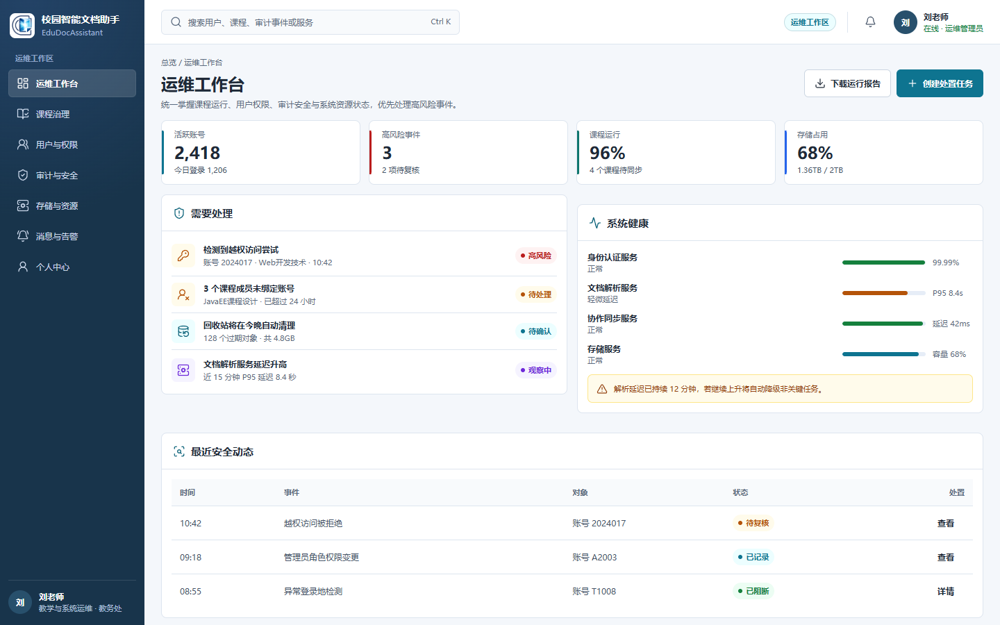

### 02 课程治理

- 页面 ID：`courses`
- 分组：教学治理
- 页面说明：统一维护课程状态、成员规模、模板关联和教学运行指标。
- 预览图：[02_courses.png](../staff/previews/operations/02_courses.png)

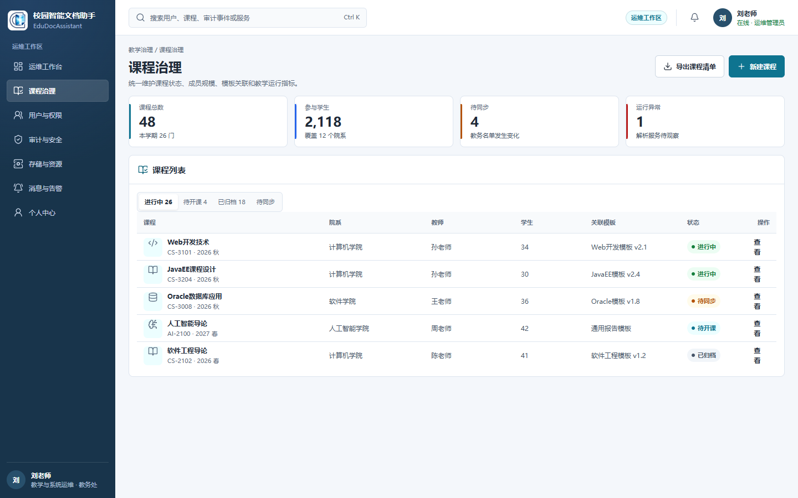

### 03 课程详情

- 页面 ID：`course-detail`
- 分组：教学治理
- 页面说明：查看课程基础信息、教师和学生规模、模板关联及最近运行状态。
- 预览图：[03_course-detail.png](../staff/previews/operations/03_course-detail.png)

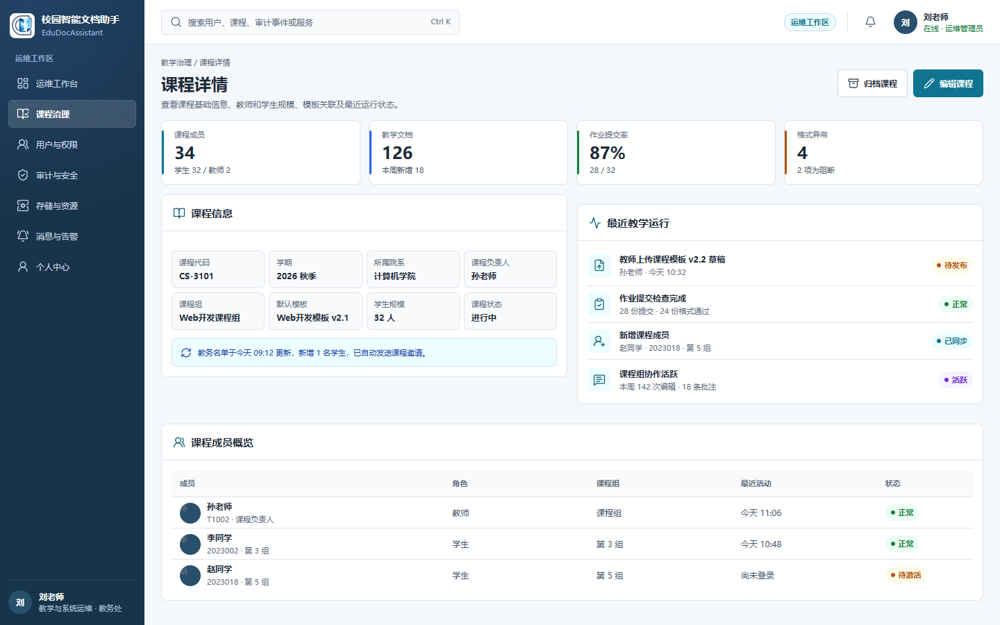

### 04 新建课程

- 页面 ID：`create-course`
- 分组：教学治理
- 页面说明：创建课程空间并配置学期、院系、课程负责人和默认教学模板。
- 预览图：[04_create-course.png](../staff/previews/operations/04_create-course.png)

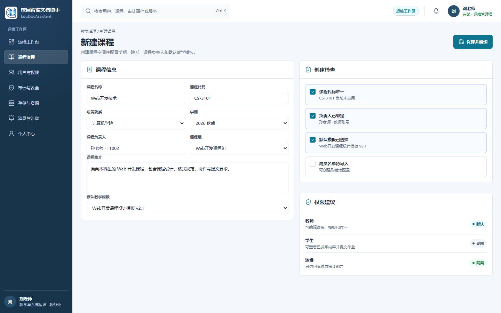

### 05 成员导入

- 页面 ID：`members`
- 分组：教学治理
- 页面说明：同步教务课程名单，统一处理账号绑定、课程组和角色映射。
- 预览图：[05_members.png](../staff/previews/operations/05_members.png)

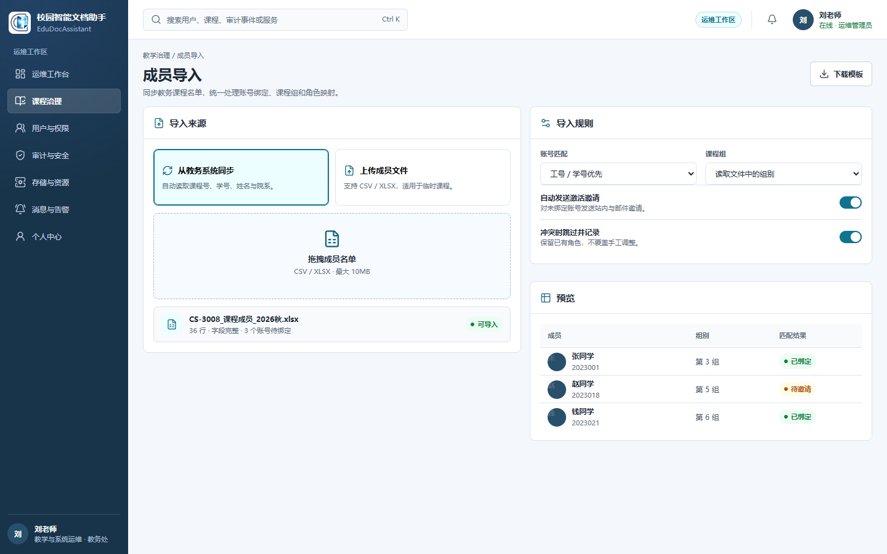

### 06 归档课程确认

- 页面 ID：`archive-course`
- 分组：教学治理
- 页面说明：确认归档范围、数据保留和成员访问变化。归档后课程进入只读状态。
- 预览图：[06_archive-course.png](../staff/previews/operations/06_archive-course.png)

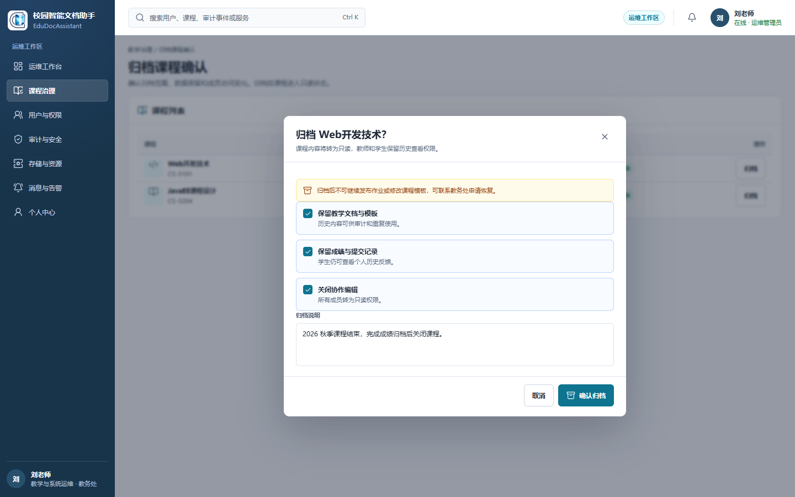

### 07 用户目录

- 页面 ID：`users`
- 分组：用户与权限
- 页面说明：管理教师、学生、课程组和运维账号，查看身份状态与授权范围。
- 预览图：[07_users.png](../staff/previews/operations/07_users.png)

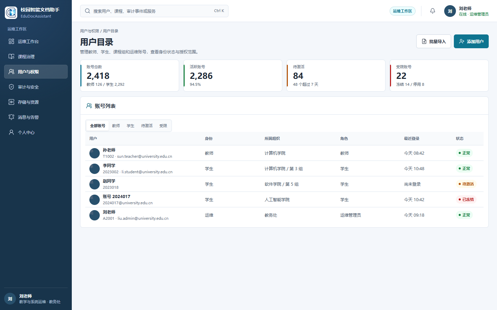

### 08 用户权限详情

- 页面 ID：`user-detail`
- 分组：用户与权限
- 页面说明：查看账号身份、授权来源、课程范围和最近访问记录。
- 预览图：[08_user-detail.png](../staff/previews/operations/08_user-detail.png)

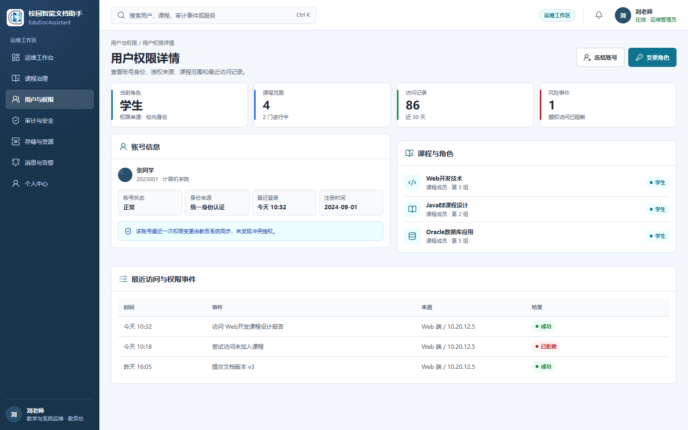

### 09 添加用户

- 页面 ID：`add-user`
- 分组：用户与权限
- 页面说明：为教师、学生或运维人员创建账号，绑定组织、角色和初始访问范围。
- 预览图：[09_add-user.png](../staff/previews/operations/09_add-user.png)

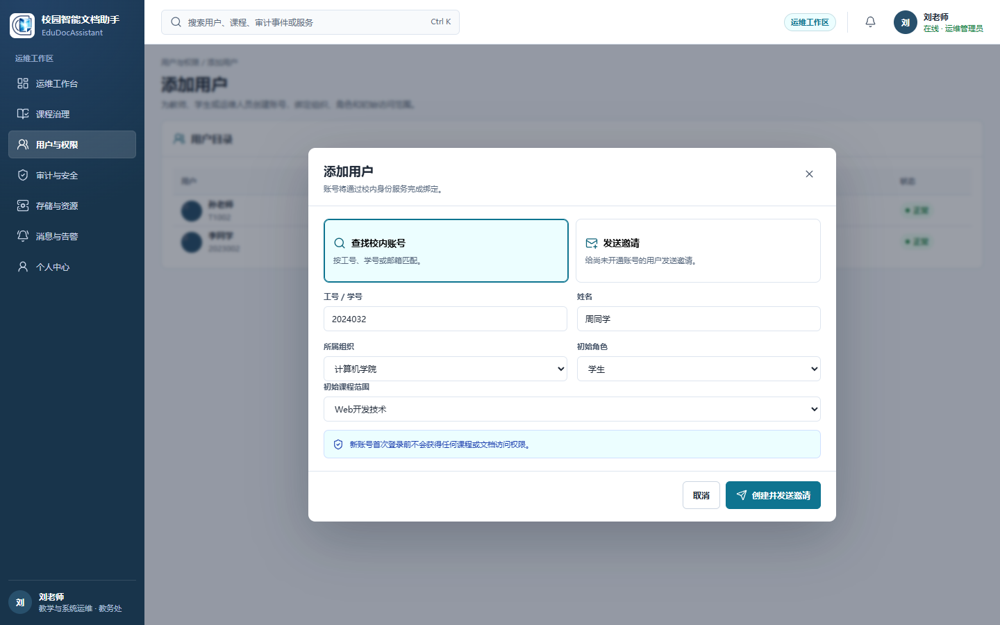

### 10 角色权限矩阵

- 页面 ID：`roles`
- 分组：用户与权限
- 页面说明：维护教师、学生和运维角色的权限边界，识别过度授权与职责冲突。
- 预览图：[10_roles.png](../staff/previews/operations/10_roles.png)

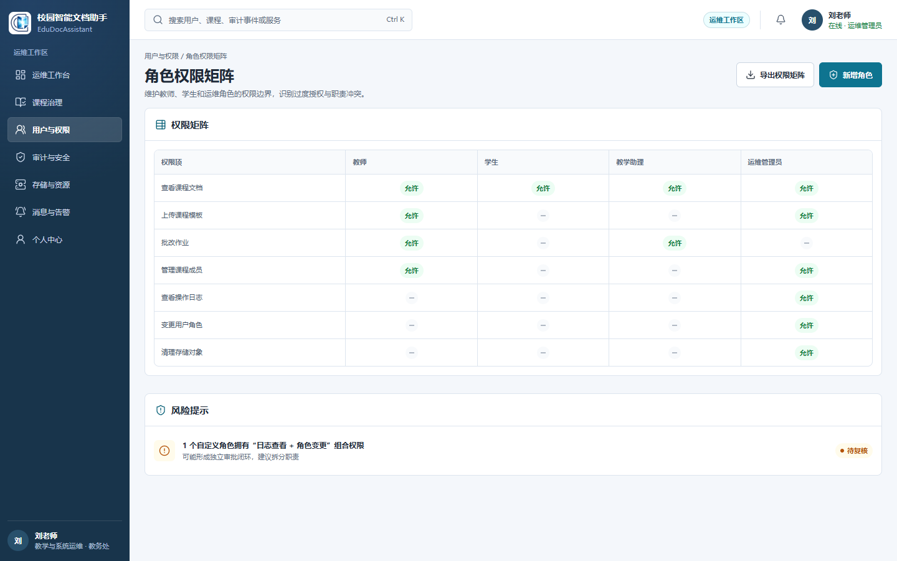

### 11 新增角色

- 页面 ID：`create-role`
- 分组：用户与权限
- 页面说明：定义角色用途、授权范围和权限项，提交前执行职责冲突检查。
- 预览图：[11_create-role.png](../staff/previews/operations/11_create-role.png)

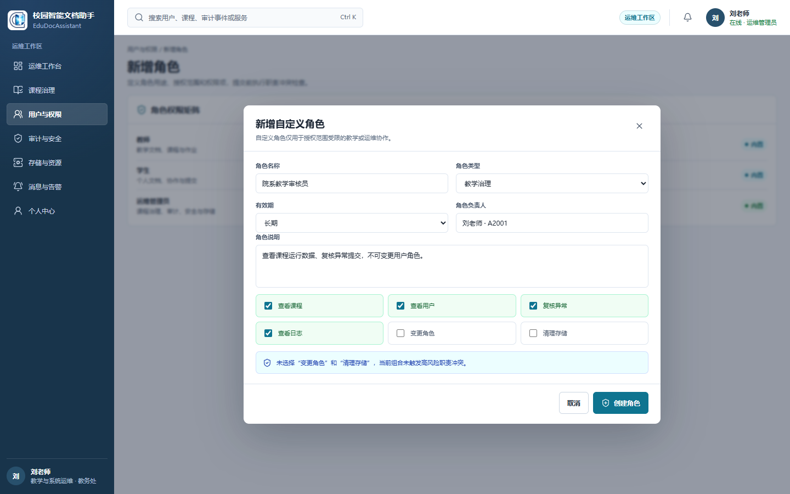

### 12 变更用户角色

- 页面 ID：`change-role`
- 分组：用户与权限
- 页面说明：确认角色变更范围、生效时间和影响，变更会立即写入审计日志。
- 预览图：[12_change-role.png](../staff/previews/operations/12_change-role.png)

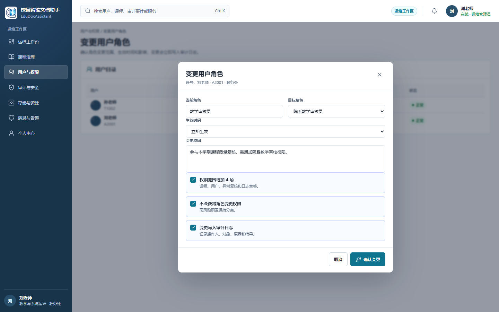

### 13 访问策略

- 页面 ID：`access-policy`
- 分组：审计与安全
- 页面说明：配置统一身份认证、课程访问、会话安全和敏感操作验证策略。
- 预览图：[13_access-policy.png](../staff/previews/operations/13_access-policy.png)

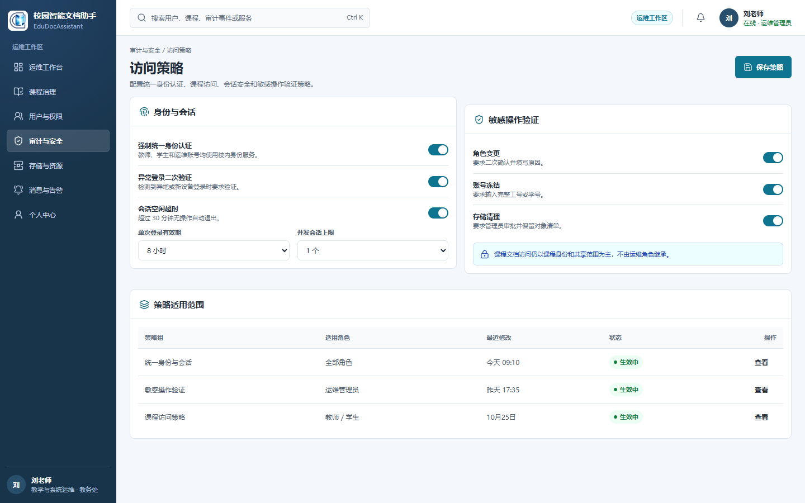

### 14 权限冲突复核

- 页面 ID：`conflicts`
- 分组：审计与安全
- 页面说明：识别职责分离冲突、重复授权和过期临时权限，并记录处理结论。
- 预览图：[14_conflicts.png](../staff/previews/operations/14_conflicts.png)

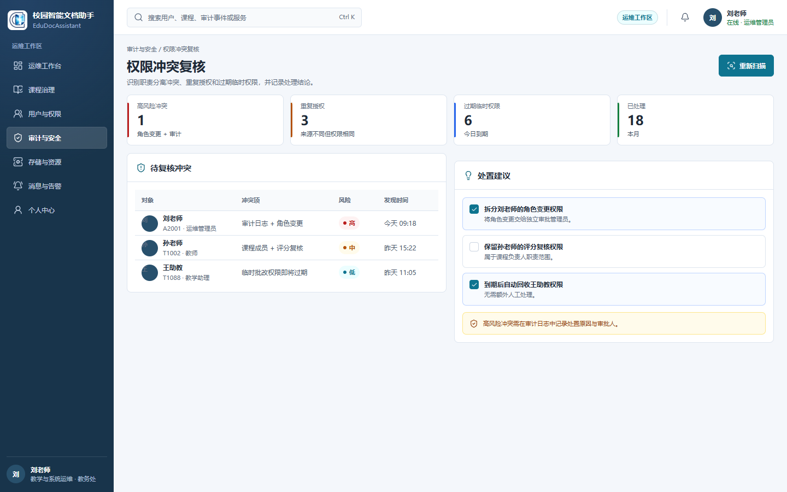

### 15 操作日志

- 页面 ID：`audit`
- 分组：审计与安全
- 页面说明：检索账号、课程、文档、权限和系统级操作，定位异常访问与关键变更。
- 预览图：[15_audit.png](../staff/previews/operations/15_audit.png)

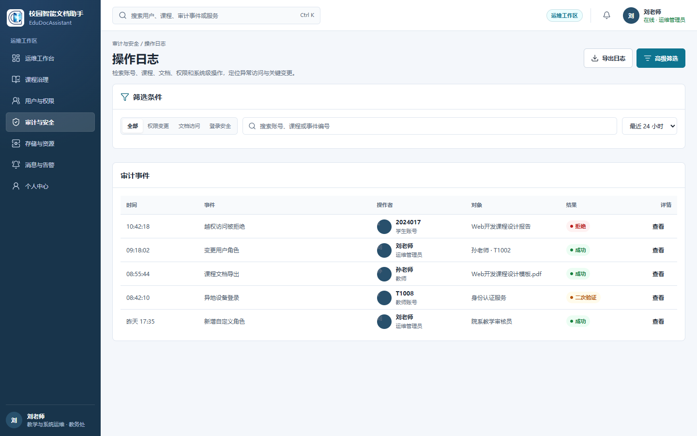

### 16 审计事件详情

- 页面 ID：`audit-detail`
- 分组：审计与安全
- 页面说明：查看事件完整链路、请求上下文、影响对象和处置建议。
- 预览图：[16_audit-detail.png](../staff/previews/operations/16_audit-detail.png)

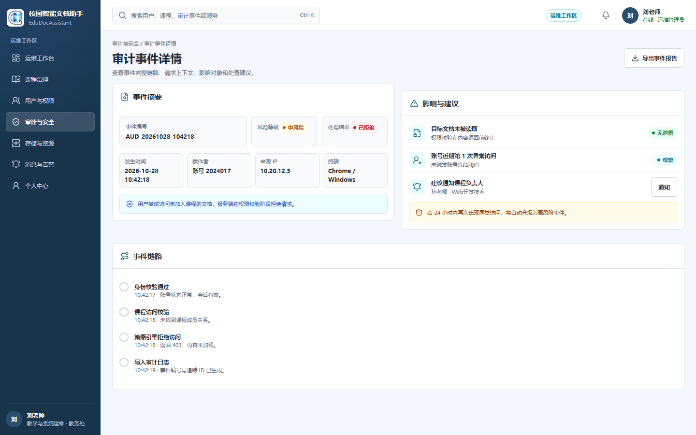

### 17 异常复核

- 页面 ID：`anomaly`
- 分组：审计与安全
- 页面说明：根据访问频率、权限边界和登录风险复核异常行为，记录处置结论。
- 预览图：[17_anomaly.png](../staff/previews/operations/17_anomaly.png)

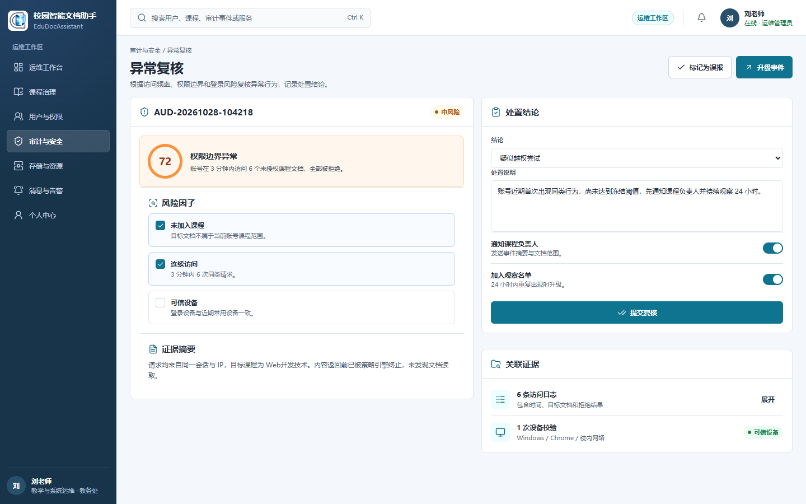

### 18 安全事件中心

- 页面 ID：`security`
- 分组：审计与安全
- 页面说明：实时汇总登录风险、越权尝试、异常导出和账号处置事件。
- 预览图：[18_security.png](../staff/previews/operations/18_security.png)

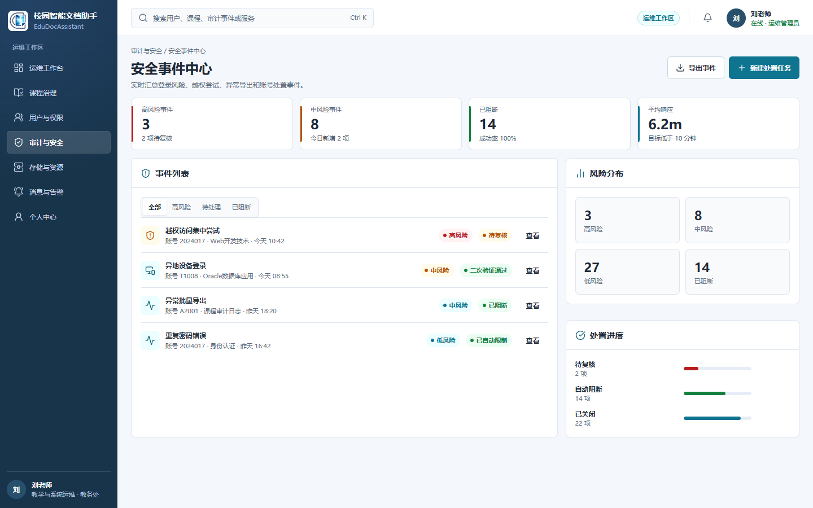

### 19 安全事件详情

- 页面 ID：`security-detail`
- 分组：审计与安全
- 页面说明：查看事件时间线、命中规则、受影响资源和应急处置操作。
- 预览图：[19_security-detail.png](../staff/previews/operations/19_security-detail.png)

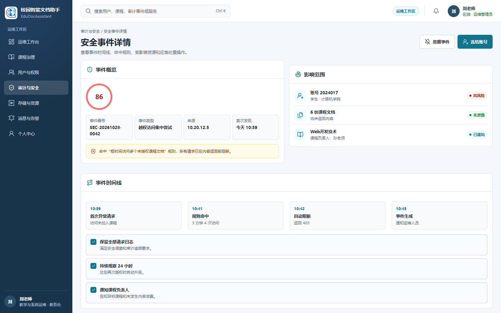

### 20 冻结账号确认

- 页面 ID：`freeze-account`
- 分组：审计与安全
- 页面说明：执行账号冻结前确认影响范围、会话终止和恢复方式。
- 预览图：[20_freeze-account.png](../staff/previews/operations/20_freeze-account.png)

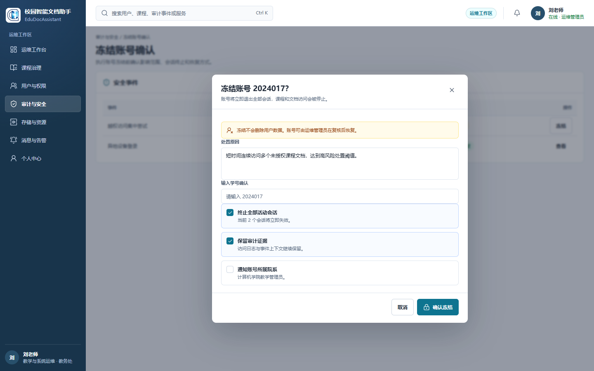

### 21 存储与回收站

- 页面 ID：`storage`
- 分组：存储与资源
- 页面说明：查看团队存储、过期对象和回收站容量，安排安全清理与恢复。
- 预览图：[21_storage.png](../staff/previews/operations/21_storage.png)

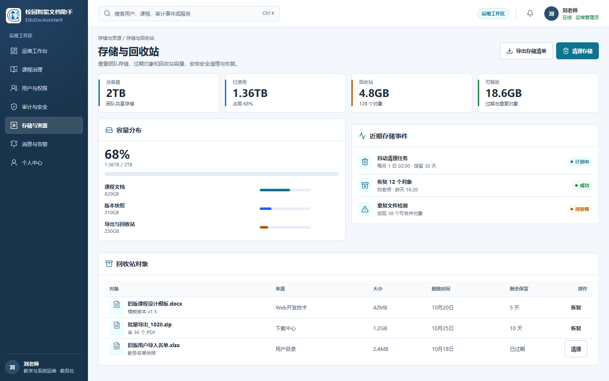

### 22 存储清理确认

- 页面 ID：`cleanup`
- 分组：存储与资源
- 页面说明：确认清理对象、保留期和恢复窗口。永久删除后不可恢复。
- 预览图：[22_cleanup.png](../staff/previews/operations/22_cleanup.png)

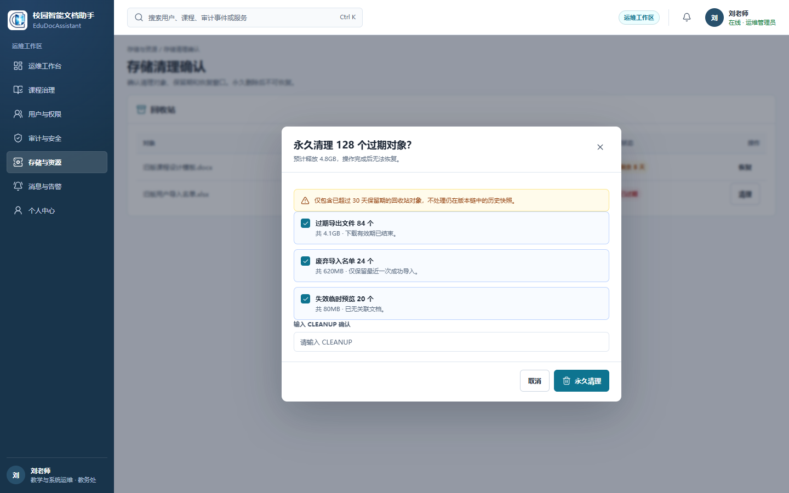

### 23 系统服务状态

- 页面 ID：`services`
- 分组：存储与资源
- 页面说明：监控身份认证、文档解析、协作同步、存储与通知服务的可用性和延迟。
- 预览图：[23_services.png](../staff/previews/operations/23_services.png)

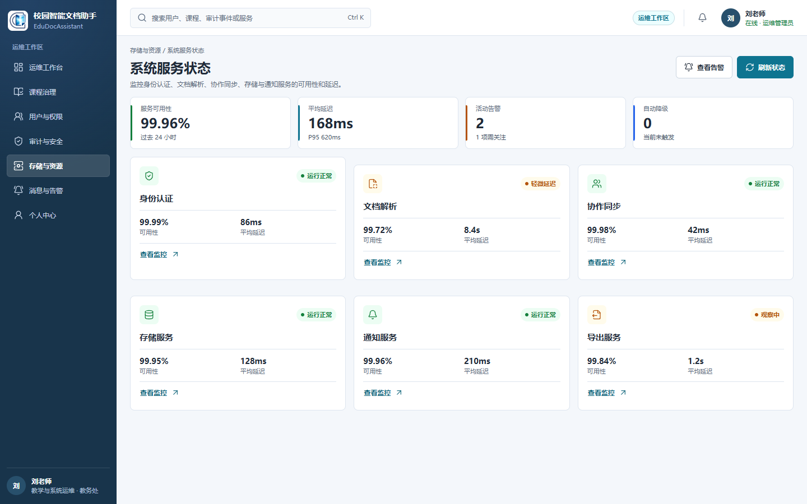

### 24 配置变更记录

- 页面 ID：`config-changes`
- 分组：存储与资源
- 页面说明：追踪影响系统运行和访问控制的配置变更，查看审批人与回滚范围。
- 预览图：[24_config-changes.png](../staff/previews/operations/24_config-changes.png)

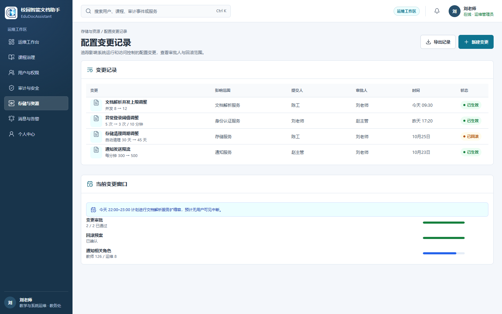

### 25 消息与告警

- 页面 ID：`messages`
- 分组：消息与个人中心
- 页面说明：集中处理系统告警、权限变更、课程治理和审批通知。
- 预览图：[25_messages.png](../staff/previews/operations/25_messages.png)

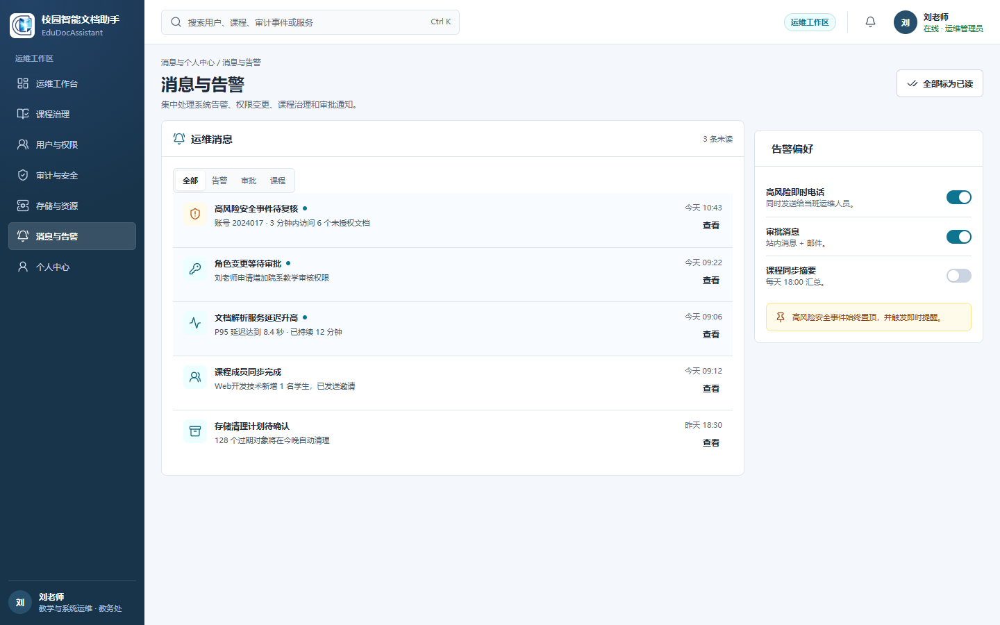

### 26 个人资料

- 页面 ID：`profile`
- 分组：消息与个人中心
- 页面说明：维护运维账号的组织信息、联系方式和个人通知偏好。
- 预览图：[26_profile.png](../staff/previews/operations/26_profile.png)

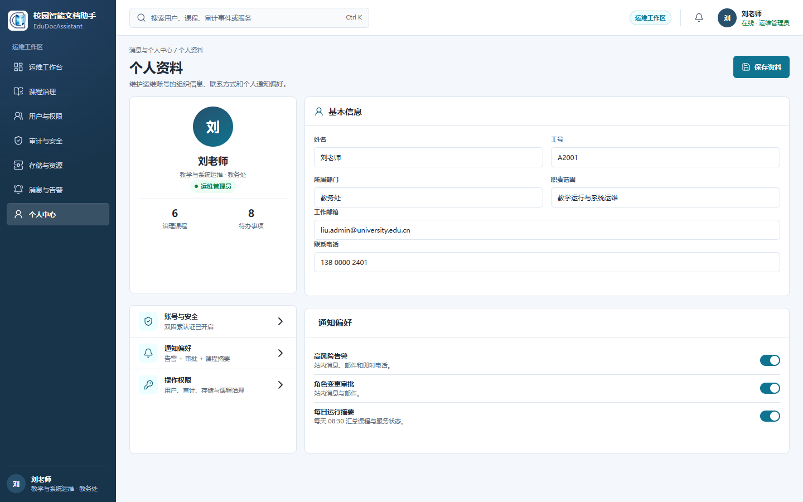

### 27 账号与安全

- 页面 ID：`account`
- 分组：消息与个人中心
- 页面说明：管理运维账号的双因素认证、会话、登录记录和敏感操作验证。
- 预览图：[27_account.png](../staff/previews/operations/27_account.png)

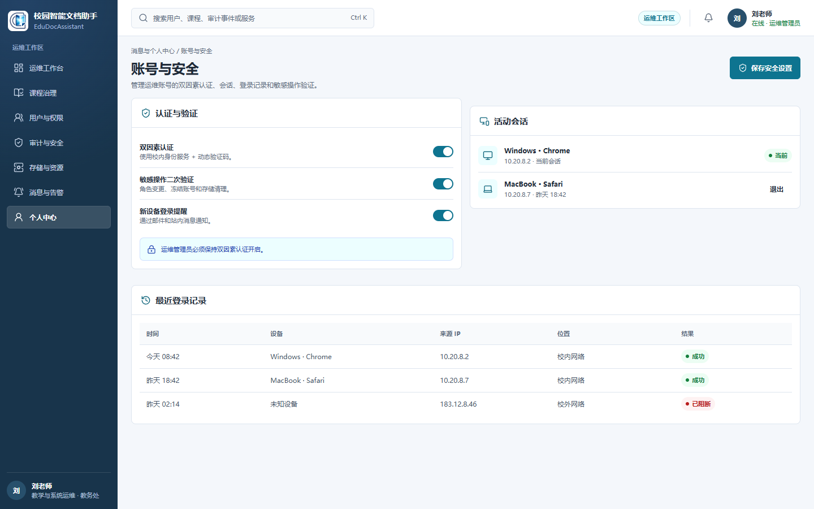
