### 01 教学工作台

- 页面 ID：`workbench`
- 分组：教学总览
- 页面说明：汇总课程、模板、作业和文档协作状态，优先处理临近截止的批改与发布任务。
- 预览图：[01_workbench.png](../staff/previews/teacher/01_workbench.png)

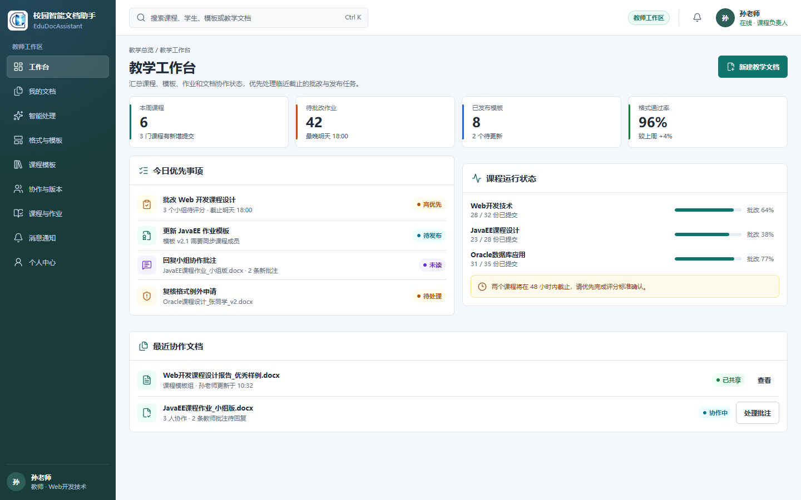

### 02 我的教学文档

- 页面 ID：`documents`
- 分组：文档接入
- 页面说明：管理本人创建和课程共享的教学文档，按课程、协作状态与格式风险筛选。
- 预览图：[02_documents.png](../staff/previews/teacher/02_documents.png)

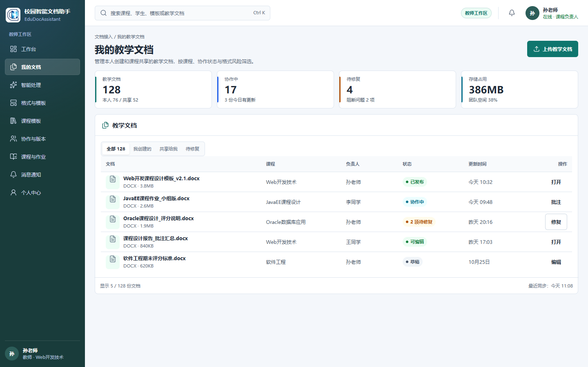

### 03 上传教学文档

- 页面 ID：`upload`
- 分组：文档接入
- 页面说明：绑定课程与用途，选择解析和权限策略。上传后可在当前页查看校验与处理状态。
- 预览图：[03_upload.png](../staff/previews/teacher/03_upload.png)

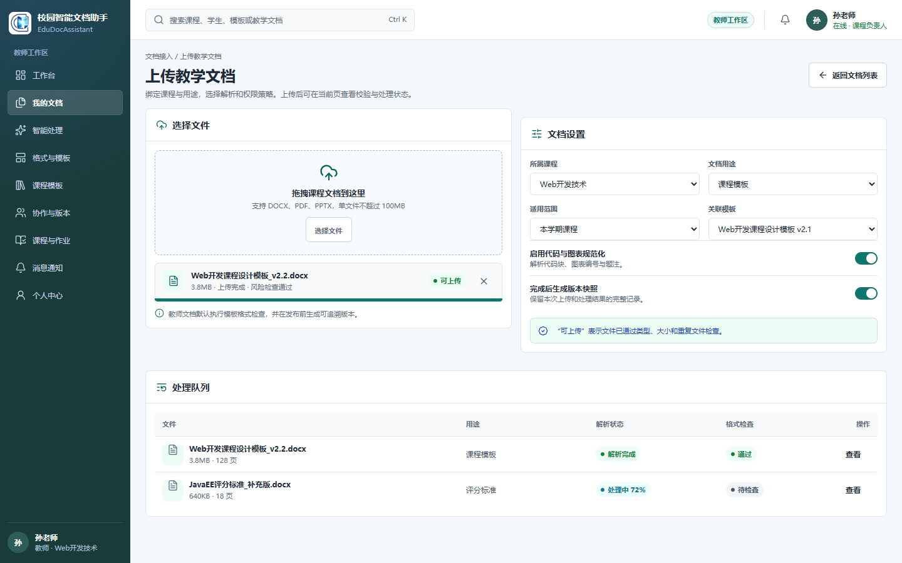

### 04 文档预览

- 页面 ID：`preview`
- 分组：文档接入
- 页面说明：检查解析结果、文档结构与教学批注，并进入智能处理或格式检查。
- 预览图：[04_preview.png](../staff/previews/teacher/04_preview.png)

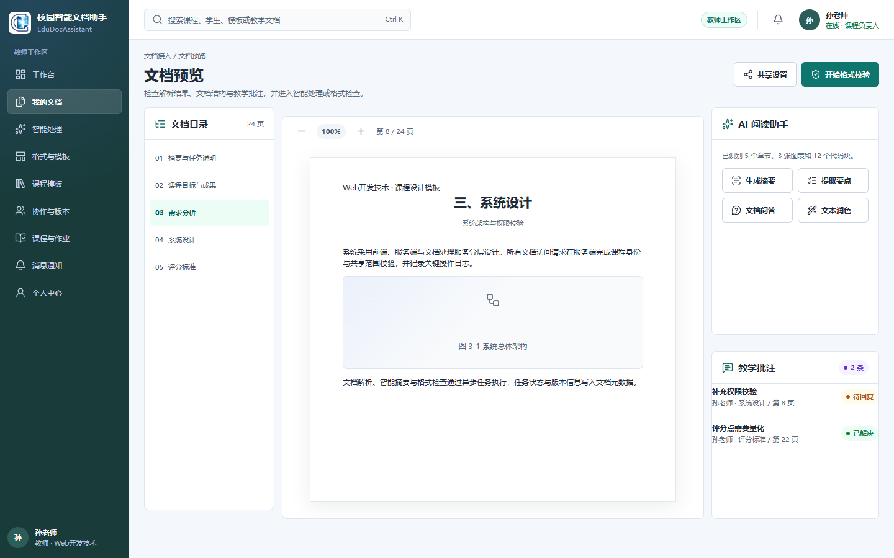

### 05 文本摘要

- 页面 ID：`summary`
- 分组：智能处理
- 页面说明：为教学文档生成可引用的结构化摘要，并保留原文出处供批注和评分使用。
- 预览图：[05_summary.png](../staff/previews/teacher/05_summary.png)

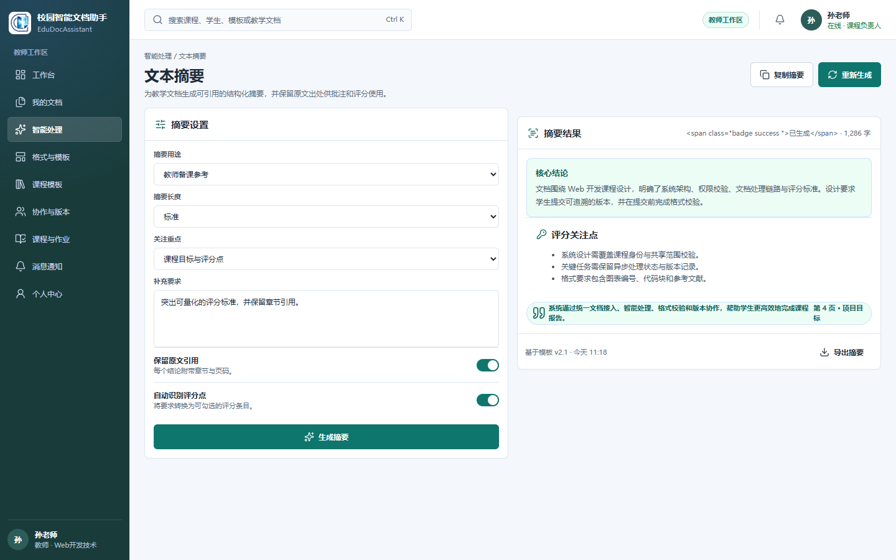

### 06 要点提取

- 页面 ID：`keypoints`
- 分组：智能处理
- 页面说明：将文档要求转化为可勾选的教学检查项，用于备课、批注和评分标准核对。
- 预览图：[06_keypoints.png](../staff/previews/teacher/06_keypoints.png)

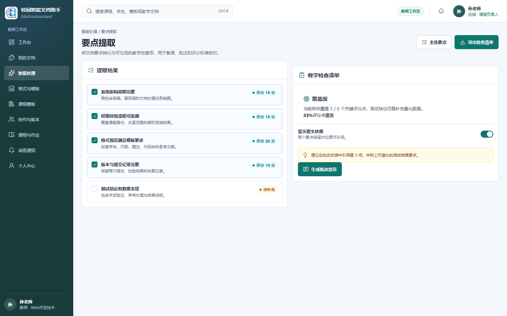

### 07 文档问答

- 页面 ID：`qa`
- 分组：智能处理
- 页面说明：围绕当前教学文档提问，回答仅引用文档内有依据的章节。
- 预览图：[07_qa.png](../staff/previews/teacher/07_qa.png)

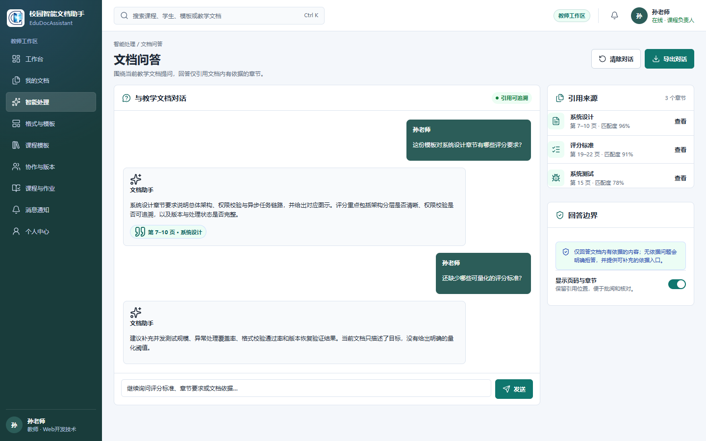

### 08 文本润色

- 页面 ID：`polish`
- 分组：智能处理
- 页面说明：在保留原意和引用关系的前提下优化教学说明，逐段比较并选择性采纳。
- 预览图：[08_polish.png](../staff/previews/teacher/08_polish.png)

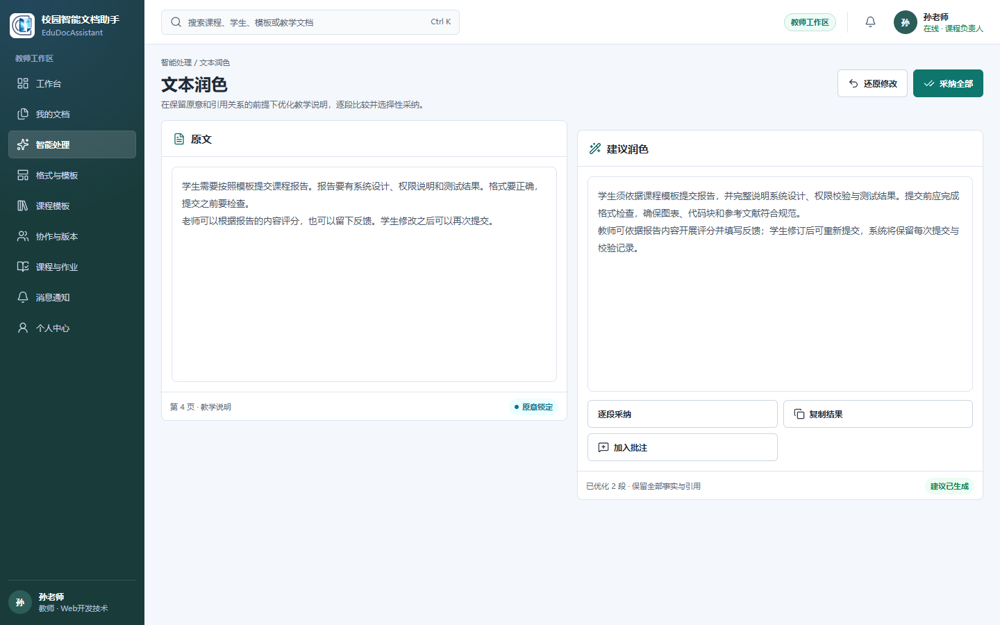

### 09 课程模板库

- 页面 ID：`templates`
- 分组：格式与模板
- 页面说明：维护课程模板、格式规则和版本状态，并控制模板在学生端的可用范围。
- 预览图：[09_templates.png](../staff/previews/teacher/09_templates.png)

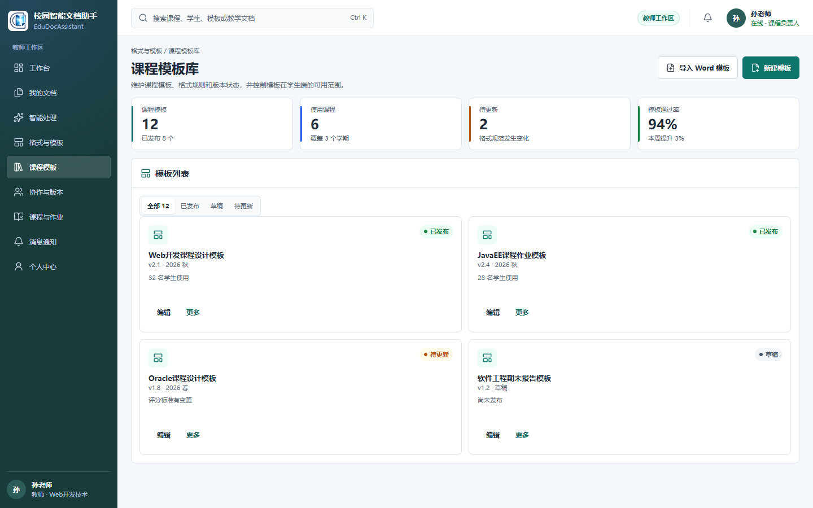

### 10 编辑课程模板

- 页面 ID：`template-editor`
- 分组：格式与模板
- 页面说明：调整章节结构、格式规则和评分要求，右侧预览会同步展示学生端效果。
- 预览图：[10_template-editor.png](../staff/previews/teacher/10_template-editor.png)

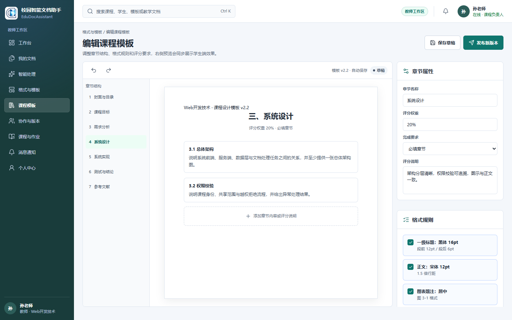

### 11 发布模板确认

- 页面 ID：`template-publish`
- 分组：格式与模板
- 页面说明：确认版本、适用范围和变更说明。发布后将同步到关联课程的学生端。
- 预览图：[11_template-publish.png](../staff/previews/teacher/11_template-publish.png)

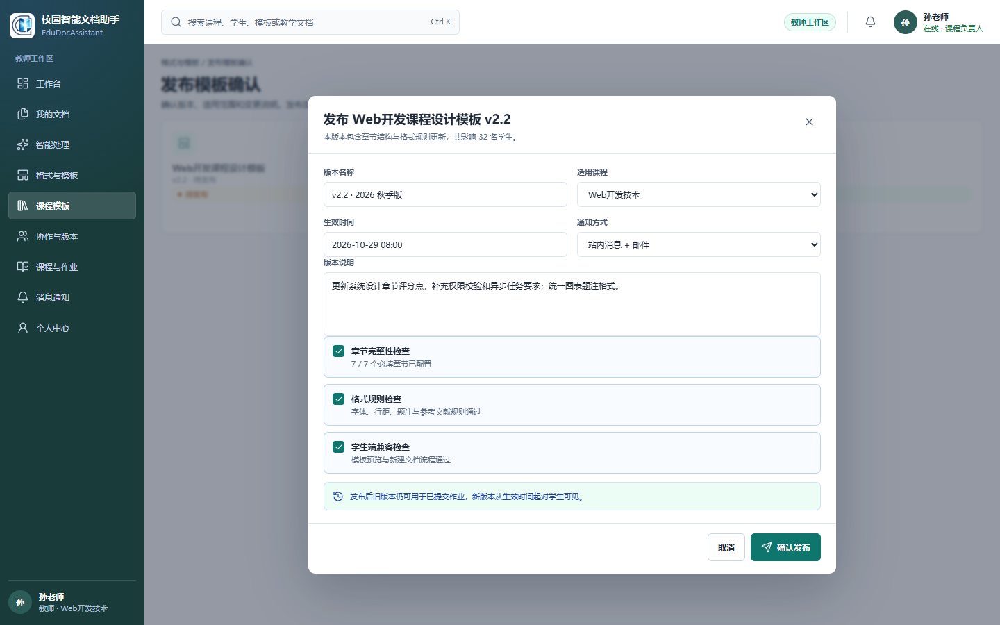

### 12 格式规范校验

- 页面 ID：`format-check`
- 分组：格式与模板
- 页面说明：按课程模板检查字体、字号、行距、页边距、题注、代码块和参考文献。
- 预览图：[12_format-check.png](../staff/previews/teacher/12_format-check.png)

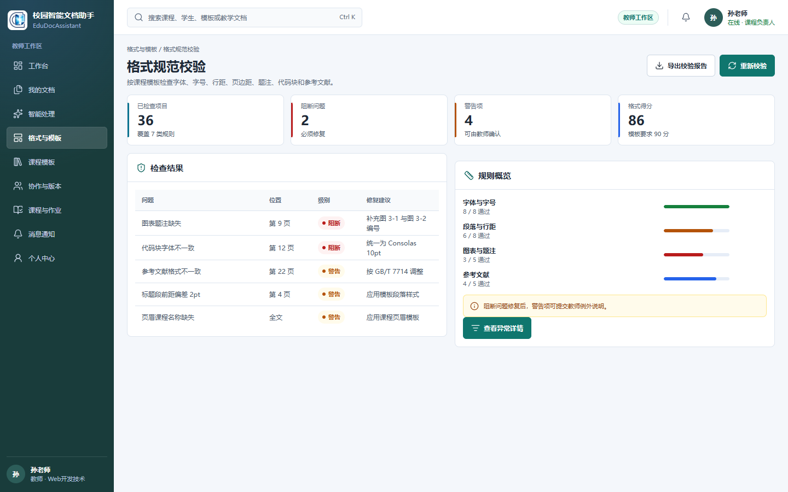

### 13 一键修复确认

- 页面 ID：`autofix`
- 分组：格式与模板
- 页面说明：选择要自动修复的格式问题，确认影响范围后生成新的文档版本。
- 预览图：[13_autofix.png](../staff/previews/teacher/13_autofix.png)

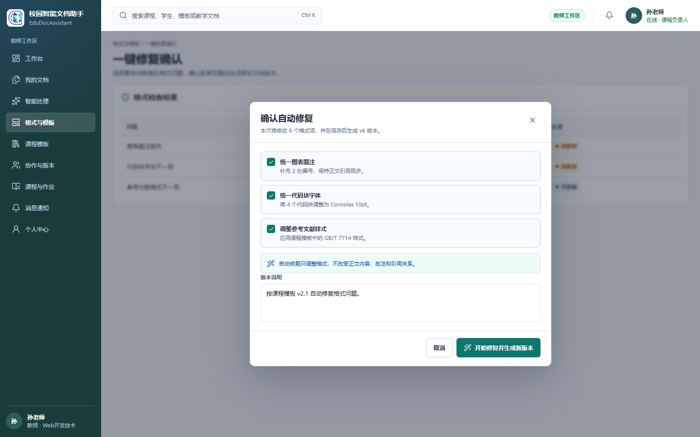

### 14 格式转换

- 页面 ID：`convert`
- 分组：格式与模板
- 页面说明：将教学文档转换为可分发格式，使用标准 A4 预览检查分页与页眉页脚。
- 预览图：[14_convert.png](../staff/previews/teacher/14_convert.png)

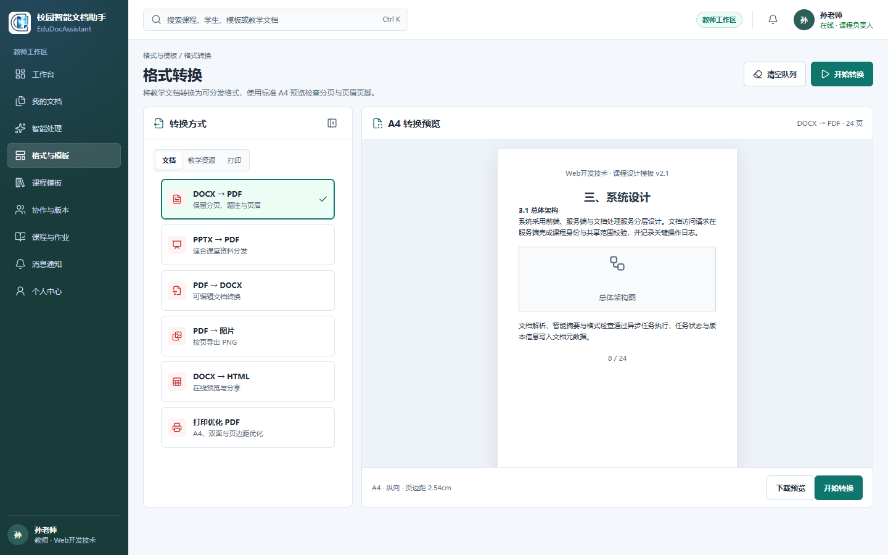

### 15 协作编辑

- 页面 ID：`collaborate`
- 分组：协作与版本
- 页面说明：与课程组成员共同维护文档，集中查看教师批注、编辑活动和当前版本状态。
- 预览图：[15_collaborate.png](../staff/previews/teacher/15_collaborate.png)

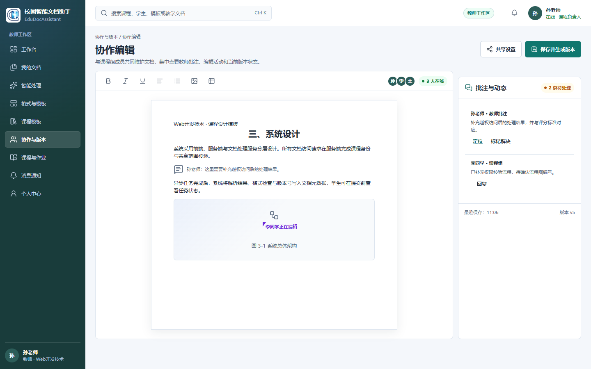

### 16 版本记录

- 页面 ID：`versions`
- 分组：协作与版本
- 页面说明：查看课程模板与教学文档的版本链、提交说明、处理状态和恢复入口。
- 预览图：[16_versions.png](../staff/previews/teacher/16_versions.png)

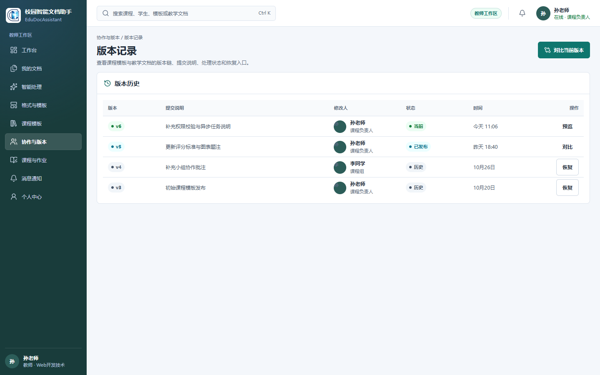

### 17 版本对比

- 页面 ID：`compare`
- 分组：协作与版本
- 页面说明：比较两个版本的内容、结构与格式规则变化，确认恢复或合并范围。
- 预览图：[17_compare.png](../staff/previews/teacher/17_compare.png)

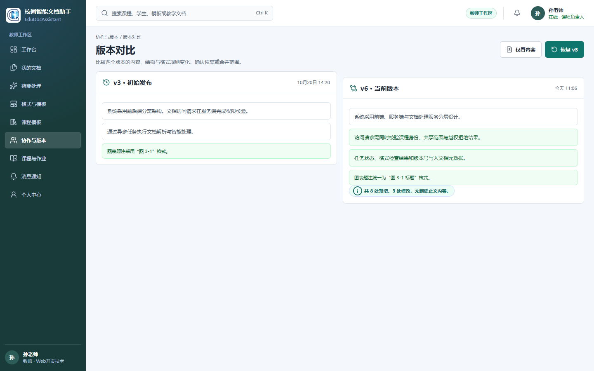

### 18 恢复版本确认

- 页面 ID：`restore`
- 分组：协作与版本
- 页面说明：将历史版本恢复为新的当前版本，原版本链与批注记录保持可追溯。
- 预览图：[18_restore.png](../staff/previews/teacher/18_restore.png)

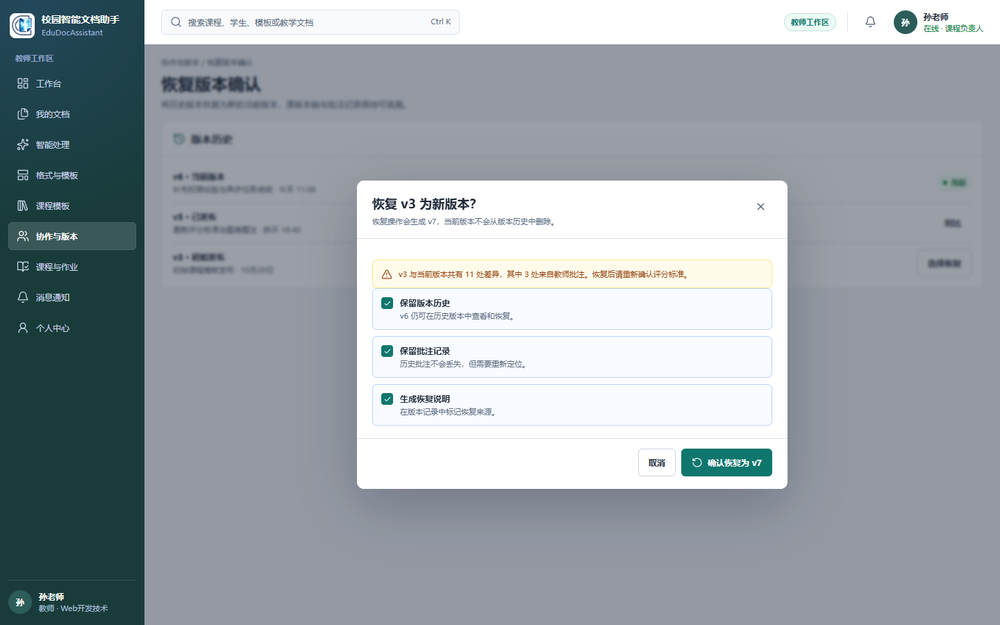

### 19 共享设置

- 页面 ID：`share`
- 分组：协作与版本
- 页面说明：控制课程组成员、协作者和外部链接的访问范围，并保留权限变更记录。
- 预览图：[19_share.png](../staff/previews/teacher/19_share.png)

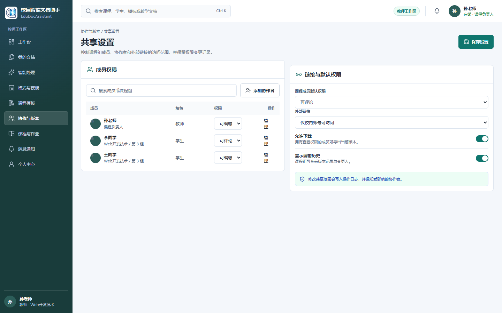

### 20 课程管理

- 页面 ID：`courses`
- 分组：课程与作业
- 页面说明：维护本学期课程、课程成员和教学文档关联，查看作业运行状态。
- 预览图：[20_courses.png](../staff/previews/teacher/20_courses.png)

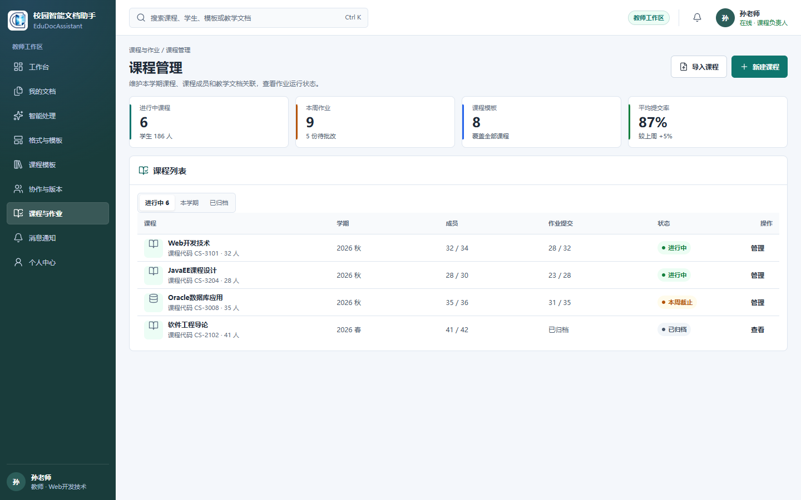

### 21 新建课程

- 页面 ID：`create-course`
- 分组：课程与作业
- 页面说明：创建课程空间，设置学期、课程组和默认文档权限。
- 预览图：[21_create-course.png](../staff/previews/teacher/21_create-course.png)

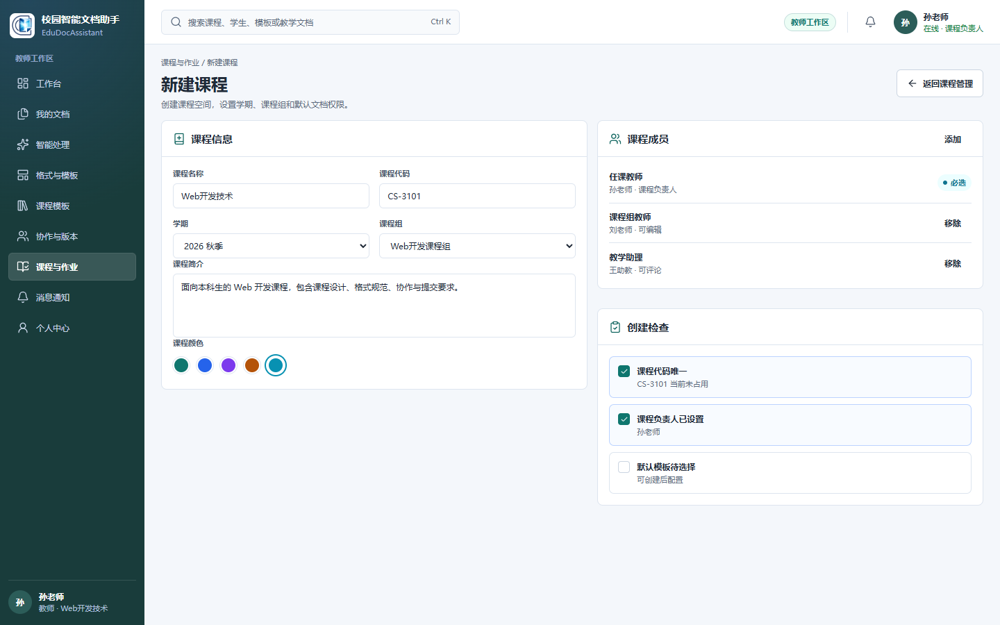

### 22 课程成员导入

- 页面 ID：`members`
- 分组：课程与作业
- 页面说明：从教务名单或 CSV 文件导入课程成员，映射学号、姓名和组别。
- 预览图：[22_members.png](../staff/previews/teacher/22_members.png)

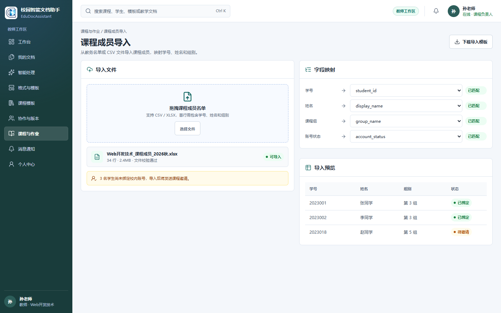

### 23 作业与提交统计

- 页面 ID：`assignments`
- 分组：课程与作业
- 页面说明：跟踪作业提交、格式检查、评分进度和课程组状态，定位需要提醒的学生。
- 预览图：[23_assignments.png](../staff/previews/teacher/23_assignments.png)

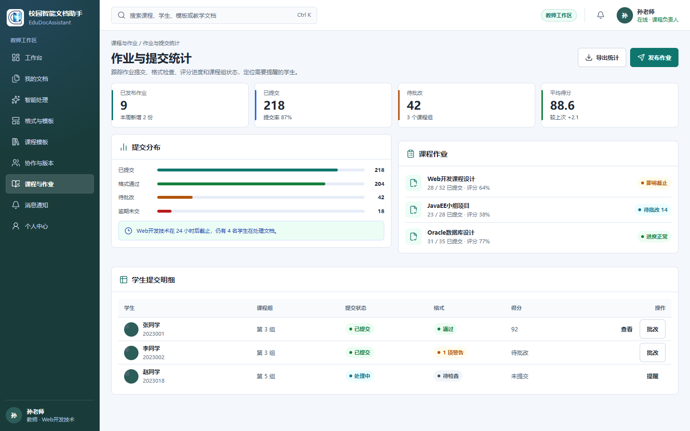

### 24 发布作业

- 页面 ID：`publish-assignment`
- 分组：课程与作业
- 页面说明：配置作业要求、截止时间、提交格式和评分标准，发布前完成学生端预览。
- 预览图：[24_publish-assignment.png](../staff/previews/teacher/24_publish-assignment.png)

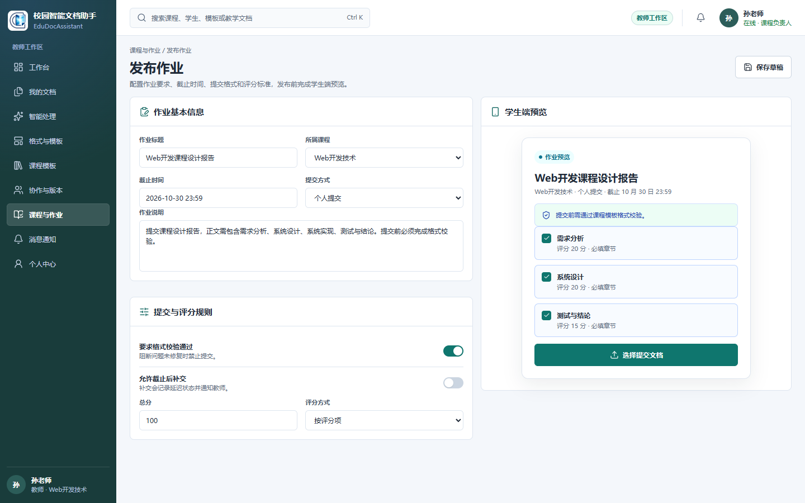

### 25 批改与反馈

- 页面 ID：`grade`
- 分组：课程与作业
- 页面说明：对照提交内容与评分标准完成评分，学生可在消息中心查看教师反馈。
- 预览图：[25_grade.png](../staff/previews/teacher/25_grade.png)

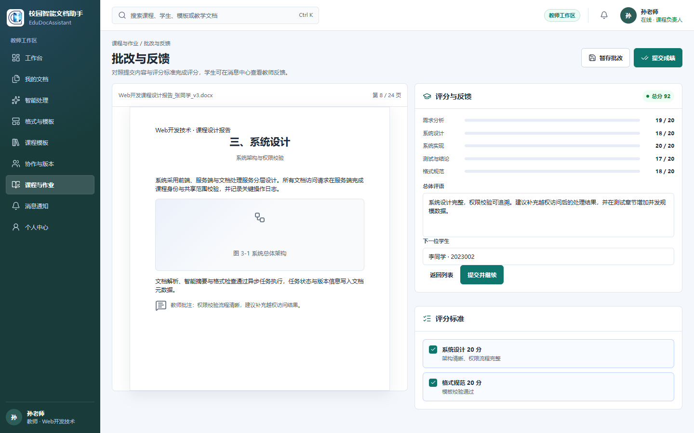

### 26 消息中心

- 页面 ID：`messages`
- 分组：消息与个人中心
- 页面说明：集中查看课程组更新、学生提交、格式异常和系统通知。
- 预览图：[26_messages.png](../staff/previews/teacher/26_messages.png)

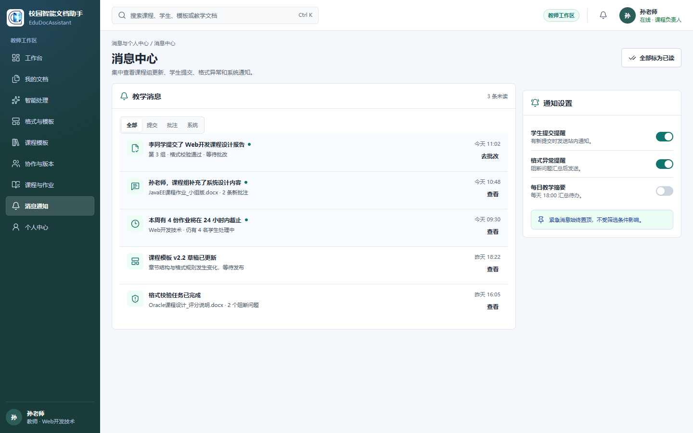

### 27 个人资料

- 页面 ID：`profile`
- 分组：消息与个人中心
- 页面说明：维护教师账号资料、工作院系、通知偏好和账号安全设置。
- 预览图：[27_profile.png](../staff/previews/teacher/27_profile.png)

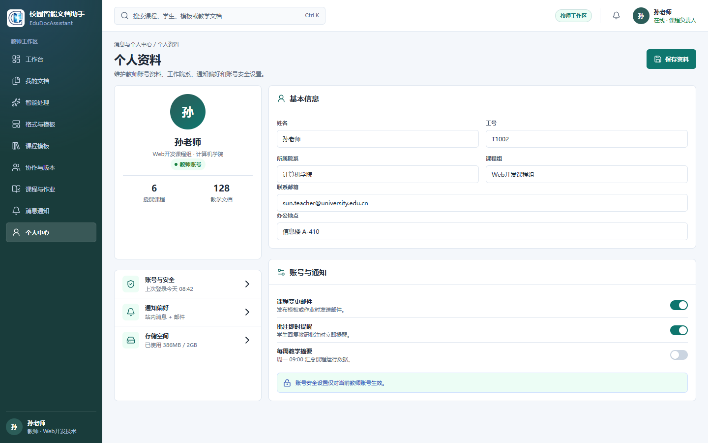
