# 需求规格说明书

> 文件编号：CIDAS-S000 ｜ 版本：1.1.0-0.0.0 ｜ 发布日期：2026-09-18
>
> 来源文件：02_需求规格说明/需求规格说明书.docx

文件编号：CIDAS-S000
面向师生的校园智能文档辅助系统
需求规格说明书
版本：1.1.0-0.0.0
2026-09-18
文件修改控制

| 修改编号 | 版本 | 修改条款及内容 | 修改日期 |
| --- | --- | --- | --- |
| 1 | 1.0.0-0.0.0 | 创建 | 2026-09-18 |
| 2 | 1.0.0-0.0.0 | 第 5 章补充原型页面截图 | 2026-09-19 |
| 3 | 1.0.0-0.0.0 | 统一接口编号与移动端口径 | 2026-09-19 |
| 4 | 1.0.0-0.0.0 | 补充目标群体说明、可行性结论与主要风险，并同步待确认事项的影响范围 | 2026-10-16 |
| 5 | 1.1.0-0.0.0 | 同步三角色原型：角色模型合并为运维端，调整文档操作与回收站口径，标注 REQ-07 未实现 | 2026-10-30 |

# 1 引言
## 1.1 标识
本文档适用的系统为面向师生的校园智能文档辅助系统（英文全称 Campus Intelligent Document Assistant System，缩写 CIDAS，产品 UI 昵称 EduDocAssistant）。文档编号为 CIDAS-S000，版本号为 1.0.0-0.0.0，发布日期为 2026-09-18。编写单位为项目组，使用对象为项目组成员、指导教师与课程评审人员。
## 1.2 系统概述
本系统是一套面向高校师生的 Web 应用，部署在学校服务器或校园云上，用于课件、作业、论文与课程报告等文档的接入、智能处理、格式规范、协作与权限管理。系统按业务功能分为文档接入、智能处理、格式与模板、协作与版本、权限与审计、导出与统计六类模块，使用对象包括学生、教师与运维人员（教学管理员与系统运维合并）。
系统由项目组自行开发，运行在校园网环境内，与学校统一身份认证、教务系统之间以接口方式衔接。涉及档案与个人信息的数据全部存储在国内服务器，按最小权限原则访问并保留操作日志。题面关键词的逐项拆解与目标群体画像见《需求陈述说明书》1.3 与 1.4，可行性结论与主要风险见本文档 3.6。
## 1.3 文档概述
本文档在《需求陈述说明书》确定的调研结论与需求条目基础上，给出可设计、可开发、可测试的需求规格。文档共十三章：第 1 至 3 章给出标识、引用文件、总体描述与可行性结论，第 4 章给出业务流程，第 5 章按模块与功能点给出功能需求，第 6 至 10 章给出外部接口、性能、设计约束、软件系统属性与数据需求，第 11 至 13 章给出合格性规定、需求可追踪性与待确认事项。
第 5 章中每个功能点按【页面效果】【应用场景】【操作描述】【对应需求】四部分描述，其中页面效果为桌面端原型的页面截图（原型文件见 03_页面原型）。本文档为内部使用文档，涉及受访者信息的内容已做匿名处理，不得对外发布。
## 1.4 基线
本文档的编写基线为《需求陈述说明书》（版本 1.0.0-0.0.0，2026-09-17）及其记录的调研证据 E01 至 E04。基线变更时，需同步更新本文档对应章节中的需求描述、合格性规定与追溯关系，并记录在文件修改控制表中。
# 2 引用文件
本文档引用下列文件：
- GB/T 8567-2006 计算机软件文档编制规范；
- GB/T 9385-2008 计算机软件需求规格说明规范；
- 面向师生的校园智能文档辅助系统 需求陈述说明书（版本 1.0.0-0.0.0）；
- 《软件工程》项目式教学需求调研收集表 ；
- 师生日常文档使用情况与痛点调查问卷及分析报告（有效样本 200 份）；
- 四门课程设计报告模板对比批注分析（Web 开发、C 语言、JavaEE、Oracle 四份模板）。
# 3 总体描述
## 3.1 产品目标与应用范围
系统的建设目标有四项。第一，减少格式返工：通过课程模板库、提交前格式校验与图表自动编号，把格式规范的执行从人工检查转为系统检查。第二，把智能处理引入日常文档工作：对上传的课件、作业与论文提供摘要、要点提取、文档问答与文本润色，并保证处理结果可追溯到原文。第三，统一权限与留痕：按角色控制文档的查看、编辑与下载范围，完整记录文档操作。第四，支撑教学协同：教师发布作业与模板、学生按课程提交、教师查看提交情况，减少在教学平台与表格之间的人工核对。
系统适用于高校院系、课程组与教学管理部门的文档处理与教学协同场景，尤其是课程报告、课程设计文档与毕业论文等格式规范明确、批改量大的场景。系统不承担教学过程管理职能，不处理涉密文档，也不提供离线部署方式。
## 3.2 产品功能
系统按业务功能划分为六类模块，各模块的主要功能与对应需求见表 3-1。
表 3-1 产品功能清单

| 序号 | 功能模块 | 主要功能 | 对应需求 |
| --- | --- | --- | --- |
| 1 | 文档接入 | 上传 Word、PDF 文档；解析与预览；文档与历史记录管理 | REQ-10、REQ-14 |
| 2 | 智能处理 | 文本摘要、要点提取、文档问答、文本润色 | REQ-10 至 REQ-13 |
| 3 | 格式与模板 | 课程模板库、格式规范校验、格式转换、代码块与图表编号 | REQ-01、REQ-02、REQ-04、REQ-07、REQ-08、REQ-14 |
| 4 | 协作与版本 | 多人协作编辑、版本回溯与对比 | REQ-03 |
| 5 | 权限与审计 | 角色与权限管理、共享与访问控制、操作日志与审计 | REQ-06、REQ-09 |
| 6 | 导出与统计 | 文档导出、作业提交与统计 | REQ-08、REQ-14 |

## 3.3 用户类型与权限
系统的用户分为学生、教师与运维人员三类。学生以本人文档为工作对象，参与小组协作；教师按所授课程管理模板、批改与统计；运维人员由原教学管理人员与系统运维人员合并而来，在授权范围内查看文档、维护课程级配置，并负责账号、角色、服务与日志。各角色与权限点的对应关系见表 3-2。
目标群体由角色与使用特征共同刻画。问卷的 200 份有效样本中，学生 154 人（77.0%）、教师 36 人（18.0%）、行政教辅人员 10 人（5.0%）；按使用强度、格式数量、痛点打分、需求指数与推荐意愿聚类，受访者可分为低痛感稳健使用（30.5%）、高痛感高诉求（29.0%）、多格式重度用户（21.0%）与低频使用（19.5%）四类群体。其中多格式重度用户与低频使用者的推荐意愿最低（5.45 分与 4.74 分），是格式转换、课程模板与一键校验等功能的重点改进对象。
行政教辅人员本期不单独设置角色，其公文与课件场景的诉求由格式规范校验与格式转换功能覆盖；校外访客、公众用户与校际共享场景不在本期范围。目标群体与用户画像的完整说明见《需求陈述说明书》1.4。
表 3-2 角色与权限矩阵

| 角色 | 文档查看 | 文档编辑 | 文档删除 | 模板管理 | 权限设置 | 日志审计 | 提交统计 |
| --- | --- | --- | --- | --- | --- | --- | --- |
| 学生 | 本人及共享 | 本人及协作 | 本人 | － | － | － | － |
| 教师 | 所授课程 | 所授课程 | 本人 | √ | 课程范围 | 所授课程 | √ |
| 运维人员（教学管理与系统运维合并） | 授权范围 | － | － | √ | √、账号级 | √ | √ |

除表 3-2 授权的范围外，任何角色不得查看未获授权的文档；权限矩阵的具体划分方式待确认，见第 13 章。
## 3.4 运行环境
系统采用前后端分离的部署方式，服务端部署在学校服务器或校园云上，用户通过浏览器访问。运行环境配置建议见表 3-3。
表 3-3 运行环境配置

| 项目 | 分类 | 配置信息 |
| --- | --- | --- |
| 应用服务器 | 硬件配置 | CPU 8 核 2.5GHz 以上；内存 16GB；系统盘 200GB SSD；千兆网络 |
| 应用服务器 | 软件 | Linux（Ubuntu 22.04 或 CentOS 7）；JDK 21；Node.js 22；Nginx |
| 数据库服务器 | 硬件配置 | CPU 8 核；内存 32GB；数据盘 500GB SSD（RAID1） |
| 数据库服务器 | 软件 | Oracle Database 26ai；Redis 7.x（会话、缓存与任务队列） |
| 浏览器端 | 硬件配置 | 内存 8GB 以上；网络带宽 2Mbps 以上 |
| 浏览器端 | 软件 | Windows 10/11、macOS；Chrome、Edge、Safari 最新两个版本 |

## 3.5 约束、假设与依赖
系统的开发与运行受到工期、预算、合规、运行环境、用户能力、多端兼容与数据本地化等方面约束，完整的约束清单、影响与确认状态见第 8 章表 8-1。其中工期与预算约束直接影响需求取舍：Must 级需求在本期实现，Should 级需求在核心功能完成后安排，Could 级需求延后；数据本地化假设要求全部数据存放在国内服务器，不得使用海外云服务。
## 3.6 可行性结论与主要风险
系统在技术、经济、操作、进度与合规五个方面的可行性结论均成立，不存在颠覆性制约；完整的论证过程与风险登记见《需求陈述说明书》1.5。本节列出对系统设计与测试工作有直接影响的结论与风险，作为后续系统设计的输入。
表 3-4 可行性结论与设计关注点

| 维度 | 结论 | 对设计与实现的要求 |
| --- | --- | --- |
| 技术可行 | 可行 | 技术栈按 3.2 表 3-2 选型；AI 能力通过独立服务封装（I05），不在应用服务器内直接运行模型推理 |
| 经济可行 | 可行 | 只使用开源组件与学校现有资源，不引入商业组件采购 |
| 操作可行 | 可行 | 界面按 6.1 的桌面端基准设计，非技术用户无需培训即可完成核心任务（NFR-04） |
| 进度可行 | 可行 | 按六类模块拆分并行开发，Must 级需求先交付，Could 级需求延后（REQ-07、C02） |
| 合规可行 | 可行 | 数据存放国内服务器，实现传输加密、存储加密、最小权限与不少于 3 年的操作日志（C04、C08、NFR-02、NFR-06） |

表 3-5 主要风险与应对

| 风险 | 影响范围 | 应对措施 | 确认时点 |
| --- | --- | --- | --- |
| 统一身份认证与教务系统接口未开放 | 6.2 软件接口、I01、I04 | 先用校内账号自建认证，接口适配层与业务逻辑解耦，接口开放后替换 | Q01，需求评审前 |
| AI 处理结果偏离原意或无法溯源 | 5.2 智能处理、REQ-10 至 REQ-13 | 摘要、要点与问答结果必须可定位原文，无依据时明确提示，润色保留专业术语 | 需求评审前 |
| 期末提交高峰并发超出实测能力 | 7 性能需求、REQ-05、P-03 | 分片上传与断点续传，按 500 并发压测，超限时排队限流 | 设计阶段 |
| 学期节点压缩开发时间 | 全文档需求优先级 | Must 级需求优先实现，Could 级需求延后，六类模块并行开发 | 迭代计划确定前 |
| 移动端诉求本期不覆盖 | 6.1 用户界面、5.1 至 5.6 | 本期交付桌面端，移动端适配排入后续迭代并保留断点设计 | Q03，后续迭代 |
| 合规要求的具体口径尚未确认 | 9.2 安全与保密性、10.2 数据保留 | 按个人信息保护相关法规实现加密、最小权限与日志审计，口径确认后校准 | Q02，需求评审前 |

上述风险与第 13 章的待确认事项一一对应：接口与合规两项需在需求评审前闭环，并发能力在设计阶段通过压测验证，进度与移动端两项在迭代计划中确定。
# 4 业务流程
## 4.1 师生文档处理总体流程
师生文档处理由学生的撰写提交、教师的发布批改、运维的支撑保障三条业务流构成。学生流从获取模板开始，经过撰写、格式处理、导出提交，最后查看反馈与历史版本；教师流从发布作业与模板开始，经过模板维护、配置校验规则、收取作业，最后批注评分并录入成绩；运维流贯穿账号权限、服务监控、高峰期保障与审计备份。三条业务流在提交与收取之间衔接，在反馈与查看反馈之间回流。
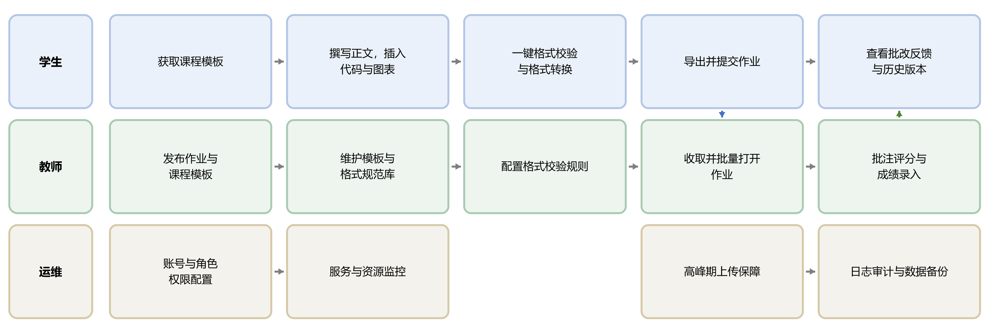

图 4-1 师生文档处理业务流程
## 4.2 文档智能处理流程
文档从上传到归档的处理链路见图 4-2。文档接入后先完成解析与切分，生成文本向量并建立检索索引；随后进入智能处理环节，提供摘要、要点提取、文档问答与文本润色；处理结果在格式规范校验环节与课程模板比对，并支持格式转换；权限控制与操作留痕贯穿链路，最后按需导出、提交与归档。业务数据、文档元数据与操作日志存储在 Oracle Database 26ai，会话、热点缓存与任务队列由 Redis 承担，文档向量由向量索引保存。
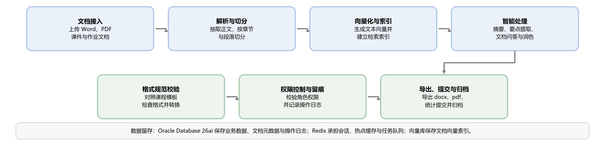

图 4-2 文档端到端处理流程
# 5 功能需求
本章按模块与功能点给出功能需求。每个功能点包含【页面效果】【应用场景】【操作描述】与【对应需求】四部分，其中页面效果为桌面端原型的页面截图；【对应需求】给出该功能对应的需求编号，编号定义见《需求陈述说明书》表 2-6 与表 2-7。表 2-6 中的 REQ-09 属于非功能需求，为与《需求陈述说明书》的编号保持一致，本文档仍沿用该编号。
## 5.1 文档接入
### 5.1.1 文档上传
【页面效果】
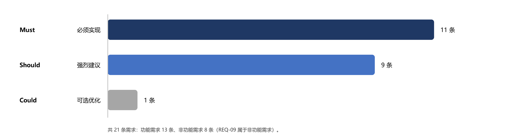

【应用场景】：师生把课件、作业、论文与课程报告等文档上传到系统，作为智能处理、格式校验与协作的基础。系统接收 Word（.doc、.docx）与 PDF 文件，单个文件不超过 20MB，支持一次选择多个文件。
【操作描述】：上传文档
1. 进入“文档接入-上传文档”，点击“选择文件”或将文件拖入上传区域。
2. 系统校验文件类型与大小，不符合要求时提示具体原因并阻止上传。
3. 上传过程中显示进度；网络中断后支持从断点继续上传。
4. 上传完成后系统自动进入解析流程，列表状态显示为“解析中”“解析完成”或“解析失败”。
5. 可为文档指定所属课程与文档类型（课件、作业、论文、报告），默认按文件自动识别。
【对应需求】：REQ-10、REQ-14、NFR-05
### 5.1.2 文档解析与预览
【页面效果】
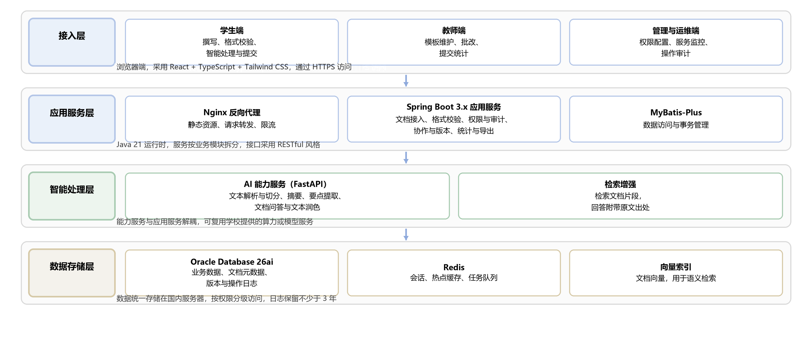

【应用场景】：解析后的文档在浏览器中直接预览，用于确认内容与结构是否完整，同时为摘要、要点提取与文档问答提供文本输入。
【操作描述】：预览与重新解析
1. 在文档列表中点击文档名称进入预览页，左侧显示章节结构，右侧显示正文。
2. 正文按页展示，支持翻页、缩放与按标题跳转。
3. 页面顶部显示解析状态；解析失败时显示失败原因并提供“重新解析”。
4. 支持在文档内检索关键词，命中位置在正文中高亮显示。
【对应需求】：REQ-10、REQ-11
### 5.1.3 我的文档与历史记录
【页面效果】
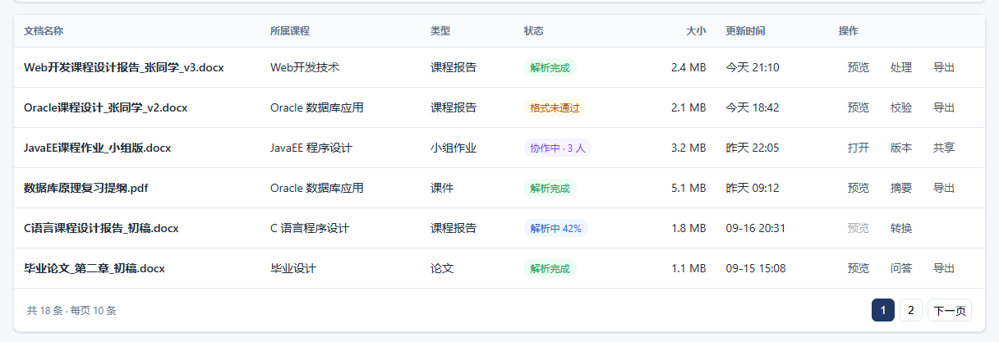

【应用场景】：师生集中管理本人上传与处理的文档，按课程、类型与时间查找，并回到任意一次处理结果。
【操作描述】：文档检索与管理
1. 进入“我的文档”，列表默认按最近修改时间倒序展示。
2. 支持按课程、文档类型、处理状态与时间范围筛选，并可输入关键词搜索标题。
3. 支持打开、删除与导出；删除的文档进入回收站，可在回收站中恢复（回收站由运维端统一管理）。文档重命名与复制列入后续版本，不在本期原型与开发范围。
4. 点击文档可查看历史处理记录（摘要、要点、问答、版本），并回到指定处理结果。
【对应需求】：REQ-14、REQ-03、D02
## 5.2 智能处理
### 5.2.1 文本摘要
【页面效果】
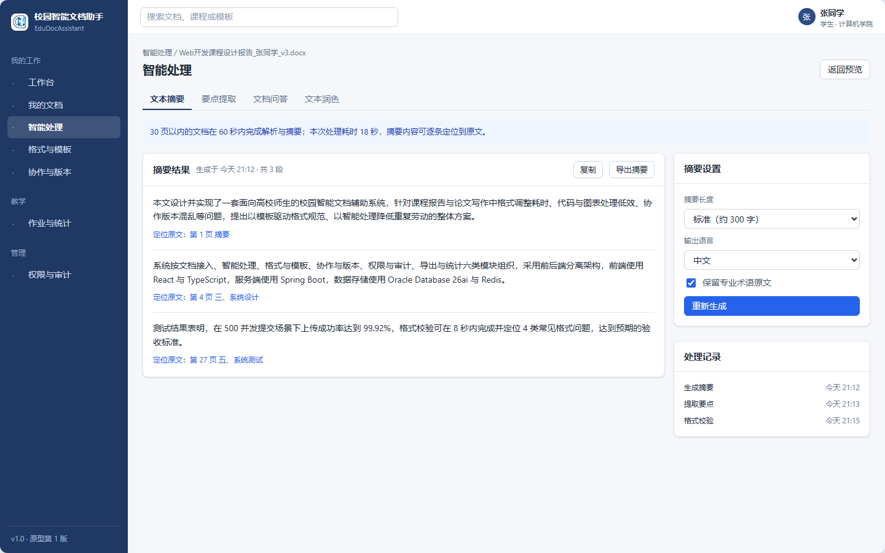

【应用场景】：面对篇幅较长的课件、论文与报告，师生需要先了解内容梗概；摘要结果需要能够定位到原文，便于核对与引用。
【操作描述】：生成与使用摘要
1. 在文档预览页点击“生成摘要”。
2. 系统显示处理进度，30 页以内的文档在 60 秒内返回结果。
3. 摘要按段落分组展示，每组摘要可展开对应的原文片段。
4. 点击摘要中的句子可跳转到原文位置并高亮显示。
5. 支持重新生成、复制摘要与导出摘要（.docx、.txt）。
【对应需求】：REQ-10、NFR-01
### 5.2.2 要点提取
【页面效果】
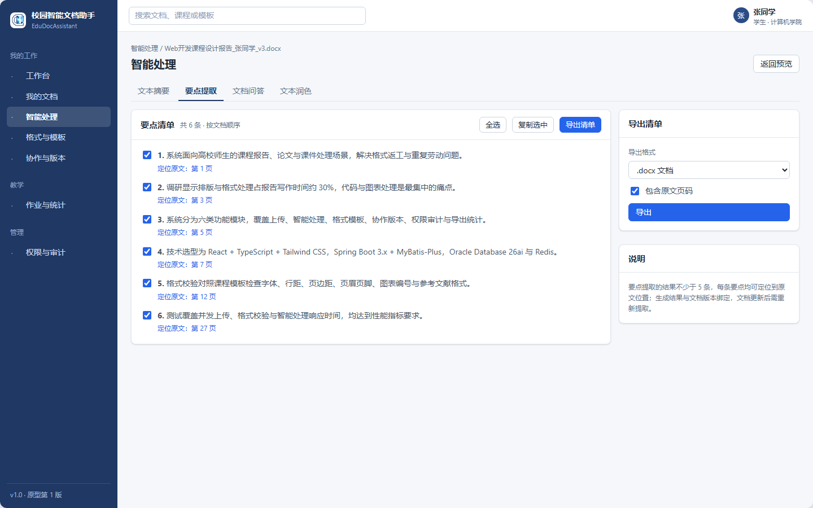

【应用场景】：复习、备课与批改前，师生希望先获得文档的要点清单，并据此定位到对应章节。
【操作描述】：提取要点
1. 在文档预览页点击“提取要点”。
2. 系统返回要点清单，条目不少于 5 条，并按文档顺序排列。
3. 每条要点可点击定位到原文位置。
4. 支持勾选要点、复制选中内容与导出清单（.docx、.txt）。
【对应需求】：REQ-11
### 5.2.3 文档问答
【页面效果】
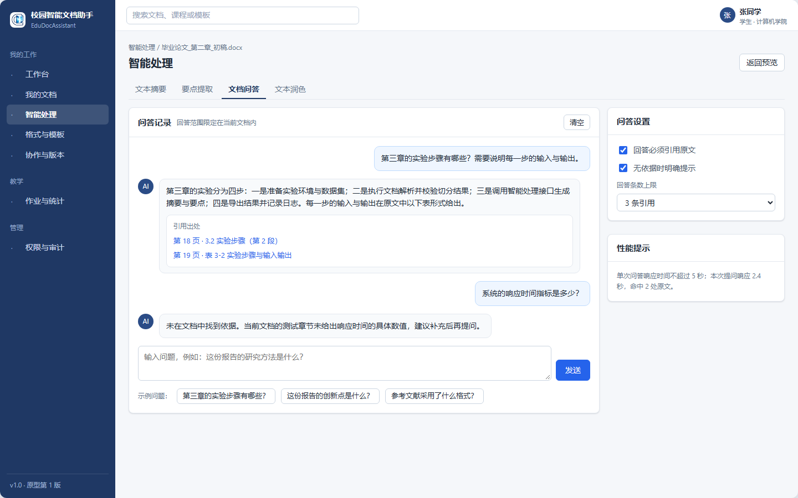

【应用场景】：师生围绕文档内容提问，例如“第三章的实验步骤有哪些”“这份报告的结论是什么”，并要求答案给出原文出处。
【操作描述】：提问与查看出处
1. 在文档预览页进入“文档问答”，输入问题后提交。
2. 系统在 5 秒内返回答案，并列出引用的原文段落或页码。
3. 点击引用内容可跳转到原文位置；支持连续追问，回答范围限定在当前文档内。
4. 当文档中没有相关依据时，系统明确提示“未在文档中找到依据”，不生成推测性内容。
5. 问答记录按文档保存，可在历史记录中回看。
【对应需求】：REQ-12
### 5.2.4 文本润色
【页面效果】
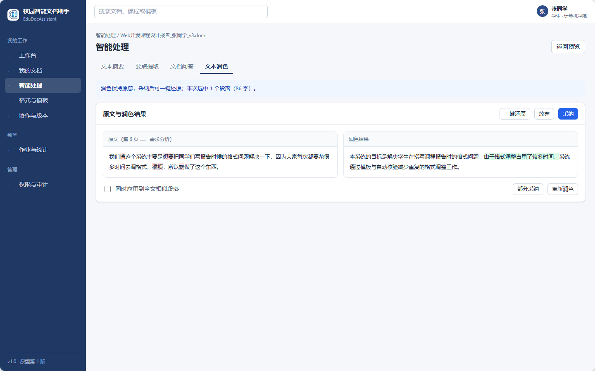

【应用场景】：对表述不通顺或偏口语化的段落做轻度润色，在保持原意的前提下改善语句质量。
【操作描述】：段落润色
1. 在预览状态下选中一个或多个段落，点击“润色”。
2. 系统以左右对照方式展示原文与润色结果。
3. 可选择采纳、部分采纳或放弃；采纳后写入文档，并保留一次撤销记录。
4. 支持一键还原到润色前内容，还原后可重新润色。
【对应需求】：REQ-13
## 5.3 格式与模板
### 5.3.1 课程模板库
【页面效果】
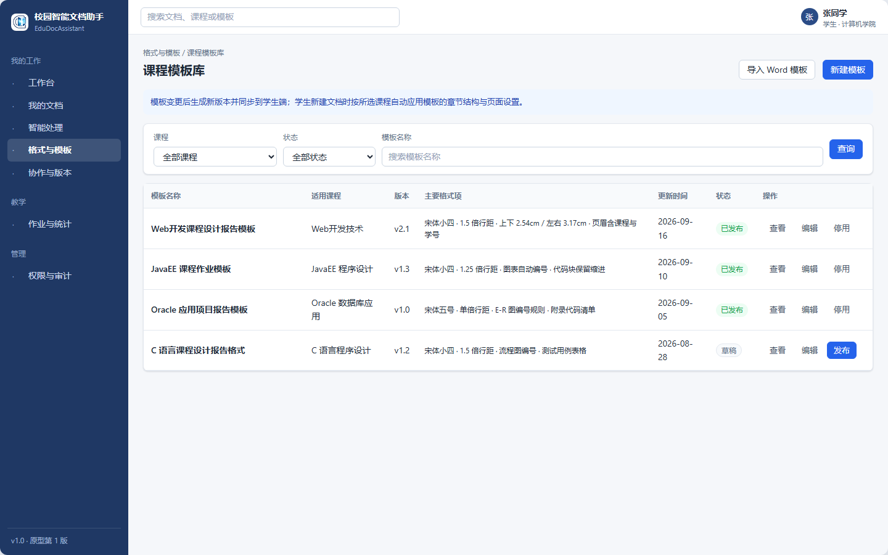

【应用场景】：不同课程对报告结构、字体、行距、页边距与封面样式的要求不同，需要集中维护并按课程下发；学生按课程选用模板，避免反复对照格式要求。
【操作描述】：模板维护与学生使用
1. 教师进入“格式与模板-课程模板”，点击“新建模板”，选择课程并设置章节结构、字体、字号、行距、页边距与封面样式等格式项。
2. 保存后可将模板发布给对应课程的学生；模板变更后生成新版本，学生端同步最新版本。
3. 学生新建文档时选择课程，系统按模板生成文档大纲与页面设置。
4. 教师可停用或删除模板；已被学生使用的历史版本不受影响。
【对应需求】：REQ-08、REQ-04
### 5.3.2 格式规范校验
【页面效果】
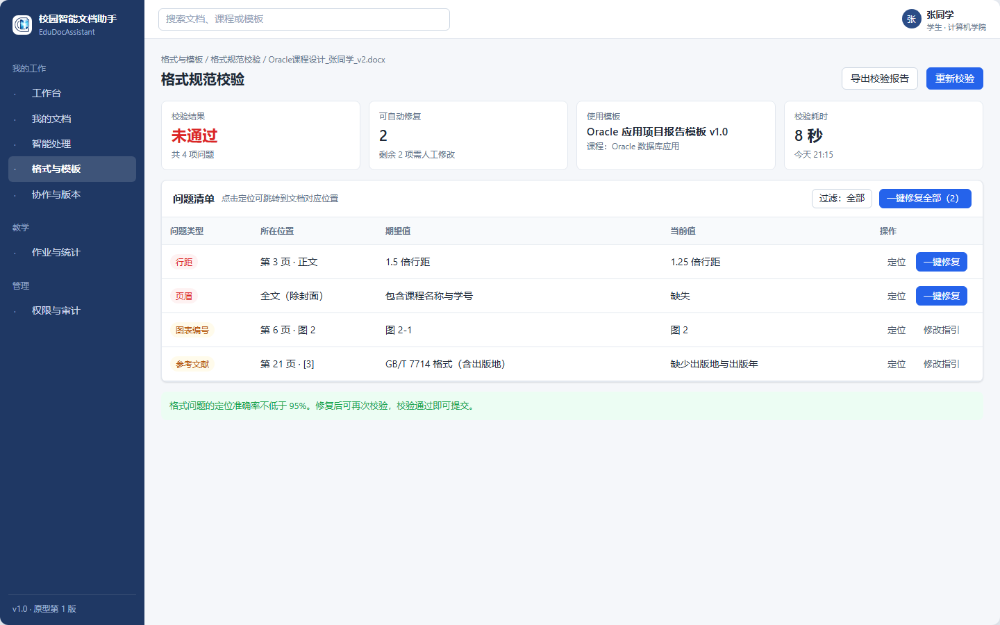

【应用场景】：学生希望在提交前完成格式自查，教师希望减少因格式不统一产生的重复批注。
【操作描述】：提交前格式校验
1. 在文档预览页点击“格式校验”，系统默认使用该文档所属课程的模板。
2. 系统逐项检查字体、字号、行距、页边距、页眉页脚、图表编号与参考文献格式，给出问题清单。
3. 每条问题显示问题类型、所在位置、期望值与当前值，点击可定位到文档对应位置。
4. 对可自动修复的问题提供“一键修复”，修复后可重新校验；不可自动修复的问题给出修改指引。
5. 校验结束后显示通过或未通过，并给出问题数量统计。
【对应需求】：REQ-04、REQ-02
### 5.3.3 格式转换
【页面效果】
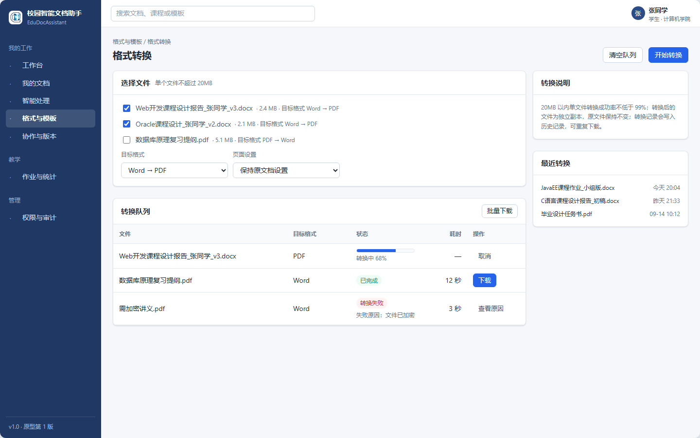

【应用场景】：提交与存档通常要求 PDF，批改与修改需要使用 Word，批量转换可以减少手工另存的工作量。
【操作描述】：文件格式转换
1. 在文档列表中选择一个或多个文档，点击“格式转换”。
2. 选择目标格式（Word 转 PDF、PDF 转 Word），确认后开始转换。
3. 转换完成后可单独下载或批量下载，原文件保持不变。
4. 转换失败时显示失败原因（如文件加密、内容损坏），并保留转换记录便于排查。
5. 转换记录包含源文件、目标格式、转换时间与结果，可检索。
【对应需求】：REQ-14、I03
### 5.3.4 代码块与图表编号
【页面效果】
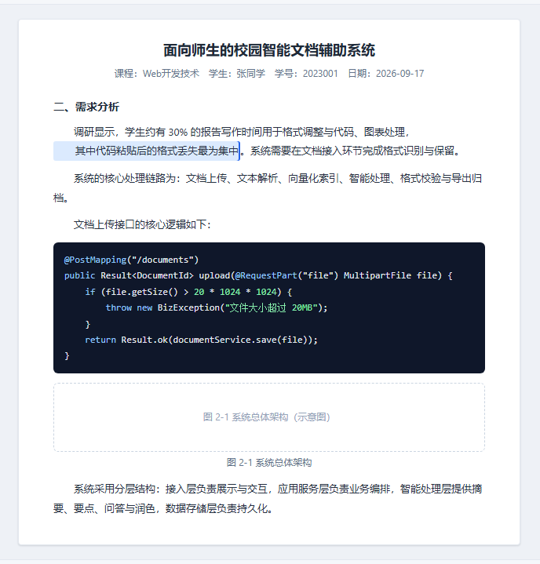

【应用场景】：课程报告中的代码与图表需要保持格式并自动编号；从开发工具粘贴代码时格式容易丢失，增删图表后编号需要人工修改。
【操作描述】：代码块与图表处理
1. 在编辑区粘贴代码，系统自动识别编程语言（如 Java、C++），保留缩进并应用语法高亮。
2. 插入图表时，系统按章节自动生成编号（如“图 2-1”）并插入对应题注。
3. 增删或移动图表后，全文图表编号与正文引用自动更新。
4. 导出 Word 或 PDF 时保持代码块格式与图表编号不变。
【对应需求】：REQ-01、REQ-02
## 5.4 协作与版本
### 5.4.1 协作编辑
【页面效果】
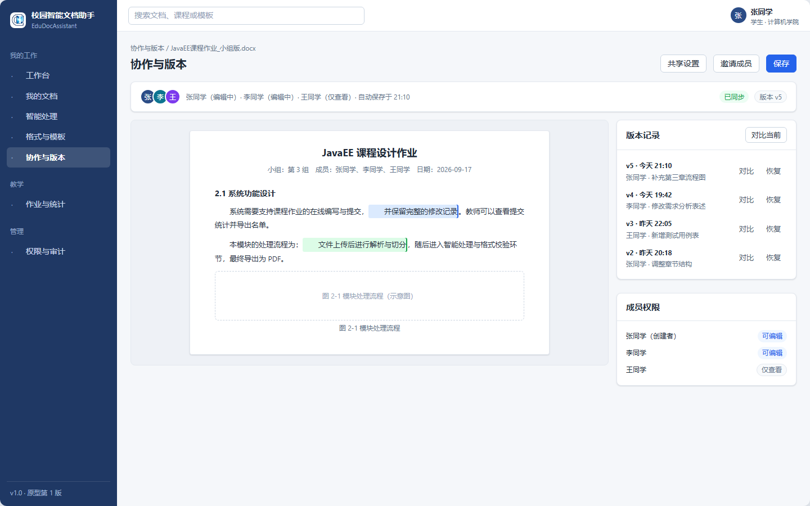

【应用场景】：小组作业需要多人同时撰写与修改同一份文档，避免通过聊天工具互传文件造成版本冲突。
【操作描述】：多人协作
1. 文档创建者点击“协作”，按账号邀请成员加入，并设置“可编辑”“仅评论”或“仅查看”。
2. 被邀请成员进入文档后同时编辑，页面显示各成员的光标位置与修改内容。
3. 系统自动保存编辑内容，并在保存时生成版本记录。
4. 成员可退出协作，创建者可移除成员；被移除后不再具备编辑权限。
【对应需求】：REQ-03
### 5.4.2 版本回溯与对比
【页面效果】

【应用场景】：需要找回早期内容，或确认某一版本由谁修改、改动了哪些内容。
【操作描述】：版本管理
1. 在文档页点击“版本记录”，按时间倒序显示版本列表，包含版本号、保存时间、操作人与修改说明。
2. 选择两个版本可对比差异，新增、删除与修改内容分别标记。
3. 可将任一历史版本恢复为当前版本，恢复操作生成新的版本记录，不覆盖历史版本。
4. 支持导出指定版本；版本与回收站的保留策略见 10.2 与第 13 章。
【对应需求】：REQ-03、D02
## 5.5 权限与审计
### 5.5.1 角色与权限管理
【页面效果】
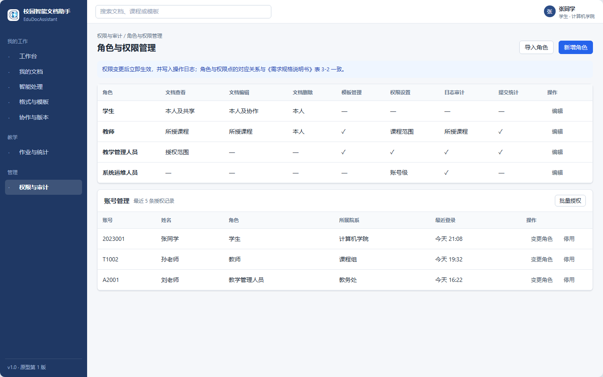

【应用场景】：不同角色在系统中的操作范围不同，需要统一配置角色与权限，并保证权限变更可追溯。
【操作描述】：角色与权限配置
1. 管理员进入“权限与审计-角色管理”，查看预置角色（学生、教师、运维人员）及其权限点。
2. 可编辑角色的权限点，或在预置角色基础上新增自定义角色。
3. 在“账号管理”中为账号分配角色；角色变更后立即生效并写入操作日志。
4. 角色与权限点的对应关系见 3.3 表 3-2。
【对应需求】：REQ-06、REQ-09
### 5.5.2 共享与访问控制
【页面效果】
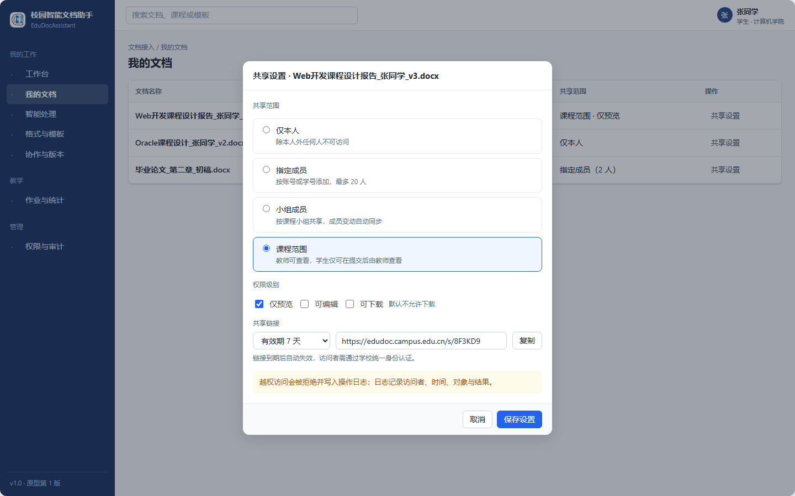

【应用场景】：学生论文与课程报告涉及个人信息与知识产权，需要控制文档的查看、编辑与下载范围。
【操作描述】：共享设置
1. 文档所有者或具备权限的教师在“共享设置”中选择共享范围：仅本人、指定成员、小组成员、课程范围。
2. 为共享对象设置权限级别：仅预览、可编辑、可下载，默认不允许下载。
3. 可生成带有效期的共享链接，到期后自动失效。
4. 访问者打开文档时进行身份校验，越权访问被拒绝并写入日志。
【对应需求】：REQ-06、NFR-06
### 5.5.3 操作日志与审计
【页面效果】
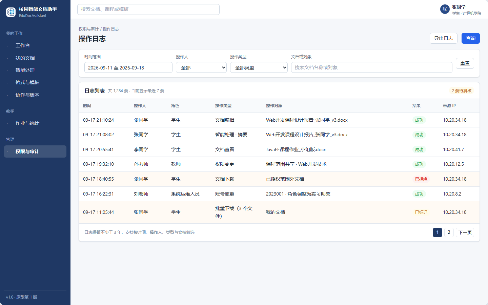

【应用场景】：需要追溯文档的查看、编辑、下载与权限变更，满足数据安全管理与责任认定要求。
【操作描述】：日志查询与审计
1. 具备权限的用户进入“权限与审计-操作日志”。
2. 日志字段包括操作时间、操作人、角色、操作类型、操作对象、操作结果与来源 IP。
3. 支持按时间范围、操作人、操作类型与文档筛选，并可导出日志文件。
4. 系统对异常操作（如短时间内的批量下载）进行标记，供管理人员复核。
【对应需求】：REQ-09、NFR-02
## 5.6 导出与统计
### 5.6.1 文档导出
【页面效果】
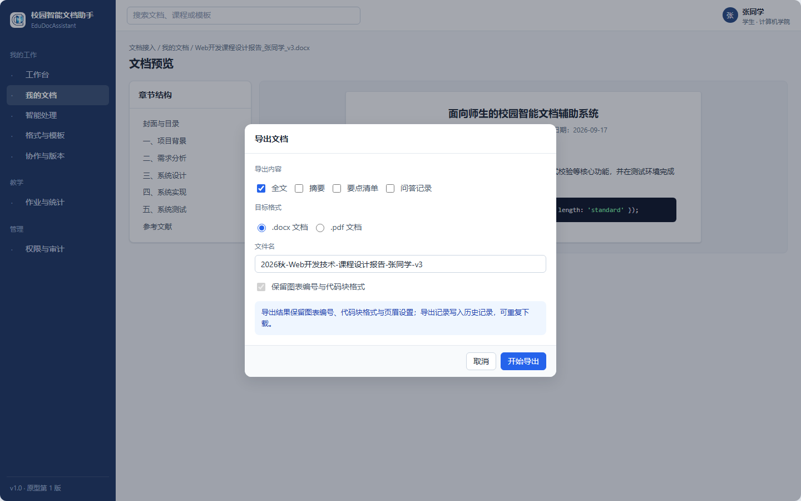

【应用场景】：师生需要把文档、摘要或要点清单导出为可用于提交与存档的通用格式。
【操作描述】：导出文档
1. 在文档预览页或列表页点击“导出”。
2. 选择导出内容（全文、摘要、要点清单、问答记录）与目标格式（.docx、.pdf）。
3. 系统生成文件并提示下载，导出结果保留图表编号与代码块格式。
4. 导出记录写入历史记录，可重复下载。
【对应需求】：REQ-14、NFR-05
### 5.6.2 提交与统计
【页面效果】
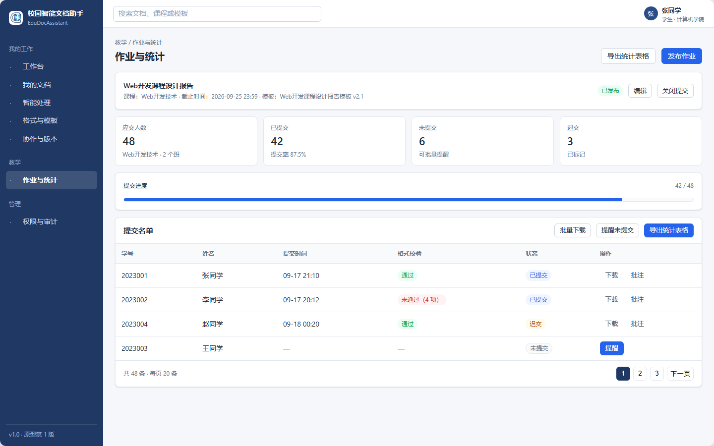

【应用场景】：教师需要发布作业并查看提交情况，学生需要按课程提交报告，避免在教学平台与表格之间人工核对。
【操作描述】：提交作业与查看统计
1. 教师发布作业，设置所属课程、截止时间与使用的模板，学生端自动可见。
2. 学生完成后点击“提交”，系统可选执行格式校验，并将文档标记为“已提交”。
3. 教师端按课程与作业查看提交统计，包括已提交、未提交与迟交人数及名单。
4. 支持批量下载提交文档、提醒未提交学生，并导出统计表格。
【对应需求】：REQ-08、REQ-04、D06
# 6 外部接口需求
## 6.1 用户界面
系统采用浏览器 Web 界面，界面语言为中文。本期按桌面端设计并实现，设计基准分辨率为 1440×900，文档列表、预览、智能处理、模板管理、统计与日志等主要页面在该分辨率下不出现横向滚动；移动端的适配范围与排期列入后续迭代，见第 13 章。状态变化除颜色外同时给出文字说明，保证信息可辨识。
## 6.2 软件接口
系统与外部软件、内部服务之间的接口见表 6-1。接口采用 HTTPS 传输，服务端接口遵循 RESTful 风格；对接学校统一身份认证与教务系统时，按学校信息中心开放的方式实现。
表 6-1 软件接口清单

| 编号 | 接口名称 | 主要功能 | 接口方式 | 说明 |
| --- | --- | --- | --- | --- |
| I01 | 用户认证接口 | 登录、登出、权限校验、令牌刷新 | HTTPS 接口调用 | 对接学校统一身份认证（待确认） |
| I02 | 文档操作接口 | 创建、读取、更新、删除、版本管理、协作编辑 | HTTPS 接口调用 | 浏览器端与服务器端之间 |
| I03 | 格式转换接口 | Word 转 PDF、PDF 转 Word、代码块渲染 | 服务内部调用 | 由格式转换服务提供 |
| I04 | 教务系统集成接口 | 账号同步、课程信息同步、成绩回传 | 定时或实时同步 | 需学校信息中心支持（待确认） |
| I05 | AI 能力接口 | 摘要、要点提取、文档问答、文本润色 | 服务内部调用 | 服务器端与 AI 能力服务之间 |

## 6.3 通信接口
系统与客户端之间使用 HTTPS 通信，传输层采用 TLS 1.2 及以上版本。文件上传支持分片与断点续传，单个文件不超过 20MB，并支持多文件批量上传。接口调用设置超时与重试机制，对超时、失败等异常返回明确的状态码与提示信息。
## 6.4 硬件接口
系统不使用专用硬件接口，仅依赖服务器、存储与校园网络。打印与另存由浏览器和操作系统提供，系统通过导出 PDF 支持打印需求。
# 7 性能需求
系统的性能指标以可测量的方式规定，覆盖并发能力、响应时间、处理时长与准确率，见表 7-1。指标在正常负载与期末提交高峰两种条件下分别验证。
表 7-1 性能指标

| 编号 | 指标项 | 要求 | 对应需求 |
| --- | --- | --- | --- |
| P-01 | 并发在线用户 | 支持 1000 名用户同时在线使用 | NFR-01 |
| P-02 | 请求响应时间 | 95% 的请求响应时间不超过 3 秒 | NFR-01 |
| P-03 | 高峰期上传 | 500 并发提交下上传成功率不低于 99.9%，响应时间小于 2 秒 | REQ-05 |
| P-04 | 文档解析与摘要 | 30 页以内文档在 60 秒内完成解析与摘要 | REQ-10 |
| P-05 | 文档问答响应 | 单次问答响应时间不超过 5 秒 | REQ-12 |
| P-06 | 格式转换 | 20MB 以内单文件转换成功率不低于 99% | REQ-14 |
| P-07 | 格式校验准确率 | 格式问题定位准确率不低于 95% | REQ-04 |
| P-08 | 参考文献格式准确率 | 生成的参考文献条目准确率不低于 98% | REQ-07 |
| P-09 | 可用性与恢复 | 系统可用性不低于 99.5%，故障恢复时间不超过 30 分钟 | NFR-03 |

# 8 设计约束
约束条件限定了系统的实现方式与技术选择，也影响需求的取舍。约束清单见表 8-1，其中技术约束与运行环境约束尚待与信息中心确认；多端兼容约束已确认为本期仅提供电脑端访问，移动端适配列入后续迭代。
表 8-1 约束、假设与依赖

| 编号 | 类型 | 具体内容 | 对系统的影响 | 确认状态 |
| --- | --- | --- | --- | --- |
| C01 | 技术约束 | 系统需兼容学校现有教务系统账号体系 | 需对接学校信息中心接口，开发周期可能延长 | 待确认 |
| C02 | 时间约束 | 项目需在学期结束前完成核心功能开发并上线测试 | 优先实现 Must 级需求，Could 级需求延后 | 已确认 |
| C03 | 预算约束 | 项目预算有限，优先采用开源技术栈 | 限制商业组件采购，部分功能需自行开发 | 已确认 |
| C04 | 政策合规约束 | 学生论文与成绩数据受个人信息保护相关法规约束 | 需实现数据加密、权限控制与日志审计 | 已确认 |
| C05 | 运行环境约束 | 系统部署在学校服务器或校园云上 | 需符合学校信息安全规范并通过信息中心审批 | 待确认 |
| C06 | 用户能力约束 | 学生与教师的技术能力参差不齐，界面需简洁 | 需开展用户测试，确保非技术用户可独立完成操作 | 已确认 |
| C07 | 多端兼容约束 | 本期仅支持电脑端访问，移动端列入后续迭代 | 本期按桌面端设计，移动端适配延后 | 已确认 |
| C08 | 数据本地化假设 | 学生数据存放在国内服务器上 | 不能使用海外云服务，需选择国内服务商 | 已确认 |

# 9 软件系统属性
## 9.1 可靠性
系统可用性不低于 99.5%，故障恢复时间不超过 30 分钟。上传与转换任务支持断点续传与失败重试；处理任务失败时保留原始文档，不产生不完整的结果数据。数据每日定时备份，备份文件与业务数据分机存放。
## 9.2 安全与保密性
文档数据在存储时加密，传输使用 HTTPS；账号按角色分配权限，遵循最小权限原则。文档的查看、编辑、下载与权限变更均写入审计日志，日志保留不少于 3 年。学生论文与课程报告未经授权不得被他人访问；导出与共享操作需具备相应权限。
## 9.3 易用性与兼容性
学生无需专门培训即可完成文档上传、智能处理与导出，单次“编辑加导出”操作不超过 5 分钟。系统支持 Chrome、Edge、Safari 最新两个版本，导出格式包含 .docx 与 .pdf；界面按桌面端 1440×900 设计基准完成适配，本期不承诺移动端浏览效果，移动端适配列入后续迭代。
## 9.4 可维护性
系统按业务模块拆分服务，模块之间通过接口调用；配置修改无需重启服务；系统日志完整可查，接口文档随版本更新。模块化设计与接口文档便于后续迭代与维护。
# 10 数据需求
## 10.1 数据实体与关键字段
系统涉及的数据实体与关键字段见表 10-1，实体之间的关系为：一个用户拥有多份文档，一份文档属于一个课程模板并包含多个版本，用户与文档的操作过程生成日志记录，提交统计由文档的提交状态汇总得到。
表 10-1 数据实体与关键字段

| 编号 | 数据实体 | 关键字段 | 保密等级 |
| --- | --- | --- | --- |
| D01 | 用户数据 | 用户 ID、姓名、角色、所属院系、账号状态 | 敏感保密 |
| D02 | 文档数据 | 文档 ID、标题、内容、版本号、创建人、创建时间、格式规范 ID | 敏感保密 |
| D03 | 格式规范数据 | 规范 ID、课程名称、字体、字号、行距、页边距、封面样式 | 内部使用 |
| D04 | 审批流程数据 | 流程 ID、文档 ID、当前节点、审批人、审批状态、审批意见、时间戳 | 内部使用 |
| D05 | 系统日志数据 | 日志 ID、用户 ID、操作类型、操作对象、操作时间、IP 地址、结果 | 敏感保密 |
| D06 | 提交统计报表 | 课程 ID、学生 ID、提交状态、提交时间、文件格式 | 内部使用 |

## 10.2 数据保留、归档与权限
文档操作日志保留不少于 3 年，可按用户、时间与操作类型检索。文档的版本记录随文档保存，删除的文档进入回收站后可恢复；文档版本与回收站的保留期限、以及个人信息脱敏展示的具体范围尚待确认，见第 13 章。全部数据存储在国内服务器上，按角色与共享范围分级访问，运维人员查阅敏感数据时同样受权限与日志约束。
# 11 合格性规定
合格性方法分为四类。演示指运行系统并通过可见的功能操作验证；测试指借助工具、测试数据集或压测环境采集数据后判断；分析指对测试结果进行归约、解释或推断；审查指对代码、文档或配置进行可视化检查。每条需求对应的合格性方法与验证内容见表 11-1。
表 11-1 合格性规定

| 需求编号 | 合格性方法 | 验证内容 |
| --- | --- | --- |
| REQ-01 | 演示 | 粘贴不同语言代码后缩进与语法高亮保持正确 |
| REQ-02 | 演示 | 增删图表后全文编号自动更新且无跳号 |
| REQ-03 | 测试 | 4 人并发编辑，版本可回溯到指定时点 |
| REQ-04 | 测试与演示 | 以课程模板样本集检验，格式问题定位准确率不低于 95% |
| REQ-05 | 测试 | 500 并发压测下上传成功率与响应时间达标 |
| REQ-06 | 演示与审查 | 权限级别可设置，越权访问被拒绝且记录日志 |
| REQ-07 | 测试 | 以参考文献样本集检验，格式准确率不低于 98% |
| REQ-08 | 演示 | 模板更新后学生端同步，提交状态实时更新 |
| REQ-09 | 审查与测试 | 抽查操作日志，覆盖查看、编辑、下载与权限变更操作 |
| REQ-10 | 测试与分析 | 30 页文档 60 秒内完成摘要，抽样评审摘要质量并核查原文定位 |
| REQ-11 | 演示 | 要点不少于 5 条且可定位到原文位置 |
| REQ-12 | 测试 | 问答响应不超过 5 秒，引用出处正确，无依据时明确提示 |
| REQ-13 | 演示 | 润色结果可对比、可还原，语义保持一致 |
| REQ-14 | 测试 | 批量转换成功率达标，历史记录可检索、可导出 |
| NFR-01 | 测试 | 1000 并发场景下响应时间满足指标 |
| NFR-02 | 审查与测试 | 核查加密配置、传输协议与审计日志覆盖率 |
| NFR-03 | 测试 | 故障演练验证恢复时间与断点续传 |
| NFR-04 | 演示 | 非技术用户独立完成编辑与导出任务 |
| NFR-05 | 测试 | 主流浏览器兼容性测试与导出格式校验 |
| NFR-06 | 审查 | 核查授权流程、数据保留周期与脱敏措施 |
| NFR-07 | 审查 | 核查日志完整性、配置热更新与接口文档 |

# 12 需求可追踪性
本文档中的每项需求均可向上追溯到《需求陈述说明书》记录的调研来源（受访者、现场观察、问卷或文档分析），并可向下追溯到设计文档、测试用例与验收记录。向上追溯关系见表 12-1，向下追溯关系在设计说明与测试文档中维护。
表 12-1 需求来源追溯

| 本说明书章节 | 对应需求 | 需求陈述说明书中的来源 |
| --- | --- | --- |
| 5.1 文档接入 | REQ-10、REQ-14 | U01、U02、U03 与问卷统计 |
| 5.2 智能处理 | REQ-10 至 REQ-13 | U01、U03、U04 与问卷统计 |
| 5.3 格式与模板 | REQ-01、REQ-02、REQ-04、REQ-07、REQ-08、REQ-14 | U01 至 U05、O01、O02 与问卷统计 |
| 5.4 协作与版本 | REQ-03 | U02、O01 |
| 5.5 权限与审计 | REQ-06、REQ-09 | U06、O02、O03 |
| 5.6 导出与统计 | REQ-08、REQ-14 | U04、U05、O02 |
| 6 外部接口需求 | I01 至 I05、NFR-05 | U04、U06 |
| 7 性能需求 | NFR-01、NFR-03 及 REQ-04、REQ-05、REQ-10、REQ-12、REQ-14 | U01、U06 |
| 8 设计约束 | C01 至 C08 | U05、U06 与课程安排 |
| 9 软件系统属性 | NFR-02、NFR-04、NFR-06、NFR-07 | U01、U04、U06 |
| 10 数据需求 | D01 至 D06 | U01、U05、U06 |

# 13 待确认事项
下列事项在编写本文档时尚未取得最终结论，处理方式已给出初步安排。事项确认后需同步更新本文档的对应章节，并按需更新《需求陈述说明书》中对应的需求、约束与追溯条目。
表 13-1 待确认事项

| 编号 | 事项 | 影响范围 | 责任方 |
| --- | --- | --- | --- |
| Q01 | 教务系统与统一身份认证接口的技术细节和开放程度 | 3.6 可行性结论与主要风险 6.2 软件接口、8 设计约束 | 项目组、信息中心，需求评审前 |
| Q02 | 数据本地化存储与个人信息保护的合规要求 | 3.6 可行性结论与主要风险 9.2 安全与保密性、10.2 数据保留 | 项目组、信息中心，需求评审前 |
| Q03 | 移动端适配的范围与排期（本期不实现） | 3.6 可行性结论与主要风险 6.1 用户界面、5.1 至 5.6 功能点 | 指导教师、项目组，后续迭代确定前 |
| Q04 | 文档版本记录与回收站的保留期限 | 10.2、5.4.2 | 指导教师、项目组，需求评审前 |
| Q05 | 角色与权限矩阵的细化方式 | 3.3、5.5.1 | 指导教师、信息中心，需求评审前 |
| Q06 | 界面视觉规范（页面截图已补入，尚缺统一视觉规范） | 5 各功能点的页面效果部分 | 项目组，原型走查后补充 |
| Q07 | Must 级需求的实现范围与迭代安排 | 全文档需求优先级 | 指导教师、项目组，迭代计划确定前 |
