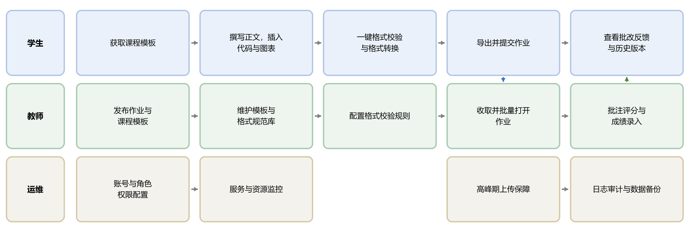
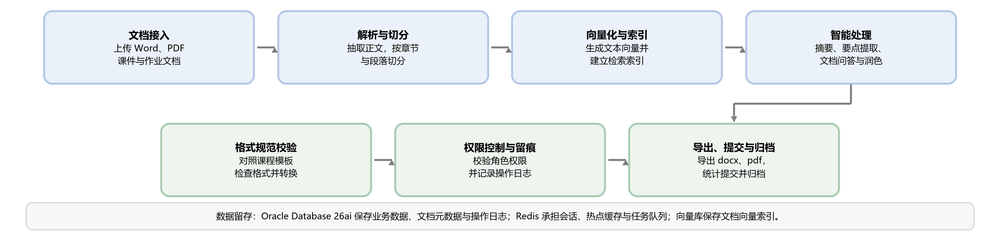
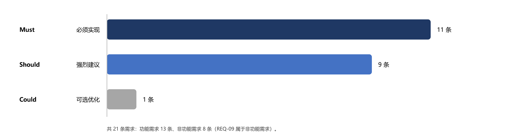
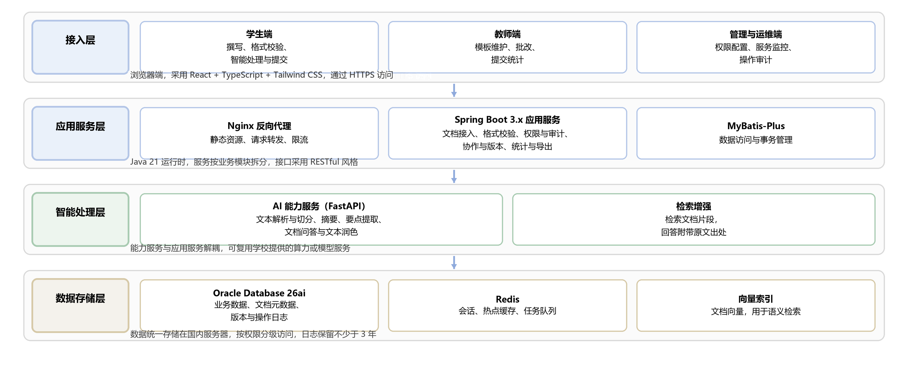

# 需求陈述说明书

> 文件编号：CIDAS-D000 ｜ 版本：1.1.0-0.0.0 ｜ 发布日期：2026-09-17
>
> 来源文件：02_需求规格说明/需求陈述说明书.docx

文件编号：CIDAS-D000
面向师生的校园智能文档辅助系统
需求陈述说明书
版本：1.1.0-0.0.0
2026-09-17
文件修改控制

| 修改编号 | 版本 | 修改条款及内容 | 修改日期 |
| --- | --- | --- | --- |
| 1 | 1.0.0-0.0.0 | 创建 | 2026-09-17 |
| 2 | 1.0.0-0.0.0 | 统一移动端口径与图名，补充编号对应说明 | 2026-09-19 |
| 3 | 1.0.0-0.0.0 | 补充题目解析、目标群体与用户画像、可行性分析与风险对策，并说明问卷设计 | 2026-10-16 |
| 4 | 1.1.0-0.0.0 | 同步角色模型：教学管理员与系统运维合并为运维角色，REQ-07 标注未实现 | 2026-10-30 |

# 1 系统概述
## 1.1 项目背景
高校师生的日常教学与学习已高度依赖电子文档。项目组于 2026 年 9 月开展的调研表明，师生普遍存在文档使用频繁、格式类型多样、编辑工具分散和应用场景复杂等特点。与此同时，现有文档工具在付费限制、格式处理、智能辅助等方面仍存在较明显的使用痛点，其中 AI 辅助和格式转换已成为较为集中的需求方向，整体使用体验和推荐意愿也有待提升。
课程设计报告的模板对比进一步表明，不同课程在章节结构、排版格式、图表规范和代码展示等方面存在较大差异。学生需要反复学习和调整不同课程的格式要求，教师也需要持续维护模板并人工检查格式问题，造成较多重复性工作。
从实际工作流程来看，学生完成报告通常需要经历撰写、代码与图表处理、格式调整以及导出提交等环节，排版和格式处理占用了较多时间；教师则需要逐份打开、批注和评分，格式不统一进一步增加了批改负担；在集中提交期间，系统运维还面临并发访问、权限管理和操作追溯等问题。
上述问题的共同特点是文档处理任务重复度高、规则明确却高度依赖人工执行，而文本、格式和结构本身又具有较强的规范化和可处理性。因此，项目组提出建设“面向师生的校园智能文档辅助系统”（Campus Intelligent Document Assistant System，CIDAS，产品 UI 昵称 EduDocAssistant），将文档规范管理与智能处理能力整合到统一的校园内部平台中，以减少格式返工和重复劳动，并为文档权限、操作追溯及规范管理提供统一支撑。
## 1.2 系统概述
本系统是一套面向高校师生的 Web 应用，部署在学校服务器或校园云上，以电脑浏览器为访问方式，本期按桌面端设计并实现，移动端适配列入后续迭代。系统接收课件、作业、论文与课程报告等 Word、PDF 文档，在完成解析后提供智能摘要、要点提取、文档问答与文本润色等处理能力，同时提供课程模板库、格式规范校验、格式转换、协作与版本、权限与审计、历史记录与导出等配套功能。
系统的使用者分为学生、教师与运维人员三类，目标群体与用户画像见 1.4。学生完成文档撰写、格式校验、智能处理、提交与历史查看；教师发布作业与课程模板、配置格式规范、批改并统计提交情况；运维人员由原教学管理人员与系统运维人员合并而来，在授权范围内查看文档、维护课程级配置，并负责账号与权限配置、服务监控、数据备份与操作审计。系统的功能边界止于文档处理与教学协同，不承担教学平台的教学过程管理职能，与学校现有教学平台、教务系统之间以接口方式衔接。
按业务功能划分，系统包含文档接入、智能处理、格式与模板、协作与版本、权限与审计、导出与统计六类模块，模块构成与端到端处理流程见图 2-2，逐条需求见 2.4 至 2.7。
## 1.3 题目解析：从题面到系统定位
题目“面向师生的校园智能文档辅助系统”由用户、场景、能力、对象与定位五个限定构成。逐项拆解题面可以避免把教学管理、教务服务等不属于本系统的职责纳入范围，也使后续需求条目能够逐条对应到题面中的限定词。
表 1-1 题目关键词解析

| 关键词 | 题面含义 | 对系统与需求的约束 |
| --- | --- | --- |
| 面向师生 | 用户限定为校内学生、教师与运维人员 | 不面向校外访客与公众用户；角色与权限按三类划分（REQ-06、REQ-09） |
| 校园 | 场景限定在校园网内，部署在学校服务器或校园云上 | 数据全部存放国内服务器，不使用海外云服务（C08）；不提供离线部署 |
| 智能 | 能力限定为对文档内容的自动理解与生成 | 摘要、要点提取、文档问答与文本润色，结果必须可回溯原文（REQ-10 至 REQ-13） |
| 文档 | 处理对象是课件、作业、论文与课程报告 | 接收 Word 与 PDF，单文件不超过 20MB；含格式校验、转换与模板管理（REQ-01、REQ-04、REQ-14） |
| 辅助系统 | 定位是辅助工具，不是教学平台 | 不承担教学过程管理，不替代教务系统与教学平台；功能边界止于文档处理与教学协同 |

一句话定义：面向校内师生的文档智能处理与格式规范辅助系统（英文全称 Campus Intelligent Document Assistant System，缩写 CIDAS，产品 UI 昵称 EduDocAssistant），在校园网内完成文档的接入、解析、智能处理、格式管理与协同流转，把重复的格式劳动交给系统，把内容判断留给人。题面不含教学、教务、题库等限定，因此系统不承担教学过程管理，也不替代学校既有教学平台与教务系统。
## 1.4 目标群体与用户画像
目标群体由角色与使用特征两个维度共同描述。角色维度来自调研登记的受访者（U01 至 U06）与访谈结论，使用特征维度来自问卷的 200 份有效样本与聚类分析；角色维度决定权限与功能边界，使用特征维度决定功能优先级与交互设计。目标群体的角色构成见表 1-2。
表 1-2 目标群体与角色

| 用户类型 | 主要场景 | 核心诉求 | 来源 |
| --- | --- | --- | --- |
| 学生（样本 77.0%） | 课程报告、课程设计、毕业论文与课件 | 减少排版与格式返工，提交前完成格式自查，长文档与参考文献处理顺畅 | U01 至 U03、问卷 Q1 |
| 教师（样本 18.0%） | 模板维护、作业发布、批改与提交统计 | 提交即合规，批改时自动指出格式问题，减少重复批注 | U04、U05、问卷 Q1 |
| 运维人员（教学管理与系统运维合并） | 课程级配置、文档查看、操作审计、账号、角色、服务监控与日志审计 | 在授权范围内查看文档、维护课程级参数；权限可控、操作留痕、高峰期稳定；账号与权限变更可追溯 | U06、O02、O03 |

按使用强度、格式数量、痛点打分、需求指数与推荐意愿做聚类，受访者可分为四类群体，各群体的特征与改进策略见表 1-3。改进资源应优先投向推荐意愿最低的多格式重度用户与低频使用者，而高痛感高诉求群体可以承担核心功能的验证与走查工作。
表 1-3 用户分群与改进优先顺序

| 群体 | 人数与占比 | 主要特征 | 改进策略 |
| --- | --- | --- | --- |
| 低痛感·稳健使用群体 | 61 人（30.5%） | 使用强度中等，痛点打分 4.34，推荐意愿 6.61 | 保持现有体验，作为稳定基本盘 |
| 高痛感高诉求·高推荐群体 | 58 人（29.0%） | 痛点打分 7.84，推荐意愿 7.12，抱怨多但持续使用 | 优先承担核心功能的验证与走查 |
| 多格式重度用户·低推荐群体 | 42 人（21.0%） | 人均使用 4.52 种格式，推荐意愿 5.45 | 优先改进格式转换与检索体验 |
| 低频使用·低推荐群体 | 39 人（19.5%） | 使用强度最低（2.08），推荐意愿 4.74 | 以课程模板与一键校验降低使用门槛 |

本期以学生与教师为主要服务对象，运维人员为管理侧用户；原教学管理人员与系统运维人员合并为运维角色，其课程级配置与系统运维职责由运维端统一承担。问卷中的行政教辅人员（10 人，5.0%）在公文与课件场景上的诉求与教师接近，本期不单独设置角色，其需求由格式规范校验与格式转换功能覆盖；校外访客、公众用户与校际共享场景不在本期范围。
## 1.5 可行性分析
项目组按技术、经济、操作、进度与合规五个方面论证系统的可行性，结论与依据见表 1-4，对设计与测试工作有影响的主要风险见表 1-5。约束编号 C01 至 C08 的完整定义见表 2-9，待确认事项编号 Q01 至 Q07 的定义见《需求规格说明书》第 13 章。
表 1-4 可行性分析

| 维度 | 结论 | 主要依据 | 相关约束与需求 |
| --- | --- | --- | --- |
| 技术可行 | 可行 | 后端 Java 21 与 Spring Boot 3、前端 React 与 TypeScript、数据库 Oracle Database 26ai 与 Redis、AI 能力用 Python 3.13 与文本向量检索，均为课程已覆盖的开源技术栈 | C03、3.2 开发环境 |
| 经济可行 | 可行 | 不采购商业组件，复用校园云与学校已有算力；成本集中在开发人力与存储 | C03、C08 |
| 操作可行 | 可行 | 学生与教师无需培训即可完成上传、处理与导出；桌面端原型 15 个页面已完成信息架构与关键交互设计 | C06、NFR-04、6.1 用户界面 |
| 进度可行 | 可行 | 调研与分析于 2026-09-17 完成，需求陈述 09-18、需求规格 09-19 定稿；按六类模块并行开发，Must 级优先、Could 级延后 | C02、REQ-07 |
| 合规可行 | 可行 | 数据全部存放国内服务器，传输使用 HTTPS 且存储加密，操作日志保留不少于 3 年 | C04、C08、NFR-02、NFR-06 |

表 1-5 主要风险与对策

| 风险 | 可能性 | 影响 | 对策 | 确认时点 |
| --- | --- | --- | --- | --- |
| 学校统一身份认证与教务系统接口未开放 | 中 | 高 | 先用校内账号自建认证，预留接口适配层，接口开放后替换 | Q01，需求评审前 |
| AI 处理结果偏离原意或无法溯源到原文 | 中 | 中 | 摘要、要点与问答结果必须可定位原文，无依据时明确提示，润色保留专业术语 | 需求评审前 |
| 期末提交高峰并发超出实测能力 | 中 | 高 | 上传支持分片与断点续传，按 500 并发压测，超限时排队限流 | 设计阶段 |
| 学期节点压缩开发时间 | 高 | 中 | Must 级需求优先实现、Could 级需求延后，六类模块并行开发 | 迭代计划确定前 |
| 移动端诉求本期不覆盖 | 高 | 中 | 本期交付桌面端，移动端适配排入后续迭代并保留断点设计 | Q03，后续迭代 |
| 合规要求的具体口径尚未确认 | 中 | 中 | 按个人信息保护相关法规实现加密、最小权限与日志审计，口径确认后校准 | Q02，需求评审前 |

综合上述五个方面，项目在技术、经济、操作、进度与合规上均可行，不存在颠覆性制约。主要不确定项集中在学校统一身份认证与教务系统接口（C01、Q01）以及合规口径（Q02），两者都可以在需求评审前闭环，且不影响本期 Must 级需求的交付。
## 1.6 文档概述
本文档记录项目组对师生文档处理业务的调研过程与结论，给出需求来源、需求条目与需求之间的追溯关系，作为后续《需求规格说明书》以及设计、开发、测试工作的输入基线。文档共三章与一个附录：第 1 章说明项目背景、题目解析、目标群体与可行性分析；第 2 章给出调研计划、问卷设计、业务流程、功能与非功能需求及追溯关系；第 3 章说明运行与开发环境；附录 A 汇总调研证据。
文档的主要读者是项目组成员、指导教师与课程评审人员，次要读者是后续接手设计、测试与运维工作的人员。本文档为内部使用文档：受访者以 U 编号匿名登记，问卷与访谈原始记录、系统操作截图只在项目组内部使用，不得对外发布；涉及个人信息的内容按学校数据管理规定处理。
## 1.7 引用文件与基线
本文档的编写格式依据下列文件：
- GB/T 8567-2006 计算机软件文档编制规范；
- GB/T 9385-2008 计算机软件需求规格说明规范；
- 《软件工程》项目式教学需求调研收集表；
- 师生日常文档使用情况与痛点调查问卷及分析报告（有效样本 200 份）；
- 四门课程设计报告模板对比批注分析（Web 开发、C 语言、JavaEE、Oracle 四份模板）。
本文档的需求基线为上述调研证据 E01 至 E04（见附录 A）。基线变更时，需同步更新本文档的对应需求条目与其来源编号，保证需求与来源之间可以双向追溯。
《四门课程设计报告模板对比批注分析》使用 REQ-STRUCT-001、REQ-FORMAT-001、REQ-DIAGRAM-001、REQ-CODE-001、REQ-PAGE-001、REQ-TECH-001 六个临时编号，与本说明书的正式需求编号 REQ-01 至 REQ-14 的对应关系见 2.4。
# 2 需求调研
调研围绕“师生在真实业务中如何使用文档、在哪些环节受阻、期望系统达到什么效果”展开，采用访谈、问卷、文档分析与现场观察四种方式。调研时间为 2026 年 9 月 12 日至 19 日，受访者 6 位，覆盖学生、教师与运维人员三类利益相关者；问卷有效样本 200 份；文档分析对象为四门课程的报告模板；现场观察 3 次，记录为 O01 至 O03。
为保证需求可追溯、可验证，本文档统一使用来源编号：Uxx 表示受访者，Oxx 表示现场观察，Dxx 表示数据或接口条目，Exx 表示证据，Pxx 表示痛点，REQ、NFR、C 分别表示功能需求、非功能需求与约束。凡未标注来源的需求一律视为待补充调研的条目，不进入基线。
## 2.1 调研计划与受访者登记
表 2-1 调研基本信息

| 项目 | 内容 |
| --- | --- |
| 调研目的 | 梳理师生文档处理业务流程，识别痛点与改进机会，形成可追溯、可验证的需求基线 |
| 业务功能 | 课程报告、论文与课件的撰写、格式规范、代码与图表处理、协作、提交与批改 |
| 调研人 | 项目组全体成员 |
| 调研时间 | 2026-09-12 至 2026-09-19 |
| 调研地点 | 校内及在线 |
| 调研对象 | 学生（U01 至 U03）、教师（U04、U05）、运维人员（U06） |
| 调研部门 | 计算机学院、课程组、信息中心 |
| 调研方式 | 访谈、问卷（N=200）、文档分析（4 份课程模板）、现场观察（O01 至 O03） |

表 2-2 利益相关者与受访者登记

| 编号 | 姓名 | 单位/部门 | 角色 | 与项目关系 | 影响程度 | 同意记录 | 备注 |
| --- | --- | --- | --- | --- | --- | --- | --- |
| U01 | 张同学 | 计算机学院 | 学生 | 撰写课程报告 | 高 | 是 | 匿名 |
| U02 | 李同学 | 计算机学院 | 学生 | 小组协作完成作业 | 中 | 是 | 匿名 |
| U03 | 王同学 | 软件工程系 | 学生 | 撰写毕业论文 | 高 | 是 | 匿名 |
| U04 | 孙老师 | 课程组 | 教师 | 批改课程报告 | 高 | 是 | 匿名 |
| U05 | 刘老师 | 课程组 | 教师 | 布置作业与维护模板 | 高 | 是 | 匿名 |
| U06 | 刘老师 | 信息中心 | 运维人员 | 系统管理与权限审计 | 高 | 是 | 匿名 |

表 2-3 调研计划与关键问题

| 序号 | 本次调研核心目标 | 关键调研问题 | 询问对象 | 预期获取证据 |
| --- | --- | --- | --- | --- |
| 1 | 梳理完整业务流程 | 请演示日常完整工作流程，说明输入与输出 | U01/U02/U03 | 访谈记录 |
| 2 | 识别业务痛点 | 哪些环节耗时久、易出错、重复工作量大 | U01/U02/U03/U04 | 访谈记录 |
| 3 | 定义业务成功标准 | 系统优化后，什么样的效果算达标 | U02/U04/U05 | 可量化验收指标 |
| 4 | 了解工具链现状 | 当前依靠哪些工具：系统、表格、纸质表单 | U01/U02/U04 | 工具清单 |
| 5 | 了解安全与约束 | 哪些信息属于敏感信息，哪些流程不可改动 | U05/U06 | 权限矩阵、合规文档 |

问卷与访谈、现场观察配合使用，用于量化痛点强度与需求迫切度。问卷共 15 题、44 个题项字段，其中作答字段 35 个、回收元数据 9 个，清洗后扩展为 83 个分析字段；题型分为单选、多选、量表、排序与开放文本五类。
每题绑定一个分析指标：Q1 与 Q2 出画像分组，Q6 出痛点严重率与痛点指数，Q7 出需求率，Q8 出核心特性优先级，Q12 出时间投入结构，Q13 出推荐意愿（NPS）。选项口径统一为等级或排序，痛点用五级频次、需求用四级、总体评价用 0 至 10 分，不使用无法量化的表述；身份与使用时长作为分组变量，避免结论被学生样本（77.0%）单方面拉动。
问卷的时间控制通过下列措施落实，实测结果与设计目标一致：
- 题量上限 15 题，以单选与多选为主，开放题仅 1 题并置于卷末选填；
- 痛点与需求使用矩阵量表，减少重复题干与页面长度；
- 预计填答时长 8 至 10 分钟，按每题 30 至 40 秒估算，开放题预留 60 秒；
- 实际中位用时 564 秒（约 9.4 分钟），四分位区间 375 至 729 秒，没有低于 2 分钟的作答；
- 问卷支持移动端作答并在页首提示预计用时，回收在 2026-09-15 与 09-16 两天内完成。
问卷的题量、题型与时间控制明细见《调查问卷分析报告》第 2 章 2.4 节，原始作答与统计口径见该报告第 2 章。
## 2.2 文档处理业务流程调研
现场观察在真实场景中进行：观察学生撰写与排版课程报告的完整过程、教师收取与批改作业的过程，以及平台运维人员的巡检、故障处理和权限维护过程，并将观察结果整理为图 2-1 的三条业务流：学生流从获取模板到提交并接收反馈，教师流从发布模板到批注评分与成绩录入，运维流贯穿账号权限、服务监控、高峰期保障与审计备份。三条业务流在“提交”与“收取”之间衔接，在“反馈”与“查看反馈”之间回流。

图 2-1 师生文档处理业务流程（来源：O01 至 O03 现场观察）
逐步骤记录如表 2-4。表中“现存问题”一列同时标注证据编号，后续痛点与需求均引用对应编号。
表 2-4 业务流程与现场观察记录

| 步骤 | 操作者角色 | 处理活动 | 使用工具 | 耗时/频率 | 现存问题 |
| --- | --- | --- | --- | --- | --- |
| 1 | 学生(U01) | 下载模板并查阅参考资料 | 浏览器、微信 | 5 分钟/每份 | 模板版本不一致（O01） |
| 2 | 学生(U01) | 撰写正文，从开发工具复制代码 | Word、IDEA | 2-3 小时/每份 | 代码粘贴后格式全部丢失（O01） |
| 3 | 学生(U01) | 使用绘图工具作图后截图粘贴 | Visio、Word | 1 小时/每份 | 截图不可编辑、不可检索（O01） |
| 4 | 学生(U01) | 手工调整字体、字号、行距、页边距 | Word | 2-3 小时/每份 | 目录页码经常对不上（O01） |
| 5 | 学生(U01) | 导出 PDF 并发送给组长合并 | Word、微信 | 10 分钟/每份 | 版本混乱，文件名不统一（O01） |
| 6 | 教师(U04) | 下载压缩包、解压并逐个打开 | 教学平台、Word | 30 分钟/每批 | 文件名混乱，难以识别（O02） |
| 7 | 教师(U04) | 阅读内容并逐条撰写批注 | Word | 20 分钟/每份 | 格式混乱影响阅读（O02） |
| 8 | 教师(U04) | 根据报告质量与答辩情况评分 | Excel | 10 分钟/每份 | 格式问题需重复批注（O02） |
| 9 | 教师(U04) | 录入教务系统 | 教务系统 | 15 分钟/每批 | 迟交作业需人工处理（O02） |
| 10 | 运维(U06) | 巡检服务器 CPU、内存与磁盘 | 监控平台 | 30 分钟/每天 | 高峰期负载过高（O03） |
| 11 | 运维(U06) | 分析日志、定位问题并重启服务 | 日志系统、SSH | 1-2 小时/次 | 期末高峰期并发崩溃（O03） |
| 12 | 运维(U06) | 数据备份、权限分配与审计 | 备份系统 | 1 小时/每周 | 缺乏细粒度权限控制（O03） |

依据表 2-4 的记录归纳出六项痛点：P01 代码与图表处理低效，P02 协作与版本混乱，P03 长文档与参考文献处理困难，P04 提交格式不规范，P05 高峰期系统不稳定，P06 权限控制与操作留痕缺失。后文的痛点与需求条目均引用上述编号。
观察补充记录：学生使用个人电脑与浏览器，网络条件一般；教师批量批改时需要在教学平台、Word 与 Excel 之间反复切换；运维侧服务部署在校园云上，期末提交高峰集中在每天晚上与截止日前两小时；三类角色都使用微信作为临时沟通与文件传递渠道，形成了大量游离于系统之外的文档副本。
## 2.3 系统功能模块调研
按业务视角，调研确认的模块划分为六类。文档接入模块负责上传与解析 Word、PDF 课件与作业文档；智能处理模块提供摘要、要点提取、文档问答与简单润色；格式与模板模块管理课程模板库、格式规范校验与格式转换；协作与版本模块支持多人协作、版本回溯与历史记录；权限与审计模块管理角色权限、共享范围与操作日志；导出与统计模块提供一键导出、提交统计与反馈记录。
六类模块在文档的端到端处理链路上依次衔接，从上传到归档的完整流程见图 2-2。链路中的每一步都对应可验证的功能需求，逐条需求见 2.4 至 2.7。

图 2-2 文档端到端处理流程
各模块的调研问答如表 2-5，本节语言偏重业务描述。
表 2-5 调研问题与调研结论

| 调研问题 | 回答要点 | 调研人员 |
| --- | --- | --- |
| 学生拿到作业后如何获取和套用模板 | 模板由教师在课程平台发布，学生下载后另存为填写。不同课程的章节结构与排版要求不一致，需要逐项对照调整。 | U01、U05 |
| 撰写报告时最耗时、最容易出错的环节 | 代码粘贴后格式丢失、图表需要手工编号、全文格式需要手工调整，排版与格式处理约占整份报告 30% 的时间。 | U01、U02 |
| 小组作业如何协作与合并 | 通过微信或 QQ 互传文件，各自修改后再合并，合并后排版容易错乱，版本覆盖后难以找回。 | U02 |
| 长文档与参考文献如何处理 | 50 页以上的文档编辑时明显卡顿；GB/T 7714 格式的参考文献靠手工敲写，格式错误率高。 | U03 |
| 教师批改时最困扰的问题 | 学生提交文档的字体、行距、页码等格式不统一，需要重复批注格式问题，无法专注内容评审。 | U04 |
| 教师如何发布作业并统计提交情况 | 每轮开课都要重新维护模板；提交情况需要在教学平台与 Excel 之间人工核对。 | U05 |
| 期末高峰期平台表现如何 | 集中提交时系统响应明显变慢，偶发上传失败，学生需重试或延后提交。 | U06 |
| 权限与数据安全如何管理 | 目前依靠群内提醒约束，缺少细粒度权限控制与完整操作日志，论文存在被未授权查看的风险。 | U06 |
| 如果只能改进一处，最希望优化哪里 | 学生希望减少排版与格式返工；教师希望提交即合规，批改工具能自动指出格式问题。 | U01、U04 |
| 系统改造成功后如何衡量效果 | 排版时间占比下降、提交格式一次合格率提升、高峰期上传成功率与响应时间可量化。 | U02、U04、U05 |

## 2.4 功能需求
功能需求按“角色在什么场景下需要什么功能、用来解决什么问题、达成什么可验证结果”组织，来源标注调研编号。优先级采用四级定义：Must 表示必须实现，缺失则系统不可用；Should 表示强烈建议实现；Could 表示可选优化；Won't 表示本期不实现。验收标准尽量采用量化描述。其中 REQ-10、REQ-11、REQ-14 的提出依据来自问卷统计，AI 辅助的需求率为 81.5%，格式转换为 76.0%。表中 REQ-09 属于非功能需求，为与调研收集表的编号保持一致仍列于本表；“状态”列记录各项需求的确认进度，待确认项在原型走查与需求确认后更新。调研文档分析形成的六个临时编号已按结构、格式、图表、代码、篇幅与技术六个方面归并到本表的正式编号：结构与技术类归入 REQ-08，格式模板类归入 REQ-04、REQ-08，图表编号归入 REQ-02，代码展示归入 REQ-01，篇幅与导出归入 REQ-14；其中 REQ-PAGE-001 提出的页数与字数统计尚未进入基线，待补充调研后确认取舍。
表 2-6 功能需求清单

| 需求编号 | 来源 | 类型 | 需求描述（角色-场景-动作） | 对应痛点 | 优先级 | 验收标准 | 状态 |
| --- | --- | --- | --- | --- | --- | --- | --- |
| REQ-01 | U01 | FR | 学生粘贴代码后，系统自动识别编程语言并保留语法高亮与缩进 | P01 | Must | 粘贴 Java、C++ 代码后保留开发工具内的缩进与高亮，无乱码 | 待确认 |
| REQ-02 | U01 | FR | 插入图表时自动生成编号，增删图表后全文编号自动更新 | P01 | Must | 在第二章插入新图后，后续章节图号自动顺延，无需手工修改 | 待确认 |
| REQ-03 | U02 | FR | 支持多人在线同时编辑同一文档，实时显示他人光标与修改 | P02 | Must | 4 人同时编辑不卡顿，修改记录可追溯，支持版本回溯 | 待确认 |
| REQ-04 | U04 | FR | 提交前一键检测文档是否符合所选课程模板规范 | P04 | Should | 准确指出行距错误、缺少页眉等具体问题，判定准确率不低于 95% | 待确认 |
| REQ-05 | U06 | FR | 优化上传服务以支持期末高峰期集中提交 | P05 | Must | 500 并发下上传成功率不低于 99.9%，响应时间小于 2 秒 | 待确认 |
| REQ-06 | U06 | FR | 文档支持仅预览、可编辑、可下载等权限级别设置 | P06 | Should | 教师可限制学生论文仅预览，权限变更留有日志记录 | 待确认 |
| REQ-07 | U03 | FR | 内置 GB/T 7714 等常用引用格式，一键生成参考文献列表 | P03 | Could | 输入 DOI 或标题自动生成标准条目，格式准确率不低于 98% | 未实现（本期） |
| REQ-08 | U05 | FR | 教师统一管理课程模板，学生在线基于模板填写，提交情况可统计 | P04/P05 | Should | 模板更新后学生端自动同步，提交状态实时可查 | 待确认 |
| REQ-09 | U06 | NFR | 系统记录文档查看、编辑、下载等操作的完整日志 | P06 | Must | 全量操作可查，支持按用户与时间筛选，日志保留不少于 3 年 | 待确认 |
| REQ-10 | U01、U03（问卷） | FR | 上传 Word 或 PDF 课件、作业后自动解析并生成文本摘要 | P03 | Must | 30 页以内文档 60 秒内完成解析与摘要，摘要可溯源到原文段落 | 待确认 |
| REQ-11 | U01（问卷） | FR | 从上传文档中提取要点清单并支持导出 | P03 | Must | 生成不少于 5 条要点，每条要点可定位到原文位置 | 待确认 |
| REQ-12 | U03、U04 | FR | 针对已上传文档进行问答，并给出原文出处 | P03 | Should | 问答响应不超过 5 秒，回答引用原文页码或段落，无法回答时明确提示 | 待确认 |
| REQ-13 | U03 | FR | 对选中段落进行简单润色并保留原意 | P03 | Should | 润色前后可对比，可一键还原，段落语义保持不变 | 待确认 |
| REQ-14 | U02（问卷） | FR | 支持 Word 与 PDF 互转，并提供历史记录管理与导出 | P02/P04 | Should | 20MB 以内单文件转换成功率不低于 99%，历史记录可检索、可导出 | 待确认 |

## 2.5 非功能需求
非功能需求的度量指标必须可量化，避免出现“界面友好”“性能要好”一类无法验证的表述。系统的质量属性按性能、安全与权限、可用性与可靠性、易用性、兼容性、隐私合规与可维护性七个方面提出，如表 2-7。
表 2-7 非功能需求清单

| 编号 | 类别 | 需求描述 | 可度量指标 | 来源 | 优先级 |
| --- | --- | --- | --- | --- | --- |
| NFR-01 | 性能需求 | 支持大量用户同时在线，文档加载与处理保持可接受速度 | 支持 1000 名用户同时在线；95% 的请求响应不超过 3 秒 | U06 | Must |
| NFR-02 | 安全与权限 | 角色权限划分、操作审计与数据防篡改 | 文档数据加密存储，传输使用 HTTPS；操作审计日志覆盖率 100% | U06 | Must |
| NFR-03 | 可用性与可靠性 | 保证系统可用时长、故障恢复时间与容错能力 | 系统可用性不低于 99.5%；故障恢复时间不超过 30 分钟；支持断点续传 | U06 | Should |
| NFR-04 | 易用性 | 新用户完成核心任务的耗时与操作步骤数 | 学生无需培训即可上手；完成一次文档编辑与导出不超过 5 分钟 | U01/U02 | Should |
| NFR-05 | 兼容性 | 适配主流浏览器版本与操作系统，支持常见格式导出 | 支持 Chrome、Edge、Safari 最新两个版本；支持导出 .docx 与 .pdf | U04 | Must |
| NFR-06 | 隐私合规 | 数据授权、数据保留周期与脱敏要求 | 学生论文未经授权不可被他人访问；数据保留周期符合学校规定 | U06 | Must |
| NFR-07 | 可维护性 | 日志、配置修改与后期迭代难度 | 系统日志完整可查；配置修改无需重启服务；接口文档齐全 | U06 | Should |

功能需求与非功能需求合计 21 条，按优先级的分布见图 2-3。Must 级需求占比过半，是本期必须交付的部分；Could 级需求仅 1 条，可安排在后续迭代。

图 2-3 需求优先级分布（共 21 条）
## 2.6 数据与接口需求
数据需求覆盖用户、文档、格式规范、审批流程、日志与统计六类数据实体；接口需求包括内部接口与外部接口，其中教务系统集成属于外部接口，需要学校信息中心提供支持，其技术细节尚待与学校信息中心确认。各项数据的权限与保密等级在表 2-8 中逐项标注。
表 2-8 数据与接口需求清单

| 编号 | 类型 | 名称 | 关键字段与内容说明 | 来源与去向 | 更新频率与保密等级 | 备注 |
| --- | --- | --- | --- | --- | --- | --- |
| D01 | 数据实体 | 用户数据 | 用户 ID、姓名、角色、所属院系、账号状态 | 用户注册至系统数据库 | 实时 / 敏感保密 | 包含密码哈希 |
| D02 | 数据实体 | 文档数据 | 文档 ID、标题、内容、版本号、创建人、创建时间、格式规范 ID | 用户上传或系统生成至文档存储 | 每次编辑 / 敏感保密 | 包含版本历史 |
| D03 | 数据实体 | 格式规范数据 | 规范 ID、课程名称、字体、字号、行距、页边距、封面样式 | 教师配置至系统数据库 | 按需更新 / 内部使用 | 每门课程可不同 |
| D04 | 数据实体 | 审批流程数据 | 流程 ID、文档 ID、当前节点、审批人、审批状态、意见、时间戳 | 审批发起至归档 | 每节点更新 / 内部使用 | 支持多级审批 |
| D05 | 数据实体 | 系统日志数据 | 日志 ID、用户 ID、操作类型、操作对象、时间、IP、结果 | 系统自动记录至日志存储 | 实时 / 敏感保密 | 保留不少于 3 年 |
| D06 | 统计报表 | 提交统计报表 | 课程 ID、学生 ID、提交状态、提交时间、文件格式 | 系统统计至教师端展示 | 实时 / 内部使用 | 支持导出表格 |
| I01 | API 接口 | 用户认证接口 | 登录、登出、权限校验、令牌刷新 | 前端至后端认证服务 | 每次请求 / 敏感保密 | 采用统一身份认证时对接校方服务 |
| I02 | API 接口 | 文档操作接口 | 创建、读取、更新、删除、版本管理、协作编辑 | 前端至文档服务 | 每次操作 / 敏感保密 | RESTful 风格 |
| I03 | 导入导出 | 格式转换接口 | Word 转 PDF、PDF 转 Word、代码块渲染 | 用户触发至转换服务 | 按需 / 内部使用 | 支持批量处理 |
| I04 | 外部系统 | 教务系统集成 | 账号同步、成绩回传、课程信息同步 | 本系统与教务系统之间 | 定时或实时 / 敏感保密 | 需学校信息中心支持 |

## 2.7 约束、假设与依赖
约束条件直接影响需求取舍与开发计划，需要逐条确认。表中时间、预算、政策合规与用户能力约束以及数据本地化假设（C02、C03、C04、C06、C08）已确认，Must 级需求须优先实现；多端兼容约束（C07）已确认为本期仅提供电脑端访问，移动端适配列入后续迭代；技术约束与运行环境约束（C01、C05）尚待与信息中心确认。
表 2-9 约束、假设与依赖

| 编号 | 类型 | 具体内容 | 对项目的影响 | 来源 | 确认状态 |
| --- | --- | --- | --- | --- | --- |
| C01 | 技术约束 | 系统需兼容学校现有教务系统账号体系 | 需对接学校信息中心接口，开发周期可能延长 | U06 | 待确认 |
| C02 | 时间约束 | 项目需在学期结束前完成核心功能开发并上线测试 | 优先实现 Must 级需求，Could 级需求延后 | 课程安排 | 已确认 |
| C03 | 预算约束 | 项目预算有限，优先采用开源技术栈 | 限制商业组件采购，部分功能需自行开发 | 课程项目性质 | 已确认 |
| C04 | 政策合规约束 | 学生论文与成绩数据受个人信息保护相关法规约束 | 需实现数据加密、权限控制与日志审计 | U06/U05 | 已确认 |
| C05 | 运行环境约束 | 系统部署在学校服务器或校园云上 | 需符合学校信息安全规范并通过信息中心审批 | U06 | 待确认 |
| C06 | 用户能力约束 | 学生与教师的技术能力参差不齐，界面需简洁 | 需开展用户测试，确保非技术用户可独立完成操作 | U01/U04 | 已确认 |
| C07 | 多端兼容约束 | 本期仅支持电脑端访问，移动端列入后续迭代 | 本期按桌面端设计，移动端适配延后 | U01/U02 | 已确认 |
| C08 | 数据本地化假设 | 学生数据存放在国内服务器上 | 不能使用海外云服务，需选择国内服务商 | U06/U05 | 已确认 |

## 2.8 需求追溯与合格性规定
每个需求都能向上追溯到调研来源与痛点，并能向下对应一种合格性方法。合格性方法分为四类：演示指运行系统并通过可见的功能操作验证；测试指借助工具或测试数据集采集数据后判断；分析指对测试结果进行归约、解释或推断；审查指对代码、文档或配置进行可视化检查。逐条对应关系见表 2-10。
表 2-10 需求追溯与合格性规定

| 需求编号 | 来源 | 对应痛点 | 合格性方法 | 验证要点 |
| --- | --- | --- | --- | --- |
| REQ-01 | U01/O01 | P01 | 演示 | 粘贴不同语言代码后格式与高亮保持正确 |
| REQ-02 | U01/O01 | P01 | 演示 | 增删图表后全文编号自动更新且无跳号 |
| REQ-03 | U02/O01 | P02 | 测试 | 4 人并发编辑，版本可回溯到指定时点 |
| REQ-04 | U04/O02 | P04 | 测试与演示 | 以课程模板样本集检验，问题定位准确率不低于 95% |
| REQ-05 | U06/O03 | P05 | 测试 | 500 并发压测下上传成功率与响应时间达标 |
| REQ-06 | U06/O02 | P06 | 演示与审查 | 权限级别可设置，变更记录进入审计日志 |
| REQ-07 | U03 | P03 | 测试 | 以参考文献样本集检验格式准确率不低于 98% |
| REQ-08 | U05/O02 | P04/P05 | 演示 | 模板更新后学生端同步，提交状态实时更新 |
| REQ-09 | U06/O03 | P06 | 审查与测试 | 抽查操作日志，覆盖率 100%，可按时段筛选 |
| REQ-10 | U01/U03/问卷 | P03 | 测试与分析 | 抽样评审摘要质量，并核查原文段落定位 |
| REQ-11 | U01/问卷 | P03 | 演示 | 要点数量与原文定位符合验收标准 |
| REQ-12 | U03/U04 | P03 | 测试 | 问答响应时间与出处引用正确，异常问题有提示 |
| REQ-13 | U03 | P03 | 演示 | 润色结果可对比、可还原，语义保持一致 |
| REQ-14 | U02/问卷 | P02/P04 | 测试 | 批量转换成功率与历史记录检索结果达标 |
| NFR-01 | U06 | P05 | 测试 | 1000 并发场景下响应时间满足指标 |
| NFR-02 | U06 | P06 | 审查与测试 | 核查加密配置、传输协议与审计日志 |
| NFR-03 | U06 | P05 | 测试 | 故障演练验证恢复时间与断点续传 |
| NFR-04 | U01/U02 | P04 | 演示 | 非技术用户独立完成编辑与导出任务 |
| NFR-05 | U04 | P04 | 测试 | 主流浏览器版本兼容性测试与导出格式校验 |
| NFR-06 | U06 | P06 | 审查 | 核查授权流程、保留周期与脱敏措施 |
| NFR-07 | U06 | P06 | 审查 | 核查日志完整性、配置热更新与接口文档 |

# 3 运行环境
## 3.1 运行环境
系统采用前后端分离的部署方式，服务端部署在学校服务器或校园云上，用户通过浏览器访问。总体架构如图 3-1，服务器配置建议如表 3-1，实际配置可在试点阶段根据并发规模调整。

图 3-1 系统总体架构
表 3-1 运行环境配置

| 项目 | 分类 | 配置信息 |
| --- | --- | --- |
| 推荐用户 | 适用对象 | 高校师生（学生、教师、运维人员） |
| 产品型号 | 系统版本 | 校园智能文档辅助系统 V1.0（EduDocAssistant） |
| 应用服务器 | 主机类型 | 校园云服务器或私有部署，X64 架构 |
| 应用服务器 | 硬件配置 | CPU 8 核 2.5GHz 以上；内存 16GB；系统盘 200GB SSD；千兆网络 |
| 应用服务器 | 软件 | Linux（Ubuntu 22.04 或 CentOS 7）；JDK 21；Node.js 22；Nginx |
| 数据库服务器 | 主机类型 | 校园云服务器或私有部署，X64 架构 |
| 数据库服务器 | 硬件配置 | CPU 8 核；内存 32GB；数据盘 500GB SSD（RAID1） |
| 数据库服务器 | 软件 | Oracle Database 26ai；Redis 7.x（会话、缓存与任务队列） |
| 浏览器端环境 | 主机类型 | 个人电脑 |
| 浏览器端环境 | 硬件配置 | 内存 8GB 以上；网络带宽 2Mbps 以上 |
| 浏览器端环境 | 软件 | Windows 10/11、macOS；Chrome、Edge、Safari 最新两个版本 |

文档解析与智能处理能力对计算资源的需求高于普通业务功能。若学校提供本地模型推理服务或算力资源，可优先复用，避免在应用服务器上直接运行大模型推理任务。
## 3.2 开发环境
开发环境按数据库与缓存、前端工程、服务器端工程、人工智能能力封装、文档处理与转换、版本管理与协作六个方面配置，如表 3-2。技术选型遵循约束 C03，应用侧优先使用开源组件；数据库选用 Oracle Database 26ai，缓存与会话管理使用 Redis，各层关系见图 3-1。
表 3-2 开发环境配置

| 项目 | 使用语言或技术 | 开发环境和工具 |
| --- | --- | --- |
| 数据库与缓存 | Oracle Database 26ai、Redis 7.x | DataGrip |
| 前端工程 | React、TypeScript、Tailwind CSS | Vite、React Router、Axios、ESLint、VS Code |
| 服务器端工程 | Java 21、Spring Boot 3.x、MyBatis-Plus、RESTful 接口 | Maven、IntelliJ IDEA、Apifox |
| 人工智能能力封装 | Python 3.13、FastAPI、文本向量检索 | PyCharm、向量数据库、大模型服务接口 |
| 文档处理与转换 | Word、PDF 解析与转换组件 | 格式转换服务、课程模板解析脚本 |
| 版本管理与协作 | Git | Gitee 或课程任务看板 |

## 3.3 适用机构或系统
系统适用于高校院系、课程组与教学管理部门的文档处理与教学协同场景，尤其适用于课程报告、课程设计文档、毕业论文等格式规范明确、批改量大的场景。系统可与学校统一身份认证、教务系统及现有教学平台对接，学生与教师账号以学校账号体系为准。
系统不适用于处理涉密文档：受约束 C08 限制，全部数据存放在国内服务器，且不提供离线部署与本地文件直传的旁路通道。对于需要长时间离线运行或不具备校园网络条件的使用场景，本系统同样不适用。
# 附录A 调研证据清单
附录汇总调研过程形成的证据材料。各材料均在取得被访者授权后采集，证据编号在正文中引用。
表 A-1 调研证据清单

| 序号 | 证据类型 | 名称与简要描述 | 采集时间 | 采集人 | 是否获得授权 | 存放位置 |
| --- | --- | --- | --- | --- | --- | --- |
| E01 | 访谈记录 | U01 至 U06 共 6 位受访者的访谈问答记录 | 2026-09-12 至 09-19 | 项目组 | 是 | 01_需求调研 |
| E02 | 系统截图 | Word、Visio、教学平台等现有工具界面截图 | 2026-09-12 至 09-19 | 项目组 | 是 | 01_需求调研\需求调研原件\系统截图 |
| E03 | 问卷原始数据 | 师生文档使用情况调查问卷原始数据（N=200） | 2026-09-12 至 09-19 | 项目组 | 是 | 01_需求调研/需求调研原件 |
| E04 | 历史文档 | 四门课程设计报告模板 | 2026-09-12 至 09-19 | 项目组 | 是 | 01_需求调研/需求调研原件 |
